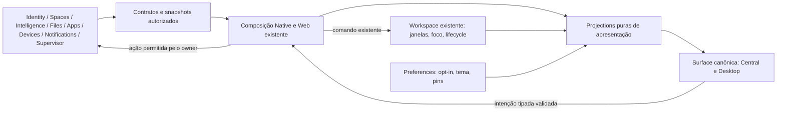
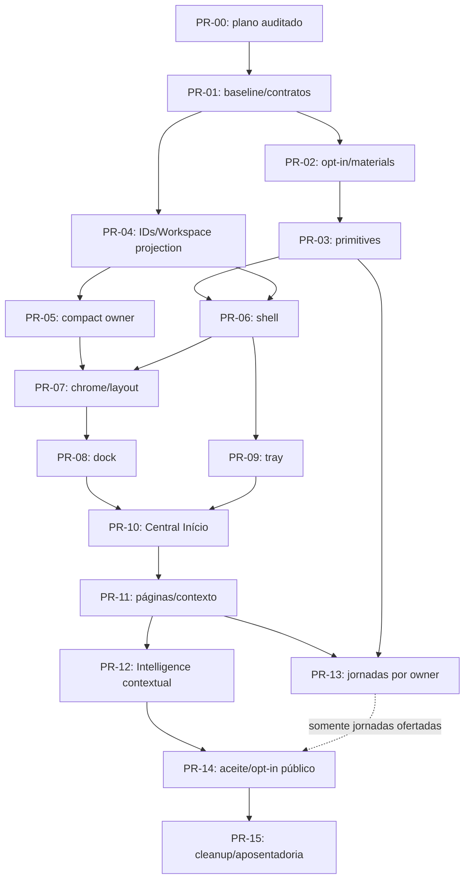

# Meridian → Surface canônica — plano de integração

**Estado: C — plano corrigido e aprovado pela auditoria independente de 14/10/2026 para iniciar somente PR-01 controlado. Não autoriza implementação ampla, oferta pública ou release.**

Registro da decisão e limites: [auditoria arquitetural independente](../evidence/meridian-integration-plan-audit-2026-10-14/relatorio.md). Os registros de 13/10 abaixo são históricos; a revalidação independente está em §1.3–1.4, com main final `5a90d66ff2e96e7eed138a0651b9d96b37a06279`. PR-01 não foi iniciado nesta auditoria. A rota documental/provenance de PR-00 deve acompanhar sua revisão antes de qualquer merge de código.

Repositório: `ordaxsystems/ordax-os`. Levantamento e revalidação realizados em 13/10/2026 (America/Sao_Paulo), com fontes fixadas pelos SHAs abaixo. Baseline inicial `9a02f05…`; main revalidada `dcbbd7b…`. Owner documental: arquitetura de Surface/Workspace; owners de domínio conservam seus contratos. Este plano cobre estratégia e execução futura. Aparência e comportamento perceptivo permanecem sob [MERIDIAN-VISUAL-SYSTEM.md](../design/MERIDIAN-VISUAL-SYSTEM.md), aprovado **F-C como SSOT visual da proposta experimental**. Não há Round 5, redesign do shell ou declaração de prontidão para produção.

**Decisão proposta: B, reimplementar a apresentação sobre os owners existentes, com C, extração seletiva de elementos visuais neutros. Rejeitar A, merge/cherry-pick do experimento.** A inspeção mostra acoplamento dos views ao catálogo editorial, demo source, controller e jornadas simuladas. Nenhum arquivo experimental ganha autoridade por ter aparência congelada.

O plano só pode entrar em execução depois de auditado e aprovado. PRs aqui descritos são unidades futuras; nenhum adapter, token, contrato executável, componente ou serviço foi criado nesta tarefa.

## 1. Git, proveniência e delta observado

| Referência | SHA real observado | Significado |
| --- | --- | --- |
| `main` no GitHub, revalidação final | `dcbbd7b83cec15c4aea5c6ed3027d0454f7e3fa0` | Merge de #1756, 13/10/2026 23:37:29 America/Sao_Paulo (14/10 02:37:29 UTC) |
| Ponta intermediária revalidada | `b2fa0bd5388ebf9eb7fa6fef0af4997546bc17f3` | Merge de #1764; probation/trust reanalisados antes do merge seguinte de Intelligence |
| Baseline inicial da main | `9a02f05d708dd4ba0d6c9e871fd283bd7859f1a5` | Merge de #1755, 13/10/2026 20:56:05 America/Sao_Paulo; leitura integral inicial + delta revalidado |
| HEAD local e remoto `codex/meridian-design-lab` | `d42b485665e60ec8998726cd4d16cfcaa8529e55` | Experimento congelado + relatório final; branch publicada durante a tarefa por ação externa a este chat |
| Commit Visual Freeze | `e7cf628a01878c484d47997721518fe6f2330c10` | Documento visual congelado |
| Merge-base `main` atual / Meridian | `9fec1276e2b8f15d1b404fe7ea3f9f05c8da5d28` | Base histórica do experimento |
| `main` local | `fafed4a8916587ad35bc07c2f3baa1a60d561b1e` | Ref local defasada; não usada como main atual |
| `origin/main` local na leitura inicial | `9fec1276e2b8f15d1b404fe7ea3f9f05c8da5d28` | Tracking inicial defasado |
| `origin/main` local na revalidação | `8806b698d21f29f16b7de212106f6f15546077fd` | Atualizado por ação externa; main remota já avançou a `dcbbd7b…`; não confundir tracking com HEAD remoto |

Checkout inspecionado: `C:\Users\TONECOS\Documents\github\ordax-apps\tools\assistant-host\.data\os-meridian-lab`. Apesar do diretório pai, o Git e o ownership são de **ordax-os**. Árvore inicialmente limpa em Meridian. Os objetos da main atual foram adquiridos por fetch do SHA, sem mover `main` ou `origin/main`. Não houve reset, merge, cherry-pick, push ou alteração de main.

O grafo revalidado tem **232 commits exclusivos de main e 22 exclusivos de Meridian** a partir do merge-base (na leitura inicial:156/22). Base → Meridian: **435 arquivos, 100.626 inserções e zero exclusões**, incluindo evidências, capturas e resultados volumosos. Isso não corresponde a 435 componentes de produto. A implementação experimental relevante contém 26 arquivos em `system/surface/experiments/meridian/` e 12 em `tools/meridian-preview/` (§19).

Base → main revalidada altera 189 arquivos (156 no baseline inicial;176 na ponta intermediária). Deltas relevantes para integração:

- Cutovers de apps retiraram bundled Activity e Internet, além de mudanças anteriores de Notes/Projects/Assistant. O dock do estudo não é lista de apps que o runtime atual oferece.
- Evoluíram SDK, contexto confiável por app, montagem e desmontagem de componentes, app data e health de módulos. Não regredir essas fronteiras por copiar composição antiga.
- #1746 corrigiu compatibilidade ESM do Native, inclusive SHA-256 sem `node:crypto`, e antecipou a confirmação real de saúde da Surface em relação ao enriquecimento opcional de Store/conta.
- #1747 mantém contexto de Files externo como precursor dormente. #1753 reforça isolamento de app data e cleanup. #1755 limita policy a Notes/import-contract; #1759 implementou o caminho mount-contract com contexto explícito e #1762 acrescentou registry isolado de probation/Files. A política gerada atual ainda só habilita Notes/import-contract: o novo código não habilita Files nem production activation.
- A main não contém o experimento Meridian nem o SSOT visual. O delta experimental de CI inclui path filters/syntax checks e smoke do preview; não é receita canônica de integração.

Foram verificados branches remotos e PRs de Meridian/Surface/Workspace. Na consulta inicial, Meridian não existia remotamente. Na revalidação final, `refs/heads/codex/meridian-design-lab` está publicada no mesmo `d42b485…`; a busca de PR por head retornou zero. Este chat não efetuou o push. PRs como #1751 e #1760/1761/1763, de base/rede/diagnósticos/root guard Owner/Development, são trabalhos independentes e não viram dependência visual. #1764 alinhou o trust promoter ao package SSOT removendo expectativa de `internet_release_mode`; não habilitou ativação ou signing automaticamente. PRs referenciados neste plano são evidência de código, nunca identidade de atualização do produto.

Toda implementação futura começa de **main então vigente**, em branch curta `codex/…`, revalida este delta e registra novo SHA. O checkout Meridian é referência. Este documento local ainda precisa ser transportado como documentação revisada, sem levar o experimento junto.

### 1.1 Revalidação da ponta durante o trabalho

A main avançou de 9a02f05 para b2fa0bd durante o levantamento: 40 commits adicionais no grafo e 26 arquivos no delta. O conjunto de documentação/código integral inicialmente lido foi complementado pela leitura do delta relevante e dos novos owners auxiliares. Reducers de Workspace, componentes Web, tokens, paletas e contratos de Identity/Spaces/Intelligence/Files mantêm as versões descritas; a mudança relevante à Surface está na composição Native/probation:

- `context-provider-registry.mjs` extrai validação bounded de contribuições e bloqueia campo duplicado/prototype/symbol, com instalação anterior ao início da composição. Registros de runtime normal e de probation são separados; não são registry de apps ou estado da Surface.
- `probation-context.mjs` resolve contribuição isolada com timeout bounded; sem contribuição não concede contexto. Native não aceita contexto de mount fornecido arbitrariamente pelo caller da UI.
- `files-probation-context.mjs` instala provider cedo, aguarda bind de FileSpace/recent/projects/appActivation depois da montagem da Surface e só cria host oculto em um probe real. Bind sem probe é DOM-neutral; falha/teardown limpam recurso. Esse host de probation é infraestrutura de health do owner, não janela do Workspace nem segundo shell.
- Policy do package SSOT e arquivo gerado continuam Notes/import-contract; Files permanece bundled e seu módulo externo dormente. Infraestrutura mount-contract implementada não é capability habilitada, nem promoção/trust/release.
- #1760/1761 atualizam diagnósticos Owner/Development; #1763 verifica mídia/root removível e ambiguidade antes de writable mount. Essas mudanças de boot são preservadas e não demandam mudança visual. #1764 retira campo obsoleto do public trust promoter e mantém gates de ativação fechados.

Os futuros PRs que alterarem raiz/reconciliação/composição devem também executar `test_component_mount_probation_context.mjs`, `test_component_probation_context_registry.mjs` e `test_native_files_probation_context.mjs`: preservar ordering, isolamento, cleanup, host lazy e nenhuma alteração de policy/grant. O host oculto não entra em dock/contagem/foreground/AX de janela; não o remover por repaint do root.

Revalidação remota: Meridian está no mesmo d42b485 local/remoto, sem PR. main b2fa0bd teve 9 checks (8 success, delete-merged-head skipped), inclusive Foundation success. Último Web smoke consultado após mudanças de composição foi em 8806b69, success com Chromium real; o delta 8806→b2fa só altera trust promoter/teste, sem mudança no source da Surface. Nesse predecessor, qemu-portable-v2 foi cancelled: **gate de plataforma não aprovado**, precisa nova evidência no ambiente apropriado. Nenhum resultado é usado para aprovar implementação Meridian inexistente.

### 1.2 Revalidação final de Intelligence Web — #1756

O merge dcbbd7b acrescentou 36 commits ao grafo após b2fa (232/22 contra Meridian; delta total desde9a02:76 commits e40 arquivos,189 arquivos desde merge-base). Foi lido o delta de CURRENT-STATE/INTELLIGENCE e o HANDOFF revisado, além dos novos adapter/client/provider/Aura e plano `docs/plans/INTELLIGENCE-INTEGRATION-CLOSURE-2026-10-13.md` integralmente. Esta seção atualiza qualquer descrição do baseline anterior:

- Central injeta `IntelligenceClientProvider` sobre port público inalterado. `WindowContent` encaminha Aura/Inteligência para `AuraContent`; a branch duplicada em DesktopContent foi removida. Providers de app continuam no mesmo Workspace, sem remount por material/presentation.
- `system/adapters/web/intelligence.mjs` implementa honestamente unavailable como degraded/inferenceAvailable=false, sem endpoint, provider, credentials, Native import ou Memory. **Boundary conectada não significa inferência remota habilitada.**
- `workspace/lib/intelligence/client.mjs` valida request/response e mantém identidade de snapshot enquanto campos semânticos não mudam. `ask` envia contexto vazio na Phase1. `AuraContent` usa AbortController/generation para ignorar resposta superada; não afirma cancelamento de backend, tool execution ou grants.
- Reusar esse client/provider/Aura no PR-12. Extensão contextual futura recebe apenas reader/port autorizado pela composição e respeita a Phase2 do owner #1757; não duplicar cliente de Intelligence nem construir contexto autorizado de estado visual.
- O grafo antigo WebShell/session/demo segue preservado e não montado; builder/provenance ainda possuem referências. Cleanup coordena Phase5 do owner com busca de dependências/cobertura, sem apagar por nome ou confundir legado inativo com caminho atual.

Foundation, Web e Intelligence Foundation do dcbbd7b foram consultados como success; QEMU desse SHA ainda estava em andamento na consulta, separado do job cancelado anterior. CI não valida Meridian ainda não implementado. O plano não habilita providers, egress, voz/arquivo ou ações para preencher a experiência visual.

### 1.3 Revalidação independente — 14/10/2026

- Main remota/fetched auditada inicialmente por objetos Git: `dcbbd7b83cec15c4aea5c6ed3027d0454f7e3fa0`; não havia avançado desde a ponta final do levantamento. A ref local `main` continua `fafed4a8916587ad35bc07c2f3baa1a60d561b1e` e não é baseline.
- Plano recebido em HEAD local/remoto Meridian `55c95eaf77cd52361af7154c66edfc6b6495a70f`. O delta desde `d42b485665e60ec8998726cd4d16cfcaa8529e55` é exclusivamente este plano (974 linhas antes das correções). Merge-base permanece `9fec1276e2b8f15d1b404fe7ea3f9f05c8da5d28`; grafo atual **232/23** (main/Meridian). A contagem 232/22 acima antecede o commit documental, não é divergência de arquitetura.
- Fetch de tracking foi executado nesta auditoria; `origin/main` passou a apontar ao SHA remoto auditado. Nenhum checkout/reset/rebase/merge de main, push ou PR foi feito. A árvore recebida estava limpa.
- Trabalhos abertos relevantes: [PR #1765](https://github.com/ordaxsystems/ordax-os/pull/1765), head `765cced393abea86166eae6c1917198a6bb360f6`, adaptador Web remoto de Intelligence; [PR #1766](https://github.com/ordaxsystems/ordax-os/pull/1766), rebind de initramfs; [PR #1751](https://github.com/ordaxsystems/ordax-os/pull/1751), prova iproute2/Surface. Os dois últimos são coordenação de plataforma, sem dependência visual nova. #1757 é [issue de fechamento](https://github.com/ordaxsystems/ordax-os/issues/1757), não PR.
- #1765 propõe adapter sobre `intelligence/1`, contexto explícito subject/targetDevice/Space/project e validação de resposta, sem compô-lo em Web `main.tsx`. Não entrega endpoint autenticado/deployed, provider, Memory ou E2E credenciado. Comparar IDs na resposta não prova sozinho A→B→A, revogação com mesmos IDs, dispose ou cancelamento: a futura composição precisa geração de autorização e testes desses eventos (§8.2/12). Revalidar merge/SHA/contrato antes de PR-12; não manter adapter Meridian concorrente.
- QEMU do mesmo `dcbbd7b` concluiu **success** em 14/10/2026 03:04:13 UTC, [run 38502009627/job 115651014641](https://github.com/ordaxsystems/ordax-os/actions/runs/38502009627/job/115651014641). PID1, one-shot fallback e OVMF/systemd-boot passaram. O passo “invalid Ed25519 candidate, durable rollback and read-only rescue” foi **skipped**, não PASS; cold-health permanece gate físico. Foundation e Web seguem success no mesmo SHA. Isso fecha somente a espera histórica desse run, não prova integração Meridian, touch físico, signing/ativação ou todos os cenários de recovery.

### 1.4 Main avançou durante a auditoria independente

Revalidação final encontrou **main `5a90d66ff2e96e7eed138a0651b9d96b37a06279`**, merge de #1765. Foram lidos os três arquivos do delta dcbb→5a90: adapter remoto172 linhas (idêntico ao head765cced já inspecionado), mudança de30 linhas no closure plan e261 linhas de teste alteradas;436 inserções/27 exclusões no total. Grafo agora **243/23**, merge-base inalterado. Composição Web, client/provider/Aura, Workspace, Preferences, tokens, Store/probation e seus contratos não mudaram. Fontes linkadas emdcbb continuam equivalentes para esses arquivos; o novo adapter é fonte de main, não experimento Meridian.

A descrição OPEN de #1765 em§1.3 é a observação inicial. Ele está **MERGED** na revalidação final; PRs1766/1751 continuam abertos. A materialidade é limitada à boundary do owner: reaproveitar o adapter canônico se futuramente houver transporte autenticado/autorizado. `main.tsx` continua explicitamente unavailable e os testes impedem composição prematura. O adapter exige IDs explícitos, valida envelope/context echo, bloqueia antes de dispatch quando degraded/busy/aborted e preserva snapshots equivalentes. Não demonstra geração de autorização A→B→A/revogação/dispose durante pending; essa obrigação de composição permanece em§8.2/PR-12. Nenhum endpoint/E2E/provider/Memory/grant foi habilitado por este merge.

CI no SHA novo: [Foundation38506816072](https://github.com/ordaxsystems/ordax-os/actions/runs/38506816072), [Surface Web38506816079](https://github.com/ordaxsystems/ordax-os/actions/runs/38506816079) e [Intelligence Foundation38506816100](https://github.com/ordaxsystems/ordax-os/actions/runs/38506816100) **success** na consulta. [QEMU38506816059](https://github.com/ordaxsystems/ordax-os/actions/runs/38506816059) **in_progress**, sem conclusão: não PASS no SHA novo. Success do run38502009627 continua evidência de dcbb, não é transferido a5a90. Isso não impede a aprovação documental C/PR-01; P/R do incremento futuro exige evidência do seu próprio SHA. Plano não implementa ou promove capacidade para fechar a espera.

## 2. Fontes lidas e hierarquia

Foi feita leitura integral dos documentos obrigatórios, não recuperação de lembranças de chats. Fontes visuais são do HEAD local Meridian; arquitetura, contratos, código e CI foram confrontados com main fixada acima. Código local da branch experimental não descreve silenciosamente a main atual.

| Conjunto | Fontes |
| --- | --- |
| Visual congelado | [Visual System](../design/MERIDIAN-VISUAL-SYSTEM.md); [auditoria final](../evidence/meridian-visual-freeze-audit-2026-10-13/relatorio.md) |
| Auditorias anteriores | [Round 4 independente](../evidence/meridian-round4-audit-2026-10-13/relatorio.md); `docs/evidence/meridian-round3-audit-2026-10-13/relatorio.md`; `docs/evidence/meridian-round2-audit-2026-10-13/relatorio.md` |
| Inventário e fluxos | [Inventário atualizado Round 2](../evidence/meridian-round2-audit-2026-10-13/inventario.md):196 itens/17 categorias; [14 fluxos](../evidence/meridian-round2-audit-2026-10-13/fluxos.md); evolução preservada pelas auditorias seguintes |
| Cânone | `AGENTS.md`, `README.md`, `MVP.md`, `docs/README.md`, `docs/CURRENT-STATE.md`, `docs/ARCHITECTURE.md`, `docs/DECISIONS.md` |
| Identidade/Surface | `docs/DESKTOP-IDENTITY.md`, `system/surface/README.md`, `PLANO-FUNCIONAL-SURFACE-E-APPS.md`, `PLANO-02-EVOLUCAO-E-REAPROVEITAMENTO-DO-LEGADO.md` |
| Modos e lifecycle | BUILD-AUTONOMY, PRODUCT-MODES, MINIMAL-USB-BOOTSTRAP, HOST-INDEPENDENCE, REMOTE-CONTROL, OPERATIONAL-REALTIME, MOBILE-COMPANION, PHYSICAL-MEDIA, DEVELOPMENT-WORKFLOW, SOURCE-MIGRATION, PROMOTION-GATES |
| Intelligence | `INTELLIGENCE-HANDOFF.md`, `docs/INTELLIGENCE.md`, contratos Intelligence/Memory/Profile context/Action Gateway/executor/grants e composição real |
| Executável | Composições Native/Web; reducers Workspace; WindowLayer; runtime catalog; preferências e stores; tokens/paletas; views e primitives existentes; contratos públicos mencionados nas tabelas seguintes |
| Entrega | Manifests atuais, `package.json`, lock v3, module boundaries/ownership, workflows Foundation/Surface Web e checks do SHA canônico |

Ordem de autoridade: contratos/locks/source da main e políticas canônicas para runtime; Visual System para linguagem perceptiva; este plano para integração; relatórios e capturas para evidência datada. Inventário/fluxos não concedem capabilities. Havendo divergência em documentos históricos, registrar a diferença contra código atual, sem enfraquecer contrato ou redesenhar Meridian.

Links de código canônico devem ser resolvidos no [tree revalidado](https://github.com/ordaxsystems/ordax-os/tree/dcbbd7b83cec15c4aea5c6ed3027d0454f7e3fa0). A leitura inicial foi fixada em [9a02f05…](https://github.com/ordaxsystems/ordax-os/tree/9a02f05d708dd4ba0d6c9e871fd283bd7859f1a5); os 40 arquivos de delta até dcbbd7b foram enumerados e as mudanças relevantes de composição/probation/trust/Intelligence reanalisadas; novos client/adapter/Aura e plano de closure foram lidos integralmente. O conteúdo do checkout local Meridian é anterior a esses deltas. Novos nomes de arquivos/API abaixo têm indicação **proposto**, não representam contratos já disponíveis.

## 3. Avaliação das três estratégias

| Estratégia | Evidência técnica | Decisão e limite |
| --- | --- | --- |
| A — merge/cherry-pick | `experience.mjs` mantém estado/janelas/drafts de jornadas e repinta HTML; demo source/storyboards possuem identities, receipts, devices e telemetria; views dependem desses modelos. Branch também contém evidence/tooling e CI de preview. O grafo final revalidado tem243 commits exclusivos de main desde merge-base (§1.4). | Rejeitada. Nem merge seletivo de commits de UI presume neutralidade. Não promover controller/source/maps; não resolver divergência transplantando o runtime antigo. |
| B — reprodução visual na Surface | Já existem presentation switcher, sidebar, dock de janelas, chrome, compact Web, Workspace Native persistente, preferências, contratos de serviços e primitives. | Caminho principal. Evoluir componentes canônicos, fornecer projections puras a partir de owners e preservar instâncias/lifecycle reais. |
| C — extração neutra | Valores de material, regras visuais, glyphs e SVGs podem ser isolados; arquivos de views completos não são neutros. | Complemento de B. Adotar trechos identificados com provenance, sem imports do experimento ou namespace duplicado de tokens. Assets condicionados a licença/origem e necessidade real. |

Não haverá `MeridianRuntime`, Window Manager Meridian, segundo app registry, segunda Identity, Space manager ou scheduler. Dois renderers existentes, Native e React/Web, continuam ligados aos mesmos contratos de domínio. Diferenças de host ficam em adapters já responsáveis pela capability.

## 4. Arquitetura atual e alvo

### 4.1 Surface real observada

| Caminho | Estado atual | Consequência para integração |
| --- | --- | --- |
| `system/composition/native/main.mjs` → `system/surface/ui/surface.mjs` | Composição de serviços reais; montagem antecipada da Surface e depois enriquecimento opcional. DOM inicial por markup; atualizações por reconciliação com IDs, preservando nós interativos. | Manter ordem de boot/health e composição. Evoluir renderers, sem substituir raiz em cada atualização. |
| `system/composition/web/main.tsx` → `workspace/components/central/central.tsx` | Uma raiz/Router; providers de conta/Spaces/preferências/Store; Central e Desktop no mesmo Workspace; WindowLayer fora da alternância das apresentações. | Preservar posição/keys dos apps. Não criar rota/root Meridian que remonte a sessão. |
| `system/surface/workspace/presentation.mjs` | Política/destino compartilhados. Desktop collapsed, Central auto; apresentação é estado de sessão. | Reusar; presentation pertence à Surface, não à Identity/Space ou Store. |
| `ui/sidebar-layout.mjs`, `ui/sidebar-hints.mjs` | Slots compartilhados, medição de capacidade, hints com cleanup. | Extender comportamento congelado; não copiar `interactions.mjs`. |
| `workspace/components/ui/*` | Button, Dialog Radix, DropdownMenu, Switch; Lucide e Inter já no lock/source. | Extender materiais e acessibilidade. Não criar segunda biblioteca de primitives. |
| `contracts/surface-render-lifecycle.mjs` | `ordax.surface-render-lifecycle/5`, API restrita: localização, subscribeRender, get/setAppTarget. | Não é Workspace snapshot nem API de app registry. Não ampliar privilégio de apps externos por conveniência do dock. |

O Native já reconcilia janelas, launcher, dock e sidebar; não herdar o repaint total do preview. Existe trabalho de reconciliação por dispatch que pode ser reduzido por selectors/revisões, sem atribuir ao estado atual um repaint integral que ele não faz.

### 4.2 Workspace real observado

| Aspecto | Native | Web/React |
| --- | --- | --- |
| Owner executável | `ui/surface-state.mjs`, manager/renderers de `ui/surface.mjs` | `central/desktop-state.ts` + `central/window-layer.tsx` |
| Identificadores | `area-N`, `window-N`, `appId`; activeAreaId/activeWindowId | Janela identificada por `title`; active/compactActive também por título |
| Estado | Áreas, janelas, minimized/maximized, ordem/posição/target | windows, normal/maximized/compact, minimized, expandedMode, compactCollapsed |
| Persistência | `ordax.workspace-store/2`, compatibilidade /1; até 8 áreas e 32 janelas por área | Sessão React; não usa o store Native; reload perde estado/drafts não persistidos pelo app |
| Compacto | Ausente no reducer/store atuais | Existe, incluindo seleção compacta e região reservada |
| Continuidade | Minimizar conserva montagem; foco restaura; área fora da ativa tem política existente de desmontagem | Camada permanece montada ao trocar Central/Desktop; close desmonta |
| Geometria | Posições no owner, chrome/layout no renderer | Grid já reserva rail, taskbar e compacto; max usa região de trabalho |

Essas implementações pertencem ao Workspace existente dentro de Surface. A localização da pasta não cria autoridade de domínio para Surface. Não inventar um novo serviço porque ainda não existe contrato público uniforme de leitura de janelas.

### 4.3 Caminho arquitetural proposto



Projection é função determinística/read-only; não armazena outra verdade, não emite grants, não cria lifecycle. Cache de DOM/medidas é recurso de apresentação com dispose, distinto de mapa de sessões. Composição injeta readers/command ports mínimos e conserva a autoridade de cada owner.

## 5. Owners, contratos e fronteiras

| Experiência | Owner real | Contrato/snapshot atual | Projection → Surface | Falta ou fronteira |
| --- | --- | --- | --- | --- |
| Janelas/foreground/lifecycle | Workspace | Reducers acima; workspace-store/2; workspace-metadata-source/1 para sync | Leitura interna comum proposta, validada sobre reducers; chrome/dock/continuidade | Metadata source contém áreas/appIds; não contém janela ativa, compact ou conteúdo. Não usá-lo como Window Manager. |
| Apresentação/chrome/materiais | Surface | presentation.mjs, tokens/paletas, componentes existentes | Central/Desktop, rail, taskbar, selectors visuais | Sem autoridade de Files, conta ou execução. |
| Conta cloud | Identity, via adapters autorizados | identity-session/1; identity-actions/1 | sidebar-account/WebAccount → Account/header | Sessão só signed-in/signed-out/unavailable; displayName não prova grant. Expiração precisa refresh do owner, sem persona substituta. |
| Sessão local/lock | Local Session/Native Host | local-session/1; credential/state separados | Overlay/estado de inércia real → Shell | Proteção de sessão, não criptografia de armazenamento. Não reaproveitar subject cloud como sessão local. |
| Contexto/seleção | Spaces | spaces/1, space-selection/1; `services/spaces/authorized-view.mjs` | Visão autorizada + seleção explícita → Space selector | Reader não é membership/create API. Selecionar não concede acesso; revogação invalida projections. |
| Modelo/resposta | Intelligence | intelligence/1, intelligence-conversation-capabilities/1 | Modelo real, busy/degraded/error e resposta → painel contextual | Capability atual não garante streaming/backend cancel. Não criar percentuais/timer de progresso. |
| Memory/fontes | Memory/Intelligence/Profile owner | memory.mjs, memory-context-auth/1, profile-content-context-port/1 e app awareness | Contexto autorizado com origem/revisão → fonte revisável | Foreground não autoriza ler documento. Contexto construído em composição e limitado pelo contrato. |
| Proposta/execução | Personal OrdaX + Action Gateway/executor/grant authority | action-gateway/1, action-executor/1, action-receipt/1, intelligence-tool-grant-issuer/registry/1 | Proposta, revisão e receipt real → UI | Só executor prova resultado. Confirmação visual não emite grant; binds exatos de owner/tool digest/ação/recurso/TTL. |
| Apps existentes | Apps/runtime catalog OS; source first-party em ordax-apps | `system/apps/runtime-catalog.mjs` (`app-runtime-catalog/1`), manifests, app-activation | Catálogo de apps realmente montáveis → launcher/dock | Disponível, instalável, instalado, montado e aberto são estados distintos. |
| Store/trust/instalação | Store estrutural + lifecycle/trust/updater OS | app-store/2, verified-app-store-catalog, lifecycle request/plan, component policies | Catálogo verificado e estado do owner → página Discover/Store | Dock não instala; Store não recebe authority por aparência; preservar cutovers/Gate A e probation. |
| Pins/tema/opt-in | Preferences | preference-runtime + catalog/appearance/color-palette/home-shortcuts e stores | IDs validados/política visual → dock/material | favorite-shortcuts atuais são destinos de apresentação, não IDs de apps instalados. Novo pin contract opcional, proposto. |
| Arquivos/references | Files | file-space/11, recent-files/1, project-catalog/1; mutations/activation existentes | References autorizadas e escopo informado → Cards/Files | Sem raw paths do host; catálogos de dispositivo não são automaticamente Space-scoped. |
| Hardware | Capability owners/Runtime Device Host | device-capabilities reader/1, device-agent/action-envelope/result quando aplicável | Capabilities/estado comprovado → Devices/tray | Descriptor não prova pairing/live device. Não criar execução genérica ou conexão fictícia. |
| Rede | Network adapter/host | network-status/1 read; network-management tipado; surface-host/1 connectivity | Estado/qualidade desconhecida explícitos → tray/quick panel | Browser online não prova Wi-Fi nem Internet alcançável. |
| Bateria/energia | Power adapter/host | power-status/1 read; power-actions tipado | Valor opcional real → tray/power panel | Ausência/null não é zero ou 84%; comandos só se capability real. |
| Horário | Relógio do host + Preferences regionais | Date/Intl, regional.locale/time-zone; mountDesktopClock | Hora/data reais → time/header | Não é autoridade de sincronização NTP nem data editorial. |
| Eventos | Notifications | notifications/3 + notification-store/1 | Centro único, unread/DND → badges/painel/faixa | Abrir painel não marca lido por inferência; evento não é estado de execução. Web sem port mostra indisponível. |
| Update/health/known-good | Supervisor/update/recovery | update-status/1, recovery-status/1; health real na composição | Projection redigida/sem token → faixa/página System | Não expor healthToken; não marcar healthy por animationend/timeout ou executar rollback no card. |
| First Run | First Run/Native Host | first-run-state-store/1 e docs/contracts/first-run.json | UI própria, primitives comuns opcionais | Receipt durável separado da preferência/Identity. Web não executa OOBE de dispositivo. |
| Recovery independente | Bootstrap/Recovery/Supervisor | bootstrap/recovery/entrypoint e políticas de boot/release | Fora da Surface normal | Precisa funcionar sem Meridian, rede ou runtime gráfico. |

OS conserva Identity global, Memory global, Intelligence, permissões, trust/signing, package lifecycle e Surface. `ordax-apps` conserva produtos first-party portáveis; Runtime/Device Host execução local; Platform/Control Plane serviços remotos de sua competência. Não mover esses owners para esta UI nem abrir APIs privadas para preencher cards.

## 6. Matriz de migração visual

“Reusar” abaixo significa componente canônico ou extração neutra pontual, nunca autorização para importar um view inteiro do experimento. As classes C/R/P/N são maturidade visual do Freeze.

| Elemento | Referência visual | Owner real | Implementação atual real | Pode reaproveitar código? | Deve reimplementar? | Bloqueios |
| --- | --- | --- | --- | --- | --- | --- |
| Central | C, header/Início/páginas/perspectivas | Surface + readers de domínio | Central React; home Native/continuation/pending | Componentes e projections canônicos | Composição visual e bindings reais | Escopo real de projetos/fontes; sem VM editorial |
| Desktop | C, sem topbar | Surface/Workspace | Desktop React; desktop-shell Native | Camada e markup existentes | Estilo/atalhos congelados | Não copiar apps/arrays de demo |
| Rail/sidebar | C, icon-first; destinos por apresentação | Surface | sidebar-layout, WorkspaceNavigation | Sim; slots/capacity/localização | Navegação paginada Central e projection Desktop | IDs estáveis/AX/overflow |
| Presentation switcher | C, destino no mesmo ponto | Surface | presentation.mjs + reducer/view | Sim | Apenas integração visual/nomes | Toggle separado de show-desktop |
| Taskbar | C, tracks e continuidade | Surface/Workspace | Footer Native/Web | Sim | Composição dos tracks | Reservas/compact/safe areas |
| Dock | C, glyphs/markers/44×44/scroll | Catalog + Workspace + Preferences | Running apps Native/Web | Base sim; glyph neutro seletivo | Join por IDs e pins reais | Web title IDs; pin contract ausente |
| Tray | C, grupo/disclosure | Network/Power/Clock/Notifications | Native quick panels; Web limitado | Componentes tipados atuais | Projection/arranjo | Ausências reais de capabilities |
| Window chrome | C | Workspace/Surface | Native createWindow; WindowLayer | Sim | Material/controles/semântica | AX, foco e identidade de janela |
| Floating | C | Workspace | Native posição; Web normal/grid | Sim | Geometria derivada e limites | Não portar coordenadas do estudo |
| Maximized | C | Workspace | maximize reducers + região reservada | Sim | Chrome e layout opt-in | Não invadir rail/taskbar/compact |
| Compact | C; landscape R | Workspace | Web compacto; Native ausente | Web semântica como referência canônica | Extensão Native no owner | Política comum/sessão/AX/área útil |
| Search | C | Surface + readers permitidos | Native launcher; Web menu/search | Inputs/launcher/dialogs | Busca de destinos e projeções | Busca global de conteúdo não contratada |
| Dialogs | C | Surface; ação no domínio | Radix Dialog e dialogs Native | Sim | Material/scroll/localização | Focus trap/inert/return/zoom |
| Panels | C | Surface; readers reais | Panel/primitives; Native quick panels | Sim | Arranjo/densidade | Modal vs não modal explícito |
| Tooltips/hints | C | Surface | sidebar-hints compartilhado | Sim, estender | Escape persistente até saída/clamp/dock | Sem title concorrente/hover-only |
| Space selector | C | Spaces | Native switcher; WebAccount/SpacesPanel | Sim | Material/placement | Selection não grant; revoked/unknown |
| Account | C | Identity/Local Session | sidebar-account, AccountCard/Panel | Sim | Arranjo/estados perceptivos | Refresh/expiração/isolation |
| Intelligence contextual | C | Intelligence/Memory/Gateway | Native real; Web Aura/client canônico, adapter default degraded e inferência remota ausente | Primitives/client/Aura canônicos; nunca demo session | Context projection e painel sob demanda | Transport/authorized source/grants |
| Operational strip | C | Readers de sessão/rede/update/Workspace | Pending/continuation/host/update helpers | Projections canônicas | Composição sem KPI fictício | Frescor/unknown/escopo |
| Cards | C | Surface + owner do conteúdo | Panel/primitives/continuation | Sim | Ritmo/hierarquia por conteúdo real | Não importar personas/agenda/percentuais |
| Argila/Grafite | C visual | Surface token owner + Preferences | tokens.css/color-palettes.css | Semântica existente | Perfil opt-in dentro do owner | Cascata/USB/contrast/forced colors |
| Motion | C visual | Surface | motion prefs/tokens/current CSS | Sim | Transições por intenção de lifecycle | Reduced motion, sem animação como state |
| Responsividade | C; landscape R | Surface/Workspace | Grid/container-size/capacity/viewport | Sim | Intenções nos containers atuais | Zoom/large text/rail oculto |
| Accessibility primitives | C direção; R alvos/texto | Surface | Button/Dialog/Switch/Dropdown; native HTML | Sim, corrigir lacunas | Contratos uniformes e nomes | SR real/zoom/forced colors/touch |

## 7. Central sobre estado real — campo por campo

A Central terá o header, Início, páginas, perspectivas, faixa operacional, contexto e continuidade do Freeze dentro da composição canônica. Páginas são apresentação Surface; não são apps/registros/serviços novos. O mesmo reader pode alimentar perspectivas distintas, sem novas fontes editoriais.

| Campo/área visual | Owner → contrato/snapshot | Adapter/projection → Surface | Ausência, frescor ou limite | Freshness/revalidação | Ação permitida |
| --- | --- | --- | --- | --- | --- |
| Marca/identidade do produto | Product family/branding canônico | Assets/Brand existentes → header/rail | Não trocar marca por artwork do estudo | Build/asset versionado, sem polling | Navegar à home; nenhuma authority de produto |
| Breadcrumb Central/página | Surface navigation state | ID de página localizado → header | Não title editorial como route/authority | Transação de navegação atual | Navegar por destinationId; sem abrir app por title |
| Space/contexto no header | Identity + Spaces authorized view + selection | Active Space explicitamente autorizado → label/selector | Nenhum selecionado/indisponível; nunca primeiro Space por fallback | Identity/catalog/selection convergentes e revalidados; geração invalida A→B→A | Abrir selector; seleção explícita pelo owner, sem membership/grant |
| Saudação/nome | Identity session displayName | Reader atual + localização → título | Saudação neutra local/signed-out; sem “Lia” hardcoded | Snapshot Identity vigente; neutralizar imediatamente signed-out/unavailable | Abrir Account; ações só por identity-actions existente |
| Data/período do dia | Date/Intl + regional preferences | Formatação existente → time/saudação | Hora real, não datas congeladas da captura | Relógio/locale/timezone atuais; uma cadência por composição | Abrir destino de calendário/relógio somente se runtime disponível |
| Profile/contexto profissional | Spaces profilePack + Profile owner | Perfil verificado para Space autorizado → resumo | Sem Profile/port, mostrar ausência; sem “Criação e design” por associação visual | Contexto/Profile revisados; revogação invalida card | Abrir perfil verificado; ativação pelo owner, nunca por card |
| Modo USB/Web/sessão local | Product mode + Local Session/host | Label por modo/capability → faixa | Não inferir USB de material Native; lock real separado da cloud | Capability/sessão atual; lock observado pelo owner | Abrir informação de sessão; unlock/lock pelo port real |
| Local de dados | Files/storage capability | Descrição de escopo efetivamente fornecida → faixa | “Dados no USB” só com owner comprovando; sem volume fake | Snapshot do storage/file-space; sem contrato de live status, não alegar freshness | Abrir Files validado; não montar/escanear volume |
| Rede | network-status ou surface-host | Network presentation existente → faixa/tray | Unknown/offline; browser online só indício de conectividade | Owner/cadência vigente; read failure vira unknown, não last known connected | Abrir painel Network; mutation só por network-management conectado |
| Atualização | Supervisor update-status + freshness | Redação de phase/status/Entrega quando fornecida → faixa | Sem data/ETA/percentual calculado pela UI; stale não healthy | evaluateUpdateStateFreshness: default90s, checkedAt inválido→unknown; fresh não prova healthy | Abrir System/update; check/apply só pelo port existente e gates do Supervisor |
| Saúde/ready | Supervisor + component-manager/1 e health bridge reais | Projection redigida de estado/receipt do owner, separada de update freshness | Sem receipt/port, unknown; healthToken nunca chega ao card | Revisão/observação do owner; ready visual/fresh timestamp não são health | Somente consultar/abrir System; Surface Meridian não emite markHealthy por CSS/timer |
| Número de janelas/continuidade | Workspace da área ativa | Snapshot de janelas realmente abertas → faixa | Contagem de janelas reais, incluindo minimizadas com semântica explícita | Workspace revision coerente com contexto; excluir probation host | Restaurar/focar por (areaId,windowId); foreground não concede leitura |
| Pendências | Notifications + sync/work readers reais | home-pending-presentation e projeções autorizadas → resumo | Estado indisponível difere de lista vazia; sem “tudo em dia” por timeout | Subscriptions/revisions do owner; unavailable não é zero | Abrir origem; read/dismiss/resolve só por intenção explícita e port do owner |
| Retome o fio/projetos | project-catalog/1 + recent-files/1 | home-continuation-presentation → cards/activation existente | Catálogo atual é de dispositivo/sessão, não Space-scoped. Rotular “Neste dispositivo” até contrato real de escopo. | Snapshot atual; updatedAt/openedAt são timestamps do item, não prova de ACL ou sync | Abrir projeto/referência pela activation/FileSpace existente; revalidar na ação |
| Documento recente/reference | Files references/targets validados | Path lógico/reference + nome/timestamp permitido → card | Revalidar permissão na ação; sem mock, raw host path ou leitura automática | Reader do owner; invalidar request antigo/revogado; openedAt não é last checked | Abrir target lógico validado; nenhum conteúdo anexado automaticamente |
| Pessoas/avatar/membership | Identity/Spaces reader autorizado | Só campos efetivamente contratados → lista opcional | spaces/1 não fornece toda equipe/avatares; omitir composição decorativa de colaboradores | Catálogo autorizado revalidado; sem reader de membership/equipe, unavailable/omitir | Abrir contexto disponível; nenhum convite/member mutation inventado |
| Agenda/“No seu horizonte” | Owner de agenda/eventos ainda não conectado a esta composição | Sem contrato, empty/unavailable com próximo passo legítimo | Não criar horários, reuniões ou deadlines; bloqueado como dado operacional | Não existe fonte/freshness contratada nesta composição | Nenhuma ação de criar/agendar por Meridian; destino só se app real disponível |
| Resultados/work | Personal OrdaX/work-canvas reader autorizado | Work/proposal/result com owner/Space/revisão → perspectiva Seu trabalho | Reader não autoriza execução; não ressuscitar app Activity removido | Revision/provenance/estado do work owner; late result descartado | Abrir work/review existente; executar só via Gateway/grant/executor e receipt |
| Apps/Ecossistema | Runtime catalog + Store verificado | Grupos disponíveis/descoberta distintos → página | Catálogo não equivale a instalado ou montado; sem ícones de apps inexistentes | Runtime/catalog e verified mount revision atuais; revalidar antes de launch | Launch só no runtime; Store descoberta separada de instalação/ativação |
| Profiles | Profile pack catalog/source autorizado | Lista bounded/versões reais → página Profiles | Não “centenas de perfis disponíveis” por fixture; paging depende de owner | Catálogo verificado/revision do owner; bounded, sem polling adicional | Ver detalhe/solicitar ativação pelo owner já disponível |
| Devices | Device capabilities/agent reader tipado | Descriptors e readiness real → página | Sem pairing/live status se não contratado; desconhecido explícito | Descriptor é capacidade anunciada; não presença/live connectivity; sem reader live→unknown | Ver detalhe; pairing/comando somente por contrato e executor tipados existentes |
| Intelligence input/modelo | Intelligence + conversation capabilities | Input sob demanda + estado do modelo → entry/painel | Microfone/stream/cancel só com capability; sem progresso scripted | Snapshot Intelligence semântico + geração autorizada; degraded preservado | Envio explícito se port ready; fontes/voz/stream/cancel só com capability própria |
| Busca/“próximo passo” | Surface destinos + readers autorizados | Filtragem de nomes públicos/permitidos → Search | Não buscar contents Memory/Files com seleção visual como autorização | Índice de destinos atual; resultados de domínio têm reader/geração próprios | Navegar/abrir referência permitida; nenhum scan global ou execução genérica |
| Preferências da Central | Preferences | Perspective/page/shortcuts de apresentação → controles | Não altera Space, app lifecycle ou grants | Preference snapshot atual; status de persistência separado | Alterar preferência validada; apresentação não altera autoridade |

As perspectivas “Visão do dia”, “Seu trabalho” e “Ecossistema” organizam a mesma informação autorizada. Conteúdo sem owner pode ter ausência explicada, não campo preenchido para ficar parecido com o screenshot. O congelamento de cards é de superfície/ritmo/hierarquia, não obrigação de fabricar todas as colunas do ensaio.

Native pode reutilizar `home-continuation-presentation.mjs` e `home-pending-presentation.mjs`, mantendo ações de Files/Account reais. Web só mostra conteúdo de reader conectado; seus placeholders atuais não autorizam instalar um backend de projetos dentro da Central. Não atribuir a projects[0], área de trabalho ou activeWindow um Space não declarado pelo owner.

## 8. Desktop, apresentações, windows e foreground

### 8.1 Separação de estados

| Estado | Owner e duração | Regra |
| --- | --- | --- |
| Presentation `central`/`desktop` | Surface, sessão, política compartilhada existente | Toggle muda composição visível e label de destino; não persiste sessão nova, não minimiza implicitamente |
| Página/perspectiva da Central | Surface, sessão | Independente de app/window ID; retorno preserva seleção de página |
| Áreas/janelas/mode/minimize/order/restore | Workspace | IDs e comando do owner; retain mount nos casos suportados; store Native atual permanece authority |
| Janela ativa lógica | Workspace | Seleção/order real; pode existir sem foreground visível |
| Foco de teclado e último ponto válido | Workspace + renderer de foco | Owner escolhe candidato, renderer realiza foco sem mover identidade. Dialog/lock impõem inércia. |
| Foreground apresentado | Projection do Workspace + política Surface + Local Session/context guard | Leitura derivada; não estado concorrente nem seletor copiado do estudo |
| Identidade/Space | Identity/Spaces | Presentation nunca modifica, cria ou reconstrói |

Desktop conserva **rail + área de trabalho + taskbar/dock + janelas, sem topbar**. Header pertence à Central. Menus de navegação e controles contextuais em telas pequenas preservam destinos sem criar topbar Desktop.

Alternar Central ↔ Desktop mantém os mesmos window IDs, instâncias, drafts e targets permitidos. Toggle não chama `show-desktop`, close/open, recreate providers ou replace root. O comando explícito show-desktop minimiza trabalho no owner e é testado separadamente de Início Meridian. Uma ação explícita de abrir/restaurar app pelo dock pode pedir apresentação Desktop e foco em **uma transação de intenções**; isso não transforma o switcher em launcher.

Correção de intenção: **Início Meridian é navegação à home da Central**, preservando apresentação/contexto e trabalho; não despacha minimize/show-desktop. A associação Início→show-desktop existe hoje nos controles canônicos e deve permanecer no perfil canonical durante a migração, mas não define a intenção Meridian. “Mostrar área de trabalho” continua comando explícito distinto do Workspace. Testar separadamente toggle, home/página e show-desktop; todos conservam a instância/draft, somente o último minimiza. Não reutilizar o callback canônico por igualdade de label.

### 8.2 Projection necessária, não owner novo

Hoje `activeWindowId` Native e `active`/`compactActive` Web não são equivalentes a foreground autorizado/visível em toda apresentação. PR-01 especifica uma leitura interna comum (**API proposta**, composition-only); PR-04 a implementa no owner existente, com getSnapshot/subscribe, revision, área atual, IDs estáveis/appId, mode, minimized e ordem. O snapshot padrão é somente metadata de lifecycle, sem target. Não exportar drafts, credentials, conteúdo de documento ou mutation do manager. Métodos de launch/focus/minimize/maximize/restore/compact/close continuam no owner, com validação de catálogo/capability.

Projection de foreground:

1. Começa do active window do owner da área/contexto válidos; não escolhe “última janela” por ordem de array do preview.
2. Exclui janela fechada, minimizada, de área não ativa, compact pane não selecionado em layout de seleção única e corpo compacto recolhido.
3. Exclui conteúdo que a composição tornou hidden/inert por apresentação, lock, modal ou invalidação de contexto. Modal possui seu próprio foco; não promover app atrás dele como conteúdo contextual acessível.
4. Se não houver candidato visível/interativo, resultado é null, conservando seleção lógica para restaurar depois.
5. Rail/dock/chrome recebem o mesmo resultado/revision; foco de teclado no dock não muda foreground até ação do usuário.

A main hoje mantém WindowLayer fora das apresentações e pode exibir janelas também sobre Central. Para o perfil Meridian, a política deve ser explícita: **páginas Central não expõem janelas regulares ocultas como foreground**; app explícito leva ao Desktop; compacto só conta se seu corpo realmente estiver visível/interativo na composição. Não esconder/desmontar apps para simular troca. Registrar essa política opt-in em testes de visibilidade/inércia; política canônica atual conserva comportamento enquanto Meridian desativado. Não inventar selector baseado apenas em string `presentation === desktop` ignorando compact/modals.

#### Especificação mínima do reader proposto para PR-01/04

O contrato permanece composition-only e ainda não existe no runtime analisado. Snapshot imutável/validado: revision monotônica das mudanças semânticas observáveis do Workspace (não tick de relógio/render), activeAreaId quando o modo suporta áreas, activeWindowId lógico ou null, ordem e janelas por IDs estáveis, mode/minimized/previousExpandedMode, compact selection/collapsed e disponibilidade das ações do owner. Janela de app tem appId do runtime catalog; painel interno do Web tem destinationId/presentation kind distintos, sem fabricar registro de app. Labels públicos vêm da localização/manifests, nunca servem de key; títulos de documentos/pessoas não entram no reader genérico. Nenhum target/conteúdo/draft/grant/credential/healthToken no snapshot padrão.

Surface junta essa leitura às revisions/estados reais de presentation, lock/modal e contexto autorizado para derivar visibilidade/foreground. O Workspace não adquire authority sobre Identity/Spaces; esses guards são inputs de composição. `getSnapshot()` mantém identidade estável enquanto semântica não muda; `subscribe()` retorna cleanup e não inicia apps, polling ou concessão. Command port é separado do reader e continua no owner atual; input inválido/ID inexistente/capability ausente é rejeitado antes de qualquer lifecycle. Não exportar methods de manager para SDK de apps externos. Essa especificação alinha consumers sem copiar shape do preview ou substituir store existente.

Invariantes obrigatórias do contrato de PR-01, antes de implementar PR-04:

1. **Identidade composta:** no Native, singleton usa o mesmo windowId/appId em áreas diferentes; a chave é `(areaId, windowId)`, não windowId global. Web recebe ID de instância estável no reducer existente e destinationId/appId separados. IDs nunca derivam de título, locale, target, subject ou posição do array; validar referências/duplicatas dentro do escopo e não reciclar identidade de janela fechada durante uma operação pendente.
2. **Shape mínimo/bounded:** listar campos permitidos, tipos/limites e estados unsupported; rejeitar payload/keys/ID inválidos, sem espalhar o state inteiro. Limites `/2` são de persistência (8 áreas/32 janelas por área); o reducer Native atual não barra todo launch acima de32. PR-04 deve definir limite de leitura/ação coerente no owner, sem esconder/truncar janelas existentes ou alegar enforcement já presente. Não aumentar contrato por pressão de layout.
3. **Target é outra borda:** `validateWorkspaceTarget` atual apenas limita string/controles; aceita até4096 caracteres e não comprova referência lógica, grant ou autorização. Se um consumidor realmente precisar target/nome privado, usar resolução específica autorizada pelo owner, allowlist de campos, propósito e revisão próprios, fora do reader genérico. Revalidar na ação; sem raw filesystem path, documento automático ou seleção visual convertida em grant.
4. **Coerência e A→B→A:** reader Workspace e projection Surface têm revisions distintas. A última identifica o conjunto coerente de Workspace + presentation/visibilidade + lock/modal + geração do contexto autorizado. Comparação de subjectId/spaceId sozinha é insuficiente. Geração de composição invalida caches/requests a cada troca, logout, expiração/revogação observada, lock e teardown, inclusive retorno aos mesmos IDs. Enquanto os inputs não convergem/revalidam, metadata protegida é redigida, ações protegidas bloqueadas e foreground=null; não publicar uma combinação de conta nova com janela/contexto antigo. Sem geração/revalidação confiável, aquele domínio fica unavailable.
5. **Entrega/cleanup:** especificar emissão inicial de subscribe, comportamento de unsubscribe/dispose idempotente e proibição de callbacks após cleanup; leitura não cria subscription por getSnapshot. Não alterar revision/identidade por evento equivalente de preferência/host/relógio. Consumers usam a mesma projection/revision; não guardam “último foreground” como contexto permitido. Antes de aplicar resposta async ou comando, conferir geração/revisão capturada e contexto corrente; dispose/abort descartam resultado, sem replay/retarget nem promessa de cancelamento do backend.
6. **Casos de aceite:** duas áreas com o mesmo singleton; dois títulos iguais e troca de locale; unknown/extra fields/oversize; Central hidden, compact selecionada/recolhida, minimized, modal, lock; A→B→A com resposta antiga; revogação sem mudar IDs; unsubscribe/dispose; snapshots equivalentes sem render novo; nenhum target privado em dock/chrome genérico/diagnóstico. PR-01 documenta exemplos e baseline/gaps honestos, sem implementar API executável ou falsificar PASS desses futuros recursos.

### 8.3 Convergência controlada do Workspace existente

- Native mantém IDs/store/reducer e comandos; Web deixa de usar título localizado como identidade. Mapear destinos a IDs estáveis do catalog/presentation owner; destinos de painéis do sistema continuam distintos de apps. Preservar keys e draft durante a mudança de label/locale. Um shim transitório título→ID só na borda de entrada, sem store paralelo, com remoção no mesmo incremento após consumidores migrados.
- Leitura comum não sincroniza automaticamente Workspace Native no Web, não salva Map em localStorage e não aumenta SDK de apps externos. Persistência Web nova é trabalho separado, fora do primeiro pacote.
- Compact Native entra como estado de sessão no reducer existente: normal/maximized/compact, modo anterior para restore, seleção compacta e collapsed explícitos. Serialização continua `/2`, gravando último modo expandido normal/maximized; compact não promete sobreviver reload nesta etapa. Web também não promete persistência. Testar roundtrip `/2` sem fields novos e reload em modo válido. Persistir compact demandaria contrato `/3` com migração/rollback próprio, fora desta sequência.
- O roundtrip `/2` preserva ID/appId/target interno/ordem/minimized/posição e active lógico válido; salva `maximized` conforme previousExpandedMode, inclusive compact minimizada. Compact selection/collapsed são somente sessão e se perdem deliberadamente no reload, com fallback do owner testado. Não perder bounds normais ao entrar/sair de compact/maximize. Reader não persiste nem recupera target protegido por conta própria.
- Foco/restauração fechada/minimize/compact respeitam instância existente. Close segue lifecycle/app cleanup atual. Nenhum mapa em projection cria uma janela.
- Áreas Native não são Spaces. Store `/2` é workspace local e não traz partição cloud por subject/Space. Não acrescentar maps por Space no shell. Conteúdo protegido e operações invalidam contexto no owner; chrome pode continuar como janela suspensa/indisponível conforme app, sem expor conteúdo anterior. Testar A→B→A, logout, revogação e lock; se o owner não oferecer reader seguro, o painel desse domínio permanece indisponível.

### 8.4 Geometria e ciclo de foco

Chrome consome nome localizado, ícone legítimo, capabilities de ação e mode do Workspace; callbacks são intenções tipadas. Floating usa bounds da área disponível, não coordenadas de storyboard. Maximized preenche a região de trabalho reservada, preservando rail, taskbar e track compacto. Compact usa grid/seleção já existente no Web como base semântica, não layout state experimental.

Abrir/focar → realizar foco após layout sem recriar nó. Minimizar → remover da ordem de tabulação/AX, conservar trabalho e escolher próximo candidato pelo owner. Restaurar → mesma janela/mount/target. Fechar → cleanup e foco para candidato válido ou origem de launcher. Lock/modal → foco próprio, fundo inert; desbloquear/fechar retorna a elemento válido, com fallback localizado se origem saiu do layout. Testar drag sem perder seleção/caret; window title não é `role=dialog` modal por padrão.

## 9. Dock — composição de três verdades

| Fonte | Diz | Não diz |
| --- | --- | --- |
| Registry/runtime catalog + verified installed mounts | Quais apps existem, capabilities, manifests, singleton e se podem ser abertos neste modo | Quais estão abertos ou fixados |
| Workspace | Window IDs, appIds, abertura/minimize/mode/foreground da área | Instalação, trust ou preferência |
| Preferences | IDs de apps fixados/ordem explícita | Que app está instalado/montado/autorizado |

Proposta: preferência opcional **`surface.dock-pinned-apps`**, device-local, default lista vazia, IDs estáveis bounded/deduplicados, validação no catálogo Preferences e resolução contra runtime catalog no momento de apresentar. Nome/type/scope são proposta, não capacidade atual. Reutilizar stores/runtime existentes; escolher serialização compatível com tipos suportados do catálogo, não introduzir localStorage privado. `surface.favorite-shortcuts` continua significando destinos da Central: não converter Internet/Intelligence/Terminal em apps instalados por suposição. Migração de favoritos só quando houver correspondência explícita e validada, sem pins automáticos no primeiro PR.

Decisão contratual proposta para PR-08: `preference-store/1` e `preference-runtime/1` aceitam **somente scalars**, não array. Persistir lista ordenada como string JSON canônica, default `"[]"`; parser do owner entrega array imutável apenas ao consumidor. Limites propostos a ratificar:64 IDs, cada appId slug lowercase até80 caracteres, string até8192 caracteres. Rejeitar JSON inválido/não-array/duplicatas/objetos/IDs malformados/oversize; manter ordem explícita e pins órfãos sintaticamente válidos. Não filtrar no store contra catálogo variável (isso apagaria intenção). Nenhum dado além de IDs, sem title/path/Space/subject. Excluir de sync, provar persistência/falha/recovery nos dois stores, e compatibilidade de rollback de §24.1; arrays diretos exigiriam evolução de contrato separada e ficam fora deste pacote.

Join puro, estável por appId: pins resolvidos em ordem de preferência; apps abertos não fixados em ordem determinística do Workspace; destinos de sistema (launcher/busca) em track próprio. Pin órfão pode permanecer salvo para futura instalação, mas não ganha botão de executar: mostrar indisponibilidade em gerenciamento de pins, sem falso indicador open. Apps instaláveis da Store ficam em Discover, não em running dock.

Um item por app pode agrupar múltiplas janelas conforme singleton/manifest. Indicador open conta janelas existentes, minimized usa marcador/label próprios; active só pelo foreground apresentado. Clique restaura/foca a janela ativa desse app ou, havendo várias sem escolha inequívoca, abre disclosure de seleção por window ID. Só chama launch quando não existe instância elegível e catalog/capability permitem. Não usar title como dedupe.

Roving tabindex, setas/Home/End, Tab de entrada/saída, focus-visible e scroll para item focado. Rolagem horizontal conserva alvo nominal 44×44, cues não interceptam controle, sem cortar último item. Pointer touch não dispara hint por hover; clique não minimiza apenas porque o item já estava ativo sem regra explícita do Workspace. Keyboard focus e foreground são estados distintos.

## 10. Tray e quick settings reais

| Indicador | Owner/capability | Atualização | Unknown/unavailable/erro | Ação e limite |
| --- | --- | --- | --- | --- |
| Rede | network-status/1 Native; surface-host/1 Web; management só com port | Reusar cadence/subscription do owner; polling Native existente, suspender/cleanup com runtime | Unknown sem detalhe; offline explícito; falha preserva último valor com indicação de obsolescência se disponível | Quick Network existente; browser não cria Wi-Fi toggle, SSID/IP ou reachability fictícios |
| Bateria | power-status/1 + host capability | Reader Native existente; sem novo timer por card | Null = sem leitura/capability; unavailable não zero; error/stale diferenciados | Disclosure contextual; não exibir 84%. Web sem owner omite valor e explica ausência quando solicitado |
| Horário | Host clock + regional Preferences | Clock compartilhado, hoje 30 s Native; tick único por composição | Erro de preferência usa fallback canônico válido; sem falsa prova de clock sync | `<time datetime>` e timezone atual; não hardcode09:41 |
| Notificações | notifications/3 | subscribe do centro único; count derivado pelo owner | Port ausente Web = indisponível; lista vazia pronta = sem eventos | Abrir centro real, markRead/dismiss explícitos; sem contador de demo |
| DND/Foco | Notification policy + preference/capability existente | Snapshot do owner | Não inferir “Foco” de ícone/tema | Toggle só se setDoNotDisturb real disponível; não criar automation |
| Quick settings | Network/Power/Preferences readers/commands específicos | Composição existente; cache read-only por revisão | Cada item tem availability; painel não certifica hardware | Reusar NetworkQuickPanel/SystemTrayQuickPanels/Preferences. Áudio, brilho e Bluetooth sem contrato não têm slider funcional |

Disclosure em área estreita preserva nome/estado dos indicadores essenciais e focus return. Erro de rede não invalida local session/work; timeout de leitura não cria estado success. Polling/subscription tem um owner, não um por ícone e outro por card. Tokens/secrets/credentials não entram nos labels/logs.

## 11. Componentes C — APIs de apresentação e acessibilidade

APIs na coluna seguinte são propostas de props/dados/callbacks, não services de domínio. Native conserva markup/event delegation; Web conserva componentes existentes. Novos componentes só quando não existir primitive equivalente; funções comuns podem ser ESM puro sem React.

| C do Freeze | Componente canônico/ação | API de apresentação proposta | States mínimos | Accessibility contract |
| --- | --- | --- | --- | --- |
| Rail | sidebar-layout + WorkspaceNavigation/Native sidebar; estender | slots, destinations autorizados por apresentação, currentPage/foreground, overflow action | expanded/icon-only/hidden; current/disabled/unavailable | nav nomeado; aria-current para página separado de app; destinations por menu/search quando oculto |
| Switcher | presentationDestination + botões atuais | currentPresentation, localized destination, onToggle | central/desktop; disabled se bloqueado realmente | Nome descreve destino; aria-pressed coerente; foco permanece; não dupla anunciação |
| Taskbar/dock item | renderDock/WorkspaceNavigation; estender | dock projection, onLaunch/onSelectWindow, overflow | pinned/open/minimized/foreground/unknown | Nome/estado sem depender só de cor; roving/scroll; 44×44 nominal e touch gate |
| Tray | quick panels/notification components | readings tipados, disclosure/open, capabilities | loading/ready/unknown/unavailable/error/stale | `<time>`; expanded/controls; badges nomeados; agrupamento não esconde acesso |
| Hint | mountSidebarHints compartilhado; estender para dock/controls | anchor/name, show/hide/dismiss policy; sem domínio | hover/focus/dismissed/touch-suppressed | Um tooltip por alvo; preservar describedby; Escape não reaparece até saída; clamp; sem title concorrente |
| Window/chrome | createWindow + WindowLayer/CompactActions | windowId/appId/title/mode/presentationForeground/actionCapabilities | normal/maximized/compact/minimized/inert/loading/error | Controles nomeados/localizados; foco/caret/return; sem focus trap em janela não modal |
| Space/Account | existing switcher/sidebar-account/AccountCard/SpacesPanel | authorized projection, selected ID, onSelect/onClear/onAccount | ready/none/archived/offline/revoked/signed-out/unavailable | Escolha explícita; nomes sem truncar AX; selected não grant; erro anunciável |
| Search/panel/dialog | launcher/Panel/Radix Dialog/Dropdown; estender | query/destinations/results, open/close, modal flag, heading, return origin | empty/loading/error/disabled/unavailable | Label input; heading/description; modal inert/trap; Escape; scroll e foco no conteúdo; close traduzido |
| Operational strip | Novo agrupamento apresentacional pequeno sobre helpers atuais | items {id,label,state,source,action?}, revision | unknown/offline/pending/warning/ready | Texto+símbolo; status/live só mudanças relevantes; não aria-live de toda a Central |
| Cards/agrupamentos | Panel/primitives/continuation; variantes | heading/content/actions/ownerScope, density | empty/loading/error/available/disabled | Ordem DOM sem reordenação incoerente; heading/links reais; sem botão aninhado ou inteira card clicável ambígua |
| Intelligence contextual | Extender AuraContent/client canônicos; legado demo Web permanece fora do caminho ativo | authorizedContext, model/capabilities, sources/proposal/result, intents | unavailable/ready/busy/error/revoked/review/result | Foco sob demanda; fontes revisáveis; role=status limitado; cancel/stream só capacidade; output como dado não confiável |

Button/icon-button permanece R, embora Button canônico possa ser estendido: tamanho atual `icon` 36×36 não é automaticamente aceite touch; dialog close possui texto “Fechar” fixo que precisa localização. Native e Web devem convergir no contrato de nome, estado, foco e target apropriado. Compact landscape/labels large text são R e exigem correção objetiva com evidência, sem Round 5 ou redesign.

## 12. Intelligence contextual, Memory e ações

O perfil Meridian apresenta a cadeia existente. A main final dcbbd7b já contém `createIntelligenceClient`, `IntelligenceClientProvider` e `AuraContent` ligados à composição Central pelo PR #1756: reutilizar essa boundary, sem novo client/store/broker. O adapter Web atual representa ausência de transporte com `state=degraded`, `inferenceAvailable=false`, `authority=none`, `toolExecution=false`. O caminho antigo de `workspace/components/intelligence/session.tsx`/lib/session possui demo e timers, mas **não é montado pela composição atual**. Nunca importá-lo no Meridian; sua aposentadoria depende da Phase5 do owner e dos contratos builder/provenance, não de substituição de um caminho ativo.

| Etapa | Origem legítima | Binding da UI | Gate funcional |
| --- | --- | --- | --- |
| Abrir contexto | Presentation/Workspace + Identity/Spaces | Intenção explícita do usuário; window ID apenas como candidato | Mudança de presentation não inicia IA ou leitura de documento |
| Resolver fontes | Composition + readers de Files/Memory/Profile/app awareness | Fonte com referência, escopo e provenance autorizados | Negar fonte sem reader autorizado; não inferir permissão pelo título da janela |
| Resolver modelo | intelligence/1 | Engine/model IDs efetivamente fornecidos; estado ready/busy/degraded/error | Modelo ausente = indisponível; sem nomes/custos/quotas de fixture |
| Conversar | Intelligence request/response + conversation capabilities | Submit tipado; resposta textual tratada como dado não confiável | Atual contrato não garante streaming ou cancelamento de backend; UI respeita `streamingSupported`/cancel/result discard |
| Memory | memory owner/context auth/1 | Context authorization da composição; limites/scopes/restrição do owner | Seleção Space não cria autorização; A/B/A e logout não reutilizam contexto anterior |
| Propor | Personal OrdaX/work-canvas + action manifests verificados | Proposta separada de confirmação e resultado | Manifest descreve intenção; não executa nem concede grant |
| Aprovar | Grant issuer/Gateway real | Intenção explícita com bindings exatos | Owner/Space/recurso/revisão/tool digest/efeito/TTL validados novamente; UI não gera grant local |
| Executar | action-executor/1 + adapter tipado | Estado/receipt do executor | Sem port/allow compatível, executar permanece indisponível; nenhum shell/egress genérico |
| Apresentar resultado | action-receipt/1 + owner do artefato | Summary/status/artifact refs/tempo do owner | “Concluído” só após receipt validado; notification não substitui receipt |

A resolução de contexto deve carregar uma revisão ligada à identidade/Space/recurso autorizados. Uma seleção muda, um grant expira ou um owner revoga acesso: descartar resposta tardia, cancelar transporte se capability permitir, invalidar fontes e voltar a revisão explícita; não recapturar silenciosamente o novo contexto. Resultado concluído permanece no owner correspondente, sem vazamento de subject anterior. A UI não precisa armazenar grant nem approval como segredo em preferência.

Native já compõe local AI, Intelligence, app awareness verificado, Profile content, Memory bound à Identity e Personal OrdaX. Web já possui client provider-neutral com snapshots semanticamente estáveis, validação de respostas e Aura com abort/generation discard. `client.ask` envia contexto vazio na Phase1; inferência remota e contexto/Memory autorizados ainda não estão conectados. Estender somente essa boundary por composição/reader autorizado, conservando o contrato público, sem outro session manager. Não instalar backend paralelo no pacote visual. O PR de apresentação pode usar indisponibilidade real onde faltar port; a habilitação de conversa/ação depende do gate específico daquele owner. O contrato de Memory context limita fontes/autorização; não aumentar esses limites para reproduzir o estudo.

## 13. Spaces, Identity, Files, Store, Devices e lifecycles separados

### 13.1 Contexto e isolamento

Reusar `deriveAuthorizedSpaces`/authorized-view e seleção real. Exigir signed-in, catálogo pronto do subject atual e ID selecionado elegível. None, archived, unavailable, offline e revogação têm apresentação explícita. Não selecionar automaticamente o primeiro Space, criar membership, grant, equipe, Profile ou permissão de Files. Reader `spaces/1` não autoriza mutação de membership; ações de gestão sem contrato público ficam indisponíveis.

Conta cloud e sessão local são independentes. Logout/expiração invalidam contexto cloud e dados restritos, preservando trabalho local que o owner permita. Bloqueio local torna a Surface inerte e mantém estado de Workspace; desbloqueio não inventa sign-in. `identity-session/1` não possui enum “expired”: tratar o retorno real signed-out/unavailable e a condição de refresh, sem sujeito fictício. Web já possui remount boundary por subject para providers; Native precisa respeitar revogação dos readers/Memory/Personal owner, sem afirmar que workspace-store/2 é particionado por subject.

### 13.2 Files e continuidade

`file-space/11` é a autoridade de paths lógicos/references e operações. Não aceitar raw filesystem path do host, symlink escape, HTML não confiável ou mocks como resultados de busca. Um card é referência para ação validada novamente pelo owner. Files bundled continua no caminho atual; externalização, trusted context e `module-read` dormentes não são habilitados por este plano visual.

`project-catalog/1` e `recent-files/1` são bounded (32 cada), de dispositivo/sessão; não carregam toda a autorização Space/subject que cards do estudo sugerem. Podem alimentar continuidade local com rótulo de escopo verdadeiro. Cards “deste Space”, compartilhamento, pessoas ou operações em coleção ficam bloqueados até reader autorizado próprio. Preview de texto/documento segue limites e parsing seguro existentes. Não converter reference em leitura/cópia automática.

### 13.3 Apps/Store

Runtime catalog só inclui apps que a composição aceita. Catálogo verificado de Store, package candidate, instalação, activation/mount e janela aberta são eixos separados. Preservar manifests/locks/trust/signing/mount cleanup e isolamento de app data. Não ressuscitar Notes, Projects, Assistant, Activity ou Internet como apps bundled/mocks porque constam do dock experimental. O port visual pode mostrar um destino indisponível claramente, sem registrar app inexistente.

#1755 separou a policy por componente. Após #1759/1762, mount-contract tem caminho implementado com contexto host-owned e registry isolado; **a policy gerada revalidada ainda só permite Notes/import-contract**. A integração visual não altera essa policy, Files external ou production activation. Source cutover, publication e release são gates próprios. UI Store tem intenções tipadas; catalog visibility/`installable` não concede instalação nem trust.

### 13.4 Devices

`device-capabilities` descreve capabilities/modos bounded (64), não prova conexão ativa/pairing. A página usa o reader do modo; ausência é indisponível. Pairing, Device Host e execução pertencem a seus owners Runtime/Platform. Envelope/result/target/grants tipados precedem qualquer botão executável. Não preencher card de computador/celular/USB com fixtures, instalar bridge genérica ou abrir comando remoto porque o card está selected.

### 13.5 Update, health e recovery

Usar `update-status/1` e helpers de freshness do owner. Status/phase/Entrega/source/runtime/target SHA só quando fornecidos; ocultar token de saúde da projection. Não inferir percentual de fase, tempo restante, known-good, “atualizado” ou “saudável” a partir de data/screenshot/CI. O freshness helper existente tem política própria (incluindo janela padrão de 90 s); não duplicá-la como cron universal da Surface. Clock skew/reader ausente continua unknown.

Manter confirmação real da Surface, heartbeat e health do Supervisor na ordem de composição atual: Surface utilizável → ready/markHealthy → enriquecimento opcional. Store/conta/Intelligence ausentes não atrasam nem falsificam ready. Uma animação Meridian não constitui prova de health; regressões de primeiro frame/foco importam para known-good/rollback.

Recovery status é reader read-only (slot/SHA/known-good/candidate/transaction/recovery entry). Rollback/recovery não se executam na Surface por conveniência visual. `bootstrap/recovery/entrypoint` abre ambiente mínimo independente, sem rede/mutação automática; continua funcionando com CSS/Surface quebrados.

### 13.6 OOBE fora do primeiro pacote

| Parte | Owner | Tratamento |
| --- | --- | --- |
| Tokens, nomes, foco, Button/Dialog/scroll | Surface comum | Evolução neutra opt-in, com regressão First Run/lock; sem depender de sessão normal |
| Welcome/regional/network/security/account/privacy/ready | First Run | Continuar `ui/first-run.mjs`, state store/receipt durável. Adaptar visual em PR separado após gates de owner |
| Local Session credential/lock | Native Host/Local Session | Nenhuma mudança de segredo/verifier/encryption por material; manter fail-closed |
| Network/update discovery no first use | Network/Supervisor | OOBE chama port real; não cria updater de demo; offline/account opcional não bloqueiam conclusão |
| Recovery boot e shell mínimo | Bootstrap/Recovery | Não carregar Meridian, React, fontes remotas ou Surface normal como dependência |
| Jornada gráfica de update/recovery | Surface/System + Supervisor reader | Apenas leitura/intenções existentes em fase posterior; sem executor visual novo |

First Run persiste conclusão antes de dismiss, não grava subject/secret no receipt, mantém retry idempotente e receipt corrompido protegido. Web não recebe OOBE de dispositivo. Antes de qualquer PR específico pre-USB, reler também `PLANO-03-FECHAMENTO-PRE-USB-NOVA-ORDAX.md` e contratos então atuais; este plano não prepara nem autoriza mídia física.

## 14. Opt-in, materiais e um único owner de tokens

### 14.1 Estado atual comprovado

- `system/surface/ui/tokens.css` é owner da paleta OrdaX USB/Native, geometria, tipografia, motion e política de acessibilidade.
- `system/surface/ui/color-palettes.css` contém Claro/Escuro standard e aliases compartilhados Native/Web. O próprio arquivo declara que geometria não pertence à paleta.
- `appearance.theme` = light/dark (default light), preferência portátil/sync. `surface.color-palette` = standard/native, device-local, excluída de sync. `resolveColorAppearance` decide aliases/scheme: **a paleta `native` força dark**, não o renderer Native. Com palette standard, ambos renderers respeitam appearance light/dark.
- Preferences tem catálogo/validação/runtime/stores e bindings Native/Web. Config genérico possui README e contrato documental `docs/contracts/runtime-configuration.json`, mas não foi encontrada implementação executável de serviço genérico de feature flags. Não instalar Flags SDK/provedor externo nem flag hardcoded/query param.

### 14.2 Caminho recomendado

Adicionar, após aprovação, **`surface.visual-system`** como preferência opcional no owner Preferences: enum `canonical`/`meridian`, default `canonical`, scope device-local, não secreto, mutável sem restart da sessão, excluído da sync inicial, validação estrita. Autoridade: release fornece default seguro, preferência local explícita escolhe perfil dentro da capability existente; políticas remotas não recebem privilégio novo. Valor inválido/ausente/unsupported retorna ao default/último valor válido conforme contrato, sem coação de string ou ativação silenciosa.

O perfil Meridian resolve **Argila com appearance light e Grafite com appearance dark**, dentro do mesmo pipeline de tema. `surface.color-palette` continua salvo e resolve normalmente quando visual-system é canonical. Em Meridian, a composição de material tem precedência explícita sobre a paleta standard/native para a Surface optada; não sobrescrever preferência anterior. Settings mostra material efetivo e a escolha de retorno sem confundir “OrdaX USB” com modo do produto. Modo USB pode usar qualquer perfil permitido; material não muda capabilities.

Estrutura, chrome e variantes de componentes obedecem ao mesmo atributo derivado do preference runtime (nome final revisado no PR), sem outra árvore/runtime. Portals recebem atributo/tokens da raiz autorizada; high contrast/forced colors/reduced motion prevalecem sobre decoração. Não criar seleção Argila/Grafite persistente adicional nem temas separados por app. Não promover Meridian como default nesta sequência.

Disponibilidade do controle público de opt-in só é exposta no PR de aceite, depois de gates de integração. Até lá, perfis parciais podem ser testados por harness canônico que usa o port de Preferences, sem query flag de produto; o controle Settings não oferece experiência incompleta. Default continua canonical em cada PR. Um release verified pode retirar a oferta de opt-in se necessário; preferência antiga é preservada/ignorada com fallback seguro. Nenhum kill switch local/remoto altera trust, grants ou acesso físico.

O ID/owner/default/type/scope/diagnóstico e condição de remoção da oferta experimental são registrados no catálogo e docs de configuração, dentro dos mecanismos existentes. O valor meridian pode permanecer perfil visual suportado depois de aprovado; o que deve desaparecer é gating transitório/compat shim e lógica duplicada, não necessariamente uma preferência legítima de aparência.

### 14.3 Revisão completa de `meridian.tokens.css`

Legenda: **M = Precisa mapear** a papel canônico; **I = Integrável**, papel válido ainda sem equivalente exato, adicionar no owner canônico somente com consumidor e estados; **E = Experimental**, não promover sem necessidade/provenance; **N = Incidental**, alias/repetição que não justifica segundo token. Todos os 56 nomes únicos do arquivo estão cobertos abaixo; valores aprovados continuam no SSOT visual, sem hexes espalhados neste plano ou em components.

| Token experimental | Classe | Destino/decisão no owner canônico |
| --- | --- | --- |
| `--md-canvas` | M | `--ordax-bg`/alias background; material opt-in |
| `--md-surface` | M | `--ordax-panel`/card/window-bg conforme consumidor; não mapear uma cor a todos os estados sem contraste |
| `--md-subtle` | M | `--ordax-subtle-bg`/secondary |
| `--md-ink` | M | `--ordax-text`/foreground |
| `--md-muted` | M | `--ordax-muted`/muted-foreground; high contrast/forced colors prevalecem |
| `--md-border` | M | `--ordax-border`/border; validar non-text contrast |
| `--md-surface-alt` | N | Alias de subtle, colapsar no token semântico canônico |
| `--md-border-strong` | I | Papel de borda forte quando necessário; fallback em todos os perfis; valor derivado no owner |
| `--md-clay-soft` | N | Alias de accent-soft, nome de material incidental, não novo SSOT |
| `--md-accent` | M | `--ordax-accent`/accent-foreground; distinguir button-bg |
| `--md-accent-hover` | M | `--ordax-accent-strong` para ação hover somente se contraste validado |
| `--md-accent-soft` | M | `--ordax-selected-bg`/accent; selected não grant |
| `--md-accent-text` | M | `--ordax-accent-ink`/button-text/primary-foreground |
| `--md-rail` | M | `--ordax-rail-bg`/sidebar-surface |
| `--md-rail-text` | I | Papel rail foreground para contraste próprio; evitar texto global sobre rail escuro |
| `--md-rail-muted` | I | Papel rail secondary text, com AX/contrast gate |
| `--md-rail-border` | I | Separador rail, só se border canônico não cobre ambos os materiais |
| `--md-rail-selected` | I | Selected específico da rail; não semântica de autorização |
| `--md-sage` | M | success quando estado; app-green quando decoração categorial, sem confundir papéis |
| `--md-sage-soft` | M | success-bg/app-green-soft por papel |
| `--md-blue` | M | app-blue para categoria; info só se houver papel canônico revisado |
| `--md-blue-soft` | M | app-blue-soft/selected-bg conforme papel |
| `--md-amber` | M | warning/app-orange conforme estado/categoria |
| `--md-amber-soft` | M | warning-bg/app-orange-soft |
| `--md-rose` | M | app-red ou papel categorial existente; não usar como danger sem semântica |
| `--md-rose-soft` | M | app-red-soft conforme consumidor |
| `--md-slate` | M | app-ink/muted; decoração não estado operacional |
| `--md-slate-soft` | M | app-ink-soft/subtle-bg |
| `--md-danger` | M | `--ordax-danger`/destructive |
| `--md-danger-soft` | M | `--ordax-danger-bg` |
| `--md-on-art` | E | Texto em artwork específico; não papel global para UI, requer contraste/provenance por asset |
| `--md-art-dark` | E | Paleta de ilustração editorial; não token de produto |
| `--md-art-light` | E | Idem; permanecer no asset se aprovado |
| `--md-art-clay` | E | Idem; não state color |
| `--md-focus` | M | `--ordax-focus`; foco não accent/active |
| `--md-shadow` | M | `--ordax-shadow`/desktop-shadow |
| `--md-shadow-small` | M | `--ordax-shadow-soft`/shadow-panel |
| `--md-window-edge` | I | Papel de contorno foreground de janela, separado de focus; fallback canônico |
| `--md-window-shadow` | M | Shadow canônico de window/depth; composição no owner, não cópia local |
| `--md-chrome-active` | I | Background chrome foreground, derivado sem nova authority de seleção |
| `--md-radius` | M | Família radius existente; valor perfil Meridian no owner, consumidor explicitado |
| `--md-radius-small` | M | Idem, controles/cards pequenos |
| `--md-radius-large` | M | Idem, grouping/panels grandes; sem raio novo por view |
| `--md-space-1` | M | `--ordax-space-1`, já equivalente; usar rem para texto/zoom |
| `--md-space-2` | M | `--ordax-space-2` |
| `--md-space-3` | M | `--ordax-space-3` |
| `--md-space-4` | M | `--ordax-space-4` |
| `--md-space-5` | M | `--ordax-space-5` |
| `--md-space-6` | M | `--ordax-space-6` |
| `--md-space-7` | M | `--ordax-space-7` |
| `--md-rail-width` | M | sidebar-expanded-width; geometria em tokens.css, não paleta |
| `--md-rail-compact` | M | sidebar-collapsed-width; capacidade medida não breakpoint copiado |
| `--md-bar` | M | Header da Central: `--ordax-header-height`, geometria no owner; só Central reserva esse track. O CSS do estudo usa bar na primeira linha da grid, não na taskbar |
| `--md-dock` | I | Track inferior taskbar/dock, papel distinto do header mesmo quando ambos medem66 no estudo. Definir token semântico no owner apenas com consumidor/bounds Native/Web; Desktop também reserva esse track |
| `--md-font` | M | `--ordax-font`, Inter já legítima/bundled; não nova fonte remota |
| `--md-duration` | M | Família motion existente; override perfil onde apropriado; reduced motion zero prevalece |

Critério de mapeamento: equivalência semântica e contraste, não igualdade de valor. Quando aliases atuais não cobrem um papel, adicionar um token semântico **no mesmo owner**, com fallback Claro/Escuro/USB e consumidor identificado. Não importar `meridian.tokens.css`, conservar `--md-*` em produção ou gerar outro catálogo autoritativo. `color-scheme`, font shorthand, media selectors e coordenadas de layout não são design tokens. Brightness/volume/observer offsets/inline styles do preview não são tokens de produto.

Accent de texto (`--ordax-accent`/accent-foreground) e par preenchimento/texto de botão (`--ordax-button-bg`/button-text e primary/primary-foreground) são papéis distintos no perfil standard atual. O mesmo accent do estudo aparece em ambos os consumidores: mapear por função, não aplicar um alias global que destrua contraste. Papel decorativo sage/blue/amber/rose/slate não cria success/info/warning/danger operacional. Os tokens art permanecem E; surface-alt/clay-soft continuam aliases N; shadows/art não substituem borda/focus em forced colors. Geometry fica fora de color-palettes.css e os perfis Meridian não podem sobrescrever a precedência de high contrast, forced colors, text scale e reduced motion.

Distribuição proposta: material/paletas e aliases no `color-palettes.css` atual; semântica comum/geometria/motion/tipografia no `tokens.css` atual. Os dois arquivos já compõem um sistema existente com responsabilidades distintas; não criar terceiro arquivo de paleta autoritativo. CSS de componentes consome esses papéis. Duplicações históricas de contrast/font/`flex:none` do experimento não são requisitos. A coleção completa precisa ter contagem conferida mecanicamente antes de aceite do PR de tokens.

### 14.4 Compatibilidade e regressão

Matriz obrigatória em ambos os renderers: canonical Claro, canonical Escuro, canonical OrdaX USB; Meridian Argila e Grafite; todas com high contrast/reduced motion/standard+large+extra-large text, e forced colors do OS quando aplicável. Combinations unsupported têm fallback documentado, nunca defaults mutados. Cobrir portaled Dialog/menus, lock e First Run. Trocar material/opt-in com app aberto conserva window IDs, drafts/caret/scroll e targets; retorno restaura tema/paleta salvos. Boot não depende de leitura cloud da preferência. CSS/font/assets não criam requisição remota.

## 15. Acessibilidade e responsividade antes da integração

### 15.1 Pendências do Freeze e gates de aceite

| Pendência | Evidência existente | Gate/etapa futura | Critério |
| --- | --- | --- | --- |
| Keyboard/AX | Auditorias Chromium e nomes/caminhos emulados | Cada PR interativo antes de merge | Ordem, nomes/states, Escape, foco/return, inert e scroll completos em canonical+Meridian |
| Screen reader real | Não homologado | PR-03 primitives e cada fluxo novo/modificado; consolidar antes do PR-14 de oferta pública | NVDA/Windows no Web/host compatível; leitor do ambiente Native suportado. Registrar versões/tarefas/resultado; AX tree não substitui |
| Zoom 200% | Não homologado | PR-03 e cada layout de PR-06/07/08/09, antes de merge | Texto/controles alcançáveis, sem clipping/perda de ação; diálogos roláveis |
| Zoom 400% | Não homologado | Mesmos PRs; reflow do layout antes de merge | Destinos por menu/busca; taskbar/dock scroll; sem criar topbar Desktop |
| Large/extra-large text | Tokens reais existem; aceite Meridian pendente | PR-02/03 e PRs de layout | Labels e headings legíveis, sem shrinking para caber, controles com altura mínima e scroll |
| Forced colors | Não homologado | PR-02/03 + chrome/dock/selector/dialog antes de merge | Focus, current, borders, disabled e open/minimized identificáveis por forma/texto/system colors |
| Icon buttons | R: base experimental 34×34; chrome landscape ≥36×40 | PR-03 e PR-07/08 | Nome, foco, target e espaçamento validados; não extender aceite44×44 do dock a todo controle |
| Compact landscape | R: dois headers/área útil pequena | PR-05/07, antes de aceitar compacto Meridian | Scroll e controls alcançáveis; orientação/teclado; nenhum controle oculto sem disclosure |
| Touch físico | Dock44×44 apenas emulado | PR-14 gate de plataforma, antes de merge da oferta opt-in para touch | Dispositivo real: precisão, scroll, seleção, rotação, menus e chrome; pendente até evidência física |

PRs de contrato/fundação podem ser aceitos com opt-in público desligado e sem alegar suporte touch. PR-14 não pode habilitar Meridian em plataformas touch sem evidência física; se não houver hardware, esse PR fica bloqueado para essa plataforma, sem bloquear todo o plano ou declarar PASS. Evidências humanas exigidas não ficam para “depois do merge” do fluxo que passa a ser oferecido. PRs de layout ainda precisam teclado/AX/zoom/forced colors e screen reader nos ambientes onde alteram fluxo. Testes herdados do Freeze são comparação, não homologação de produto.

A cor de foco não é o estado foreground. Tooltip não é o único nome de botão. Disabled usa atributo nativo e razão acessível; unavailable é estado do domínio. Status live anuncia mudanças curtas, sem despejar toda coleção em aria-live. Dialogs modais usam trap/inert/return; painéis não modais não recebem trap por estética.

### 15.2 Migração de intenções responsivas

| Intenção congelada | Mecanismo recomendado | Verificação |
| --- | --- | --- |
| Rail icon-first, expand/collapse | CSS grid/track + sidebar capacity existente; preference/estado de apresentação | Label AX permanece quando texto desaparece; slot ordering estável |
| Rail sai quando falta espaço | Viewport para safe areas/limite global, medição de container para capacidade; nenhum novo estado de domínio | Mais/menu/search conservam todos os destinos, incluindo Account/Space; fallback de foco |
| Dock rola | Container inline-size, overflow horizontal e scrollIntoView do focus; observer único se medição necessária | 320/390, zoom e centenas de entradas; último item acessível, sem shrink do target |
| Tray disclosure | Container queries/capacidade do track, trigger nomeado | Estado essencial e todas as ações disponíveis no disclosure |
| Cards/páginas | Container queries sobre região de trabalho real (rail/compact alteram espaço sem mudar viewport) | Não copiar breakpoint 760/844/1100 do protótipo; testar antes/depois do ponto real de saturação |
| Panels/dialogs | max-block-size pela área disponível/dynamic viewport; scroll do conteúdo; sheet estreito por container/viewport | Teclado virtual, safe areas, zoom, landscape; heading/close acessíveis |
| Compact | Container queries já usadas + estado Workspace | Seleção única em narrow; tile quando região comporta; collapse não vira foreground |
| Touch/hover | `pointer: coarse`, `hover`, capabilities do host como indicação de interação | Não inferir dispositivo/permission/mode do OS por width; híbridos mantêm teclado+touch |

Breakpoints de shell globais são derivados de orçamento de espaço medido no renderer canônico; componentes internos respondem ao próprio container. Capabilities determinam funcionalidade, nunca layout como substituto de autorização. Fonte cresce/scroll aparece; não usar scale transform global, fixed height que corta texto ou topbar Desktop para encaixar ações.

## 16. Segurança — riscos e testes negativos

| Área | Risco de integração | Controle/gate |
| --- | --- | --- |
| Auth/local session | Persona ou label mantém privilégio após logout/lock | Readers reais, refresh e inércia; A→B→A/logout/expiração/lock e resposta tardia; sem subject em preferências |
| Spaces | Selected/current/accent confundidos com membership | authorized-view + revalidação no owner, revoked/archived/none; não first fallback |
| Grants | Click/confirm visual cria allow | Gateway/issuer/executor exatos; expiry/deny/digest/recurso mismatch falham fechado |
| Files | Reference/card/busca expõe raw path/conteúdo sem grant | Logical refs/reader autorizado, parsing/size limits; tests de path traversal/symlink/revogado |
| Devices | Card pronto parece pairing/capability de execução | Descriptor read-only, readiness do owner; alvo/transport/grant tipados; sem shell genérico |
| External actions | Link/model output passa a executor/egress | Output não confiável; ação declarada + revisão explícita + adapter typed; sem automação de UI |
| Intelligence/Memory | Foreground/contexto leva leitura ou coleta automática | Context auth em composição, scopes/revisões/provenance; discard stale result; sem demo session |
| Notifications | Evento substitui truth/receipt ou marca lido ao abrir | Centro único/policy; leitura e marking explícitos; receipt do executor |
| Store | Ícone/pin/installable altera trust/activation | Catalog/verified mounts/lifecycle separados; fallback unavailable; duplicidade bundled/external rejeitada |
| Update/recovery | CSS ready reporta health/known-good; token vaza | Heartbeat/probe reais e projection redigida; nenhuma mutation recovery na Surface |
| Rendering | HTML de source/assets introduz XSS | React/textContent/escape canônico, CSP; validar SVGs/links; nunca string-helper editorial com atributos não validados |
| Preferences | Opt-in libera capabilities ou remote config muda trust | Key typed/non-secret/default seguro; test nenhum delta de grants/identity/Space/mode ao trocar perfil |

Princípio operacional: owner ausente/invalidado não fornece estado autorizado; Surface mostra unknown/unavailable e não chama execução. Fail-closed de autorização não exige travar trabalho local de outro owner. Secrets, healthToken, credentials e raw refs privados não entram em snapshots públicos/logs/visual evidence; capturas de teste usam dados sintéticos **do harness**, identificados, sem ship no produto.

## 17. Performance e escala

O preview executa controller/repaint completo e listeners/maps de aparência próprios. Não portar esse modelo. O Native já preserva DOM; React conserva WindowLayer montado. Evoluir reconciliação e selectors sobre revisions com custo de mudança local, sem forçar render de todos os apps no tick do relógio ou na chegada de notification.

- Subscriptions por owner/consumidor, com unsubscribe e dispose determinísticos; timer único de relógio/rede por composição. `ResizeObserver` por região que realmente precisa medir, agrupando medidas/escritas sem loop; nenhuma instância por item/card/window para hover básico.
- Motion usa transform/opacity quando compatível e respeita prefs de redução. Não animar layout grande em cada snapshot; shadows/materials medidos em GPU modesta, sem backdrop-filter em centenas de cards. Animação não cria lifecycle nem atrasa boot health.
- Dock faz join bounded por IDs/revisão; memoiza leitura sem cache de autoridade. Visible count/scroll não muda registry. Large lists usam paging/readers do owner; virtualização só com foco/AX e custo medidos, sem perder item focused/dialog trigger.
- Contratos atuais limitam Spaces a64, Store a256, projects/recent32 e Workspace8 áreas/32janelas por área. Não aumentar limites no cliente para simular “centenas”. Stress acima do limite deve falhar validado; catálogo paginado maior exige PR do owner/contrato, não fixture ou fetch-all na Surface.
- Profiles/apps/Spaces têm busca/offset/paginação conforme port real; se não houver paginação, respeitar limite e declarar capacidade. Nenhum scan global de Files/Memory ao abrir Central.
- Comparar harness atual `tools/surface-web/multi-app-state-profile.mjs` e `tests/test_surface_multi_app_profile.*`, complementando lifecycle/mount counts e retentores após close/teardown. Não usar score de screenshot como medição de performance.

Budgets propostos para aprovação no PR-01, sempre comparados no mesmo host/fixture/control build: zero remount de app por toggle/material/clock; zero crescimento de listeners/observers após 50 ciclos abrir/fechar; zero polling duplicado; zero full-root replacement após mount; não regredir p95 de interação/first usable frame mais de10% frente ao baseline canônico medido sem justificativa e aceite; nenhuma nova long task >50ms atribuível a hover/clock no perfil controlado. São critérios de engenharia propostos, não números de produto exibidos. Baseline/variance/hardware/trace são registrados; budgets absolutos de hardware dependem de medição, não inventados neste levantamento.

## 18. Testabilidade e evidência

Cada PR tem testes proporcionais aos contracts/states que modifica (§21). Usar harnesses/testes canônicos existentes, dados de teste isolados e mode capabilities reais. Não criar test suite ligada ao DOM/fixture do preview. Visual snapshot só prova aparência de um recorte; lifecycle, autorização e cleanup precisam asserts próprios.

| Camada | Provas necessárias |
| --- | --- |
| Unit/projection | Join de IDs/availability, foreground/null, presentation destino, token resolver, defaults/invalid values, timestamp/unknown, sem mutação de input |
| Contracts | Schema/métodos/revisões/limites e import graph; projection não expõe secrets; `/1→/2` Workspace e roundtrip preservados; compact sessão não altera schema |
| Workspace lifecycle | Launch/focus/minimize/maximize/restore/compact/close/area switch; mesma instância/draft/caret nas alternâncias; mount/dispose counts e context invalidation |
| Accessibility | Keyboard/AX/nomes/inert/return/Escape; zoom200/400, large text, forced colors, leitor real e touch conforme gates |
| Visual | REF do Visual System em Argila/Grafite, comparação por região; fixtures do harness rotuladas; dados/timestamps variáveis mascarados apenas na comparação, não no produto |
| Browser | Smoke Native e Web, real Chromium; ready health real; lazy module failure/reload/cleanup; first-run e lock regressions |
| Theme/responsive | Claro/Escuro/USB+Meridian, portals; 320/390/844landscape/amplo como pontos históricos, mais pontos de saturação real/container e zoom |
| Failure/security | Sem ports/offline/error/stale/revoked/expired grant/missing source/invalid catalog/mount failure; late async results e isolation |
| Platform/release | Linux CI/build determinístico; USB/native/QEMU e físico aplicáveis; update/known-good/rollback/signing separados |

Toda evidência registra SHA, command/runner, OS/browser/AT e modo/capabilities, expected/actual e PASS/FAIL/PENDING/SKIPPED com motivo. PENDING/SKIPPED não satisfaz gate exigido. Não inferir release/boot físico de CI verde. Evidência do Freeze permanece congelada; evidência de integração fica em novo diretório por PR/SHA, sem Round5.

## 19. Classificação arquivo por arquivo do experimento

Classificações: **PC** portar conceito; **EV** extrair visual neutro; **RO** reimplementar sobre owner real; **RT** manter temporariamente como referência; **RA** remover após integração/aposentadoria da referência; **NP** nunca portar o código como runtime de produto. Um arquivo pode ter conceito aproveitável e código NP. RA não autoriza exclusão agora.

### 19.1 `system/surface/experiments/meridian/` — 26 arquivos

| Arquivo | Classe | Destino e limite |
| --- | --- | --- |
| `assets/atlas-study.svg` | EV condicional / RT / RA | Arte editorial de Atlas, não identidade/projeto real. SVG local sem referência externa observada; origem/licença e uso legítimo ainda precisam prova. Só asset estático opcional se aprovado, sem trasladar card/persona. |
| `assets/meridian-field.svg` | EV condicional / RT / RA | Candidato a wallpaper/arte aprovada. Revisar provenance/licença, contraste/reduced decoration e payload; integrar ao owner de assets existente se necessário. Paths/gradients não são tokens de status. |
| `catalog.mjs` | PC / NP / RT / RA | Conceito de destinos por apresentação; catálogo/scene/window target editorial não vira registry. Recriar composição a partir de runtime catalog + Surface destinations. |
| `context.mjs` | PC / NP / RT / RA | Referência de contexto/foreground; seletores e fallback de primeiro projeto não são autoridade. Usar authorized Spaces/Identity/Workspace projection. |
| `demo/data.mjs` | NP / RT / RA | Fixtures, personas, status, devices, arquivos/percentuais; nenhum dado de produto. |
| `demo/source.mjs` | NP / RT / RA | Demo state/dispatch não vira adapter, reader ou store; não preservar sua API como port universal. |
| `demo/storyboards.mjs` | PC / NP / RT / RA | Cenários ajudam selecionar testes canônicos negativos; não jornadas/dados publicados. |
| `experience.mjs` | PC / NP / RT / RA | Controller, mapas de drafts/janelas/sessão e repaint total; reproduzir comportamento via owners. Nenhuma linha promovida como Window Manager/composition. |
| `icons.mjs` | EV seletivo / RT / RA | Glyphs locais declarados originais, currentColor/stroke. Verificar provenance e expandir icon owner Native/Lucide existente se necessário; não copiar catálogo/callbacks nem novo icon registry. |
| `interactions.mjs` | PC / NP / RT / RA | Referência de hints/focus/press/motion/observação. Extender helpers canônicos com cleanup; não importar como state manager de aparência/lifecycle. |
| `journeys/navigation.mjs` | PC / NP / RT / RA | Fluxos e retomada são referenciais; cada intent terá command port real. Sem fake receipt/Identity/pairing/update. |
| `journeys/view.mjs` | PC / NP / RT / RA | Padrões de erro/escopo/confirmação; dados/form drafts/resultado não são service contracts. Fora do primeiro pacote. |
| `meridian.css` | EV seletivo / RO / RT / RA | Extrair regras aprovadas de shell por consumidor; reescrever sobre classes/tokens canônicos. Nunca importar arquivo inteiro. |
| `meridian.journeys.css` | PC / EV posterior / RT / RA | Referência visual de jornadas P; adaptar em PR do lifecycle correspondente, não no shell inicial. |
| `meridian.tokens.css` | EV seletivo / RO / RT / RA | Classificação integral §14; mapear ao owner atual, sem namespace --md ou segundo SSOT. |
| `meridian.views.css` | EV seletivo / RO / RT / RA | Cards/panels/contexto: regras visuais quando neutras, bindings/markup reais. Não levar cascata incidental/density fixes cegamente. |
| `ui.mjs` | PC / NP / RT / RA | Helpers string/atributos de demo não substituem primitives existentes; escaping não garante todos os atributos. Extender Button/Dialog/Panel canônicos. |
| `views/central.mjs` | PC / RO / RT / RA | Composição Central, sem exportar VM editorial/saudação/agenda. Readers da §7. |
| `views/continuity.mjs` | PC / RO / RT / RA | Reusar home continuation/pending e work readers reais; não dados/receipts de source. |
| `views/desktop.mjs` | PC / EV seletivo / RO / RT / RA | Preservar sem topbar/área de trabalho. Workspace real e asset revisado; não arrays de windows/apps. |
| `views/explore.mjs` | PC / RO / RT / RA | Descoberta/Profiles/Store por catálogos verificados; sem preços/plano/availability fictícios. |
| `views/intelligence.mjs` | PC / RO / RT / RA | Estados/fontes/proposta/revisão como referência; bindings reais §12. |
| `views/operations.mjs` | PC / RO / RT / RA | Readers Network/Devices/System/Supervisor; nenhuma telemetria fixa. |
| `views/panels.mjs` | PC / RO / RT / RA | Panels/Dialogs/Account/Space visualmente; reuse primitives/owners, não form state simulado. |
| `views/shell.mjs` | PC / EV seletivo / RO / RT / RA | Slots/rail/header; evoluir desktop-shell/WorkspaceNavigation/Central existentes. Não segundo shell montável. |
| `views/taskbar.mjs` | PC / EV seletivo / RO / RT / RA | Dock/tray/switcher por join real; sem `foregroundWindow` ou launcher editorial. |

Views atuais importam UI/catalog/context ou dados derivados do estudo. Portanto **não há componente de view completo classificado como pronto para copiar**. Um trecho CSS/glyph pode ser neutro; função que recebe demo snapshot com aparência de “view model” não se torna contrato puro por trocar o nome do parâmetro.

### 19.2 `tools/meridian-preview/` — 12 arquivos

| Arquivo | Classe | Destino e limite |
| --- | --- | --- |
| `README.md` | RT / RA | Referência histórica de execução; marcar aposentadoria quando novo harness estiver disponível; não guia de produto. |
| `browser-smoke.mjs` | PC / NP / RT / RA | Migrar intenções/asserts válidos para smoke canônico; fixtures/DOM de preview não são gates de Surface. |
| `index.html` | NP / RT / RA | Entry point experimental não vira composição Native/Web. |
| `main.mjs` | NP / RT / RA | Imports de fixture/storyboard/query params; não flag de produção, não fallback offline. |
| `navigation-smoke.mjs` | PC / NP / RT / RA | Extrair casos de toggle/navegação para IDs/states reais; não copiar runner. |
| `round2-audit-smoke.mjs` | PC / NP / RT / RA | Evidência histórica; assertions de estado ajudam coverage, não prova atual. |
| `round2-smoke.mjs` | PC / NP / RT / RA | Idem; geometria R2 não baseline de shell congelado. |
| `round3-audit-smoke.mjs` | PC / NP / RT / RA | Cenários de falhas/contexto, reescrever sobre owners reais. |
| `round3-smoke.mjs` | PC / NP / RT / RA | Idem; conservar somente cenários legítimos no novo harness. |
| `round4-audit-smoke.mjs` | PC / NP / RT / RA | Comparações de REF podem orientar novo harness; não controller/session. |
| `round4-smoke.mjs` | PC / NP / RT / RA | Nominal44×44/scroll/foco como casos; touch físico ainda pendente. |
| `serve.py` | NP / RT / RA | Servidor loopback/allowlist/CSP do estudo; não Native Host, app gateway ou servidor de release. |

Auxiliares fora dessas duas pastas, como `tests/test_meridian_storyboard.mjs`, path filters e chamada de smoke do preview em CI, também são REFERENCE_ONLY: não cherry-pick de workflow, não novo gate autoritativo baseado em demo. Evidências, PNGs, hashes, source snapshots e SSOT visual não são código de runtime e serão preservados (§24).

## 20. Ordem recomendada e dependências

A ordem de exemplo foi ajustada: **Workspace identity/projection e compact real precedem a declaração de dock/chrome prontos**. Tokens/primitives podem evoluir em paralelo às decisões de contrato, mas o shell não começa a tratar selectors editoriais como dados enquanto essas lacunas estiverem abertas.

| Fase | Conteúdo | Saída/limite |
| --- | --- | --- |
| 0 — plano e proveniência | Auditoria deste documento, baseline de main vigente, referência visual única disponível para revisão | Nenhuma implementação antes de aceite |
| I — contrato e fundação neutra | Baseline/test matrix; preference/material plumbing; primitives; IDs/projection Workspace | Opt-in público fechado, defaults canônicos preservados |
| II — lifecycle Workspace | Convergência de leitura e compact Native de sessão, foco/context invalidation | Um owner por janela; nenhum store de preview |
| III — shell e windows | Rail/switcher/taskbar, chrome/layout, dock e tray reais | Desktop sem topbar; toggle conserva sessão/Space/apps |
| IV — Central | Início/continuity/faixa operacional; páginas/contexto por reader | Nenhum dado editorial/percentual falso |
| V — Intelligence contextual | Fontes/modelo/resposta/Memory e revisão por ports reais | Execução externa só em gate/PR do owner; demo Web desacoplada |
| VI — aceite e oferta opt-in | A11y/perf/temas/browser/platform/release aplicáveis; Settings expõe opção | Não default; nenhuma plataforma pendente declarada aprovada |
| VII — jornadas e remoção | Jornadas por lifecycle; cleanup de shims/tooling/reference runtime | Recovery independente; sem segunda arquitetura permanente |

PR-13 de jornadas específicas é opcional para a oferta do shell se suas telas continuarem canônicas e não forem apresentadas como migradas. Deve vir depois das fundações e gates correspondentes, nunca usado para bloquear unnecessarily Central inteira. Dependências de produto ausentes são bloqueios do campo/ação correspondente, não licença para mocks.



## 21. Plano de PRs pequenos e reversíveis

**Convenções:** E/F/V/A/P/R = gates estrutural, funcional, visual, acessibilidade, plataforma e release descritos em §22. A sempre significa o subconjunto aplicável à alteração; evidência humana exigida não é suprida por AX automático. R-CI é gate de source/candidate; R-release é promoção/assinatura/ativação real, separado do merge. P-físico não é inferido de browser.

Todos os PRs futuros partem de main atualizada; mudam somente arquivos citados ou dependências justificadas no próprio review. Nomes **novos/propostos** não foram criados nesta tarefa. Cada PR atualiza source migration/provenance para trechos EV, documento de estado/gaps que efetivamente mudaram e ledger de duplicações; não atualiza SSOT visual por redesenho. Se um incremento exceder escopo revisável, dividir por componente mantendo gates próprios; não usar um mega-PR de “migrar Meridian”.

Os números são **marcos**, não licença para acumular todos seus arquivos em um PR. Divisões obrigatórias: PR-02a preference/resolver/compatibilidade antes de PR-02b material/tokens; PR-04a projection Native sobre IDs existentes antes de PR-04b IDs/projection Web e migração de seus consumidores (remover shim no próprio04b). PR-05 depende de04a/04b concluídos. PR-10/11 dividem por renderer e reader/fluxo; cada parte mantém gates/rollback e não oferece campos sem port. PR-12 é apresentação sobre boundary pronta: autenticação/transporte/contexto/egress pertencem aos PRs dos owners de #1757, sem misturá-los no PR visual. PR-13 já é por jornada/owner. Cada subdivisão tem head/main/owner/critério próprios; não juntar Native+Web+contrato+composição nova em um mega-review.

| Marco | Dependências obrigatórias (diretas ou transitivas) |
| --- | --- |
| 01 | 00: estratégia auditada e referência visual revisável; documentar contrato, não executá-lo |
| 02a → 02b → 03 | 01; preference/rollback antes de tokens e primitives |
| 04a → 04b | 01; não depende de03, pois não introduz controles novos |
| 05 | 04a/04b |
| 06 | 02b,03,04b |
| 07 | 05,06 |
| 08 | 04b,07; contrato scalar de pins e rollback aprovado pelo owner Preferences |
| 09 | 03,06; ports reais do modo |
| 10 → 11 | 08/09 antes de10; 10/04b antes de11 |
| 12 | 11/04b; gates específicos dos owners antes de contexto/conversa real |
| 13a/b/c | 03/11 e lifecycle do respectivo owner; opcionais |
| 14 | Fechamento transitivo de02–12; 13 somente para jornadas ofertadas |
| 15 | 14 e replacement coverage/retention aceitos; shims de04 não esperam15 |

### PR-00 — auditar e publicar apenas a estratégia

- **Objetivo/owner:** arquitetura Surface/Workspace e auditoria independente validam este plano, fronteiras, gaps e gates. Owner visual permanece o Visual System.
- **Arquivos/dependências:** este documento, índice documental canônico e registro de decisões se exigido pelo aceite; nenhuma dependência de runtime. A main ainda não possui o Visual System local: referenciar/preservar o SSOT aprovado e suas evidências necessárias por migração documental separada ou no mesmo PR documental, com provenance dos SHAs, sem criar SSOT concorrente ou copiar todas as 435 adições.
- **Contratos/testes/gates:** leitura contra main vigente, links/hashes/cobertura dos 38 arquivos e 56 tokens, E documental e revisão independente. Publicação da referência visual preserva exatamente o conteúdo aprovado e links de evidência; não altera Freeze.
- **Aceite:** reviewer consegue identificar owner/port/ausência de cada campo e PR; aprovação registrada antes de PR de código.
- **Rollback:** retirar plano da rota ativa se rejeitado e conservar evidência histórica; nenhum runtime afetado.
- **Não entra:** qualquer adapter/token/refactor/merge/cherry-pick, push do experimento ou mudança de main nesta tarefa.

### PR-01 — baseline de integração e contrato de leitura

- **Objetivo/owner:** Workspace/Surface formalizam contrato documental proposto, incluindo as seis invariantes de §8.2, visibilidade/foreground/compact policy, baseline de mount/perf/a11y e evidência de ambiente. Sem novo contrato executável, reader operacional, reducer ou segundo lifecycle.
- **Arquivos/dependências:** `docs/contracts/` (contrato de Workspace presentation reader proposto), docs de Surface/Workspace, testes/harnesses `test_surface_workspace`, `test_web_central_windows`, reconciliation, multi-app-state-profile; depende PR-00. Contrato composition-only, sem expansão do surface-render-lifecycle/5 de apps externos.
- **Contratos/testes/gates:** E, unit/contract tests das invariantes com harness atual; F baseline de draft/mount/visibility; V referência/shot setup; A levantamento sem alegar gates físicos; R-CI. Testes devem falhar em mudança real de invariant, não espelhar implementação.
- **Aceite:** exemplos atuais e propostos claramente separados; IDs compostos Native, metadata sem target, geração/coerência de contexto, emissão/cleanup/revisions e negativas definidos. Baseline e gaps reais, endpoints inexistentes marcados; budgets aprovados. Recursos ainda ausentes não recebem PASS por fixture. Fixtures ficam somente nos testes.
- **Rollback:** revert documento/harness additive; sem migração persistida.
- **Não entra:** UI Meridian montável, adapters de domínio, compact Native ou new flag service.

### PR-02 — preference e material plumbing neutro

- **Objetivo/owner:** Preferences + token owner Surface adicionam opt-in opcional default canonical e perfis Argila/Grafite no sistema existente, sem oferta pública ainda.
- **Arquivos/dependências:** `services/preferences/catalog.mjs`, appearance/color-palette/runtime e stores/sync whitelist se necessário; **nova definição proposta** da preference visual-system no mesmo owner; `ui/tokens.css`, `ui/color-palettes.css`, `central/preferences-context.tsx`, Native preference binding; depende PR-01.
- **Contratos/testes/gates:** preference validation/serialization/no-sync, color appearance resolver; existing test_preference_runtime/surface_preferences/color_palette; theme/forced colors/large text/reduced motion/portals; E/F/V/A e R-CI. Nenhum manifest/releaseMode alterado.
- **Aceite:** defaults/Claro/Escuro/USB idênticos em canonical; switching não remonta apps; invalid/absent fallback seguro; 56 tokens classificados sem --md no bundle.
- **Rollback:** canonical resolve imediato; retirar oferta/perfil novo, ignorar optional key sem apagar preferência antiga; temas salvos intactos.
- **Não entra:** control público Settings, shell alternativo, novo pacote de flags, novo registry de tokens ou persistência Argila/Grafite duplicada.

### PR-03 — primitives, hints e iconografia mínima

- **Objetivo/owner:** Surface estende Button/Dialog/Panel/hints existentes para estados/nomes/touch targets/materiais; extrai glyph neutro somente quando houver lacuna real.
- **Arquivos/dependências:** `workspace/components/ui/button.tsx`, `dialog.tsx`, dropdown/switch apenas quando afetados; `central/primitives.tsx`; `ui/sidebar-hints.mjs/.css`; `ui` native helpers/strings e icon owner existente; depende PR-02. Sem copiar `ui.mjs`/`icons.mjs` completos.
- **Contratos/testes/gates:** APIs atuais preservadas, localized close/name, hint Escape até saída/title suppression/clamp; test_sidebar_hints, teclado/AX/zoom200/400/large text/forced colors, screen reader real no Web; E/F/V/A e R-CI. Provenance/licença para qualquer EV.
- **Aceite:** controles funcionam em todos os materiais e portals, hints únicos/dismissible, targets revisados por interação; pending touch físico registrado, não aprovado.
- **Rollback:** reverter variantes/glyph aditivo; semantics corrigidas podem permanecer se independentes, com aceite explícito.
- **Não entra:** Window Manager, Search global, state manager de interactions ou biblioteca UI paralela.

### PR-04 — IDs estáveis e projection de Workspace

- **Objetivo/owner:** Workspace alinha leitura Native/Web, substitui título como identidade por IDs estáveis no Web e fornece foreground derivado à Surface.
- **Arquivos/dependências:** `ui/surface-state.mjs`, `ui/surface.mjs`, `central/desktop-state.ts`, `window-layer.tsx`, `desktop.tsx`, config/window-content bindings; **reader/projection propostos** em `system/surface/workspace/` e contrato composition-only revisado; depende PR-01, dividido04a/04b conforme acima. Controles novos pertencem a03/07, não a04. `workspace-store/2` não muda schema.
- **Contratos/testes/gates:** ID/catalog validation, area/active/visible/null/lock/modal, stale context/result; tests_workspace/web_central_windows/reconciliation/external_catalog/workspace_persistence, mount counts, A→B→A/locale changes; E/F/A/P-browser/R-CI.
- **Aceite:** mesma janela após rename/locale/toggle/minimize/restore; projection read-only sem conteúdo/token; dock/rail futuros leem a mesma revision. Title→ID shim eliminado ao migrar consumidores neste PR.
- **Rollback:** reverter reader/consumidores; nenhuma mudança de formato persistido, Native `/2` continua compatível; Web sessão não grava novo store.
- **Não entra:** sincronização de janelas Web, partition maps por Space/subject, compact Native, APIs privilegiadas para apps externos.

### PR-05 — compacto Native no owner existente

- **Objetivo/owner:** Workspace implementa compact de sessão Native com restore/focus/collapse corretos, alinhado à semântica Web já real.
- **Arquivos/dependências:** reducer/renderers `ui/surface-state.mjs`, `surface.mjs`, styles de layout; helpers de política `surface/workspace/` propostos; `central/desktop-state.ts` só alinhamentos necessários; depende PR-04.
- **Contratos/testes/gates:** serializar último modo expandido normal/maximized no `/2`; roundtrip/reload, normal↔max↔compact/minimize/close, selected compact, foreground null ao recolher; lifecycle/mount/caret; landscape keyboard/AX/zoom/reader; E/F/V/A/P-browser/R-CI.
- **Aceite:** nenhuma recriação ou store paralelo; window bounds reservam tracks; reload não promete compact persistido; controles alcançáveis em landscape.
- **Rollback:** retirar comando/controle compact Native, restaurar modo anterior pelo owner; nenhum snapshot `/3` ou data migration a desfazer.
- **Não entra:** persistência compact `/3`, posições do storyboard, player de jornada ou CSS completo do preview.

### PR-06 — rail, switcher e tracks do shell

- **Objetivo/owner:** Surface evolui o shell estrutural existente e destinos por apresentação.
- **Arquivos/dependências:** `ui/desktop-shell.mjs`, `sidebar-layout.mjs/.css`, `surface.mjs`; `central/central.tsx`, `desktop.tsx`, `styles.css`; presentation.mjs apenas policy extension justificada; depende PR-03/04/02.
- **Contratos/testes/gates:** toggle é presentation-only, home/show-desktop separado; rail overflow/menu/search, focus fallback, container capacity; test_sidebar_layout/surface_workspace/web_central_windows; V REF rail/header/Desktop sem topbar; E/F/V/A/P-browser/R-CI.
- **Aceite:** mesma sessão/Space/windows/drafts ao alternar; todos destinos alcançáveis após rail sair; um shell por renderer, mesmo ponto do switcher.
- **Rollback:** canonical profile resolve layout anterior sem reset/migration; revert mudanças opt-in isoladas.
- **Não entra:** controller Meridian, segunda raiz/route, dock registry/pins, novos reader de domínio ou topbar Desktop.

### PR-07 — chrome, floating/max e compacto visuais

- **Objetivo/owner:** Surface apresenta estados do Workspace real conforme Freeze.
- **Arquivos/dependências:** createWindow/renderers `ui/surface.mjs` e CSS canônico; `central/window-layer.tsx`, `compact-actions.tsx`, `styles.css`; depende PR-05/06.
- **Contratos/testes/gates:** ação tipada/id, maximize exclui rail/taskbar/compact, focus vs foreground, inert/hidden; test_web_central_windows/workspace/reconciliation, screenshots REF float/max/split; A de icon controls/zoom/large text/forced colors/reader/landscape; E/F/V/A/P-browser/R-CI.
- **Aceite:** geometria e forma/AX distinguem focus/active/open/minimized; nenhum remount por mode; retorno de foco válido.
- **Rollback:** canonical chrome/layout; owner states permanecem válidos. Nenhuma persistência alterada.
- **Não entra:** fullscreen/pseudo WM, resizing policy nova sem contrato, title-based selector ou coordenadas demo.

### PR-08 — dock/pins e join real

- **Objetivo/owner:** Surface/Workspace/Preferences compõem dock com runtime catalog real.
- **Arquivos/dependências:** `desktop.tsx` WorkspaceNavigation, Native renderDock, **projection proposta** em workspace; definição proposta `services/preferences/` de pins, catálogo/stores/sync exclusion; runtime catalog somente se public reader precisar extensão segura; depende PR-04/07.
- **Contratos/testes/gates:** unit join/dedupe/orphan pins/singleton/multiwindows/catalog revoke/minimized/foreground; preference bounds; keyboard roving/scroll/44×44emulado/AX/zoom, theme/REF dock cheio; app activation lifecycle; E/F/V/A/P-browser/R-CI.
- **Aceite:** dock não instala nem cria registry; restaura instância; pins vazios por default e shortcuts não viram installed apps; touch físico continua gate PR-14.
- **Rollback:** remover oferta/consumidor de pins e ignorar optional key; current running-apps canonical continua; nenhum app/window perdido.
- **Não entra:** Store installation/trust/activation novo, defaults de apps fictícios, window maps de preview ou gesture framework novo.

### PR-09 — tray e disclosure com capabilities reais

- **Objetivo/owner:** Surface consome Network/Power/Clock/Notifications existentes em group/disclosure Meridian.
- **Arquivos/dependências:** Native quick panels/network presentation/power/clock/notification UI; Web `central/desktop.tsx`, notifications.tsx e composição para injetar somente ports já públicos; CSS; depende PR-06/03.
- **Contratos/testes/gates:** reader null/unknown/error/stale, browser online hint, battery missing, time prefs, unread/DND, subscription cleanup; network/power/notifications/localization contracts + browser; E/F/V/A/P-capability/R-CI.
- **Aceite:** nenhuma leitura fictícia; um centro de notificações; disclosure acessível; sem duplicar polling.
- **Rollback:** usar tray canonical/omitir capability ausente; readers continuam owners; nenhuma configuração de rede/energia modificada por rollback visual.
- **Não entra:** áudio/brilho/Bluetooth sliders sem port, hardware fake, conectividade como grant ou segundo centro de eventos.

### PR-10 — Central/Início e faixa operacional sem fixtures

- **Objetivo/owner:** Surface compõe header/Início/perspectivas/continuity sobre readers reais, respeitando escopo do dispositivo.
- **Arquivos/dependências:** `central/central.tsx`, `primitives.tsx`, `styles.css`; Native `ui/desktop-shell.mjs`, home continuation/pending renderers/helpers, `surface.mjs`; **projection de Central proposta** no owner de apresentação; composição Native/Web só injection de ports mínimos; depende PR-08/09.
- **Contratos/testes/gates:** field mapping §7, projections puras/empty/error/unavailable/stale, device scope, project/recent bounds, no first project fallback; unit home_continuation/home_pending/recent/projects/notifications/update freshness; browser/REF Central wide/narrow, keyboard/AX/zoom/reader/theme; E/F/V/A/P-browser/R-CI.
- **Aceite:** todos campos têm owner/provenance ou ausência explicada; nenhum número/data/persona/agenda fictício; falha opcional não trava ready/lifecycle; cards acionam targets validados.
- **Rollback:** canonical Início/layout; readers/projetos/files mantidos, nenhuma operação/dado removido.
- **Não entra:** domínio de projetos/agenda novo, scope Space fictício, percentuais/status fabricados, automation ou sincronização global nova.

### PR-11 — páginas/contexto e selectors reais

- **Objetivo/owner:** Surface organiza páginas Central e perspectivas usando Identity/Spaces/Profile/Apps/Store/Devices readers autorizados existentes.
- **Arquivos/dependências:** `central/central.tsx`, `desktop.tsx`/SpacesPanel, `account-context.tsx`, `primitives.tsx`, Store/notification views canônicos somente extensão apresentacional; Native sidebar-account/space-switcher/presentation helpers; **page projection proposta** em Surface; depende PR-10/04.
- **Contratos/testes/gates:** identity-session/spaces/selection/profile catalog/app runtime/verified Store/device capabilities; signed-out/unavailable/archived/revoked/A→B→A/late result/offline; no install inference/pin unavailable; bounded collection/AX/zoom/reader/REF context; E/F/V/A/P-capability/R-CI.
- **Aceite:** context/identity não mudam ao trocar presentation/perspective; seleção explícita não grant; funções ausentes indisponíveis sem mock. Diretório/painel de domínio preserva owner atual.
- **Rollback:** canonical páginas/selector presentation; não limpar seleção legítima, membership ou identidade por revert visual.
- **Não entra:** create Space/membership, account backend, pairing executor, Store activation, perfis fictícios ou apps retirados.

### PR-12 — Intelligence contextual de apresentação

- **Objetivo/owner:** Surface/Intelligence apresentam contexto/fontes/modelo/resposta reais sob demanda, estendendo a boundary canônica #1756 já existente. Transporte/contexto remoto são dependências do owner #1757, não implementados pelo pacote visual.
- **Arquivos/dependências:** `workspace/components/intelligence/aura-content.tsx`, `client-context.tsx`, `workspace/lib/intelligence/client.mjs`, UI Intelligence Native e composição/readers mínimos; **projection contextual proposta** no owner adequado; depende PR-11/04 e ports públicos reais do modo. Reusar contrato público unchanged e client estável existente. Extensão de contexto só após autorização pelo owner/composição; transporte/grants faltantes precisam PR próprio, não escondidos neste PR.
- **Contratos/testes/gates:** intelligence/conversation capabilities, Memory context auth, Profile content/app awareness, work-canvas/Action Gateway/executor quando já conectado; `test_web_intelligence_canvas.mjs` e verifier canônico, stable snapshots/equivalent status/authority-bearing response; invalid/revoked context/backend error/discard/cancel/zero request on toggle; screen reader/AX/zoom/forced colors; E/F/V/A/P-mode/R-CI. Atualizar provenance digests apenas após review da alteração real, sem relaxar verifier.
- **Aceite:** nenhuma demo import/scripted progress no caminho ofertado; fontes com origem/escopo/revisão; execução não disponível sem owner/allow. Web sem transport conserva degraded/inferenceAvailable=false no adapter já existente; isso não constitui inferência remota funcional.
- **Rollback:** remover entry/contextual presentation e retornar UI canônica segura; descartar tasks de UI pelo port sem apagar Memory/work do owner. Nunca restaurar demo como fallback de produto.
- **Não entra:** novo client/provider/store de IA, provedor/model backend, Memory paralela, execução externa nova, auto grant por foreground, recibo fictício ou ChatGPT/MCP bridge. Aposentadoria do WebShell/demo inativo coordena Phase5 de #1757, não vira segundo caminho ativo.

### PR-13a/13b/13c — jornadas específicas separadas, posteriores

Estes são **PRs diferentes**, não pacote cumulativo. Só iniciar após o owner do fluxo aceitar escopo e contracts atuais; depende PR-03/11, mais o gate de lifecycle correspondente. Não são necessários para declarar migradas apenas as partes do shell aceitas.

| PR | Objetivo/owner/arquivos | Contratos e testes/gates | Aceite/rollback | Explicitamente fora |
| --- | --- | --- | --- | --- |
| 13a First Run | First Run + Surface: `ui/first-run.mjs/.css`, i18n First Run; reler plano pre-USB | first-run-state-store/1, network, local session; durable completion/idempotence/corrupt receipt/offline/optional account/expired subject; first-run-browser-smoke/test_first_run_*; E/F/V/A/P-Native/R-CI | Mesma sequência/receipt/segredos/early boot; material não precisa normal session. Reverter apenas apresentação, receipt preservado | Novo OOBE Web, installer/disk mutation, senha em prefs/telemetry ou demo receipt |
| 13b Store/Devices/auth panels | PR por owner: views Store, Devices ou Account atuais, sem juntar lifecycles | Store/trust/lifecycle; ou device typed pairing/executor; ou Identity actions. Cada PR tem test específico failure/deny/expiry/mount/provenance+AX/browser/platform; E/F/V/A/P-owner/R-CI | Mesmas intents e authority existentes; material opt-in. Reverter visual sem alterar instalação/pairing/identity | Habilitar capabilities não implementadas; migration de app source; pricing/persona/devices fixtures |
| 13c System/update status | System/Surface + Supervisor: `system/apps/system/` UI e update/recovery presentation helpers | update-status/recovery reader, nomenclatura; stale/known-good/candidate/error/rollback state; health budget/native/release envelope tests; E/F/V/A/P-USB/R-CI e R-release quando aplicável | State/Entrega/SHA reais, healthToken redigido; recuperação independente. Revert visual/opt-in, known-good permanece | Recovery runtime Meridian, reset/rollback executor novo ou markHealthy por imagem/timer |

### PR-14 — aceite transversal e oferta pública do opt-in

- **Objetivo/owner:** Surface/Preferences + responsáveis de plataforma/release expõem seleção Meridian em Settings somente após gates verdes para o modo ofertado; default canonical.
- **Arquivos/dependências:** Settings Native/Web e catálogo/diagnóstico de preferência; testes/harnesses/browser CI e ledger de evidências; `docs/CURRENT-STATE.md`/Surface integration status/Promotion gates apenas estado comprovado; depende PR-02 a12 exigidos pela oferta. PR-13 só se aquelas jornadas forem anunciadas como Meridian.
- **Contratos/testes/gates:** matriz completa E/F/V/A/P/R; themes Claro/Escuro/USB, lock/first run/boot readiness/known-good/rollback; perf budgets; leitor real, zoom200/400, forced colors/large text; touchscreen físico **antes do merge da oferta touch**; CI exata + candidate determinístico; release/signing/activation separados e necessários antes de canal físico/usuário final.
- **Aceite:** nenhum PENDING em gate exigido pelo modo; capability/availability do modo vem da composição real, não flag hardcoded. Oferta limitada não afirma outra plataforma pronta; se não existir mecanismo canônico de elegibilidade do modo, não inventar lista de allow em UI — bloquear oferta até contrato/owner apropriado.
- **Rollback:** desativar oferta/selecionar canonical via Preference validada; se problema de runtime, release owner usa known-good/rollback existente. Preservar Workspace/prefs/dados; kill switch não emite grants.
- **Não entra:** default Meridian, promoção Stable automática, escrita física, bypass signing/gates ou plataforma pending marcada PASS.

### PR-15 — retirar shims e aposentar runtime de referência

- **Objetivo/owner:** Surface/arquitetura encerra duplicações rastreadas e dependency no preview, mantendo evidência/SSOT visual.
- **Arquivos/dependências:** adapters/aliases de compat transitórios realmente criados em PRs anteriores, runners/CI de comparação substituídos, source migration/docs/evidence index; depende PR-14 e equivalência de coverage. Main atualmente não contém as 38 fontes experimentais: não introduzir para depois apagar. Remoção no checkout/branch de referência é etapa de aposentadoria separada, após preservar prova recuperável e aceite de retention (§24).
- **Contratos/testes/gates:** import graph/bundle scan zero experiment/demo dependency; testes canônicos cobrem intenções relevantes; links/hashes/PNG preservados; E/F/V/A de regressão/R-CI. Não transformar test fixtures canônicas em shipping data.
- **Aceite:** ledger sem shim vencido/segundo controller, canonical components como único caminho por renderer; referências visuais continuam auditáveis; opção visual não bifurca domain runtime.
- **Rollback:** recuperar referência congelada arquivada/commit identificado somente para inspeção, nunca religar runtime de demo; reverter deletion de shim só se indispensável e com prazo/owner explícitos.
- **Não entra:** apagar evidência do Freeze, reabrir design, branch permanente de lógica, remover canonical Claro/Escuro/USB ou mudar default.

## 22. Matriz de gates e ambientes

### 22.1 Definição dos gates

| Gate | Prova | Neste host Windows | Ambiente adicional/exigência |
| --- | --- | --- | --- |
| E estrutural | owners/boundaries/import graph/schema/public ports/zero demo/runtime duplication | Leitura/diff, Node contract tests e Python portátil; revisar main exata | `tools/verify/module_boundaries.py` e json contracts em CI Linux; sem private imports de app |
| F funcional | Window/app lifecycle/state/revocation/fail-closed/subscriptions/cleanup | Node/TS/browser local se toolchain/browser disponível; ausência não PASS | Native composition/host fixture real e Web; isolamento/logout/A→B→A; platform ports em runner próprio |
| V visual | REF do SSOT, materials, states e composição com dados reais/fixtures só de teste | Chromium/screenshot de build canônico pode rodar; não executado nesta tarefa | Capturas nos dois renderers/host modes relevantes; visual review independente da arquitetura |
| A accessibility | Keyboard/AX/inert/zoom200/400/large text/forced colors/screen reader/touch targets | Keyboard/AX/zoom/forced colors/NVDA podem ser verificados no Windows quando disponíveis | Leitor do Native/OS suportado, AT específicos e touchscreen físico; emulação insuficiente |
| P platform | USB/native/host capabilities/boot/first run/graphics/physical touch | Statics/browser e Windows host contracts; nenhum USB físico testado aqui | Linux Native/QEMU quando aplicável, USB físico suportado, host Device capabilities reais; Secure Boot/support policy específica |
| R release | CI/candidate determinístico/provenance/signing/update/known-good/rollback | Inspeção de CI/manifest; nenhuma release preparada/promovida | CI Linux/artifact runner, signing owner e canal correto; health/rollback em runtime/USB suportado; consentimento físico separado |

A mudança de Surface não reconstrói kernel sem dependência comprovada. Foundation pode exigir POSIX (`sh`, `fcntl`, `jq`) no CI; não tornar WSL/Linux obrigatório no host do desenvolvedor e não fingir que toda suite é Windows-native. Harness portátil e CI Linux são complementares, não exceção para ignorar falha.

### 22.2 Gates por PR

| PR | E | F | V | A | P | R | Bloqueio específico |
| --- | --- | --- | --- | --- | --- | --- | --- |
| 00 | Documentação/provenance | N/A runtime | SSOT/links preservados | Pendências declaradas | N/A | Sem release | Auditoria do plano/visual reference local |
| 01 | Reader contrato/boundaries | Baseline/invariants | Reference harness | Baseline/ledger | Browser setup | CI relevante | Não confundir proposed reader com implementado |
| 02 | Preference/token owner | Defaults/no-sync/no-remount | 5 perfis | Contraste/text/motion/forced colors | Native/Web bindings | CI deterministic | Canonical regression/material cascade |
| 03 | API/primitives/provenance | Hints/controls/cleanup | States | Keyboard/AX/zoom/AT real | Browser; touch pending | CI | Icon buttons R e dismiss policy |
| 04 | Composition-only IDs/reader | Lifecycle/context/focus/store | Sem regressão | Focus/AX/locale | Native/Web | CI | Title identity e revoked context |
| 05 | Compact state owner | Restore/session/roundtrip | Split/landscape | Controls/zoom/AT | Native/browser | CI | Sem Native compact atualmente |
| 06 | Um shell/runtime | Toggle/destinations | Rail/tracks/no topbar | Overflow/focus/reflow/AT | Native/Web | CI | Todos destinos via menu/busca |
| 07 | Chrome owner/API | Mode/foreground/caret | Float/max/split | Icon/landscape/zoom/forced colors/AT | Native/Web | CI | Foreground precisa visibilidade real |
| 08 | Catalog/pin/Workspace join | Launch/restore/deny/orphan | Dock/markers/scroll | Roving/44emulado/zoom/AT | Browser, físico em14 | CI | Pins não registry; physical touch pendente |
| 09 | Reader/capability | Unknown/error/unavailable | Tray/disclosure | Names/focus/AT | Host ports disponíveis | CI | Não simular battery/Wi-Fi no Web |
| 10 | Field/source mapping | Real scope/continuity | Central/strip/cards | Reflow/zoom/AT | Native/Web | CI | Sem agenda/membership/project Space fake |
| 11 | Authorized readers | A/B/A/revoked/selection | Pages/selectors | Long labels/search/AT | Mode capabilities | CI | Sem domínio novo para completar layout |
| 12 | Client canônico/Intelligence boundaries | Context/revision/deny/stale | Context/fontes/review | Response/review/AT | Mode transport | CI | Reusar #1756; demo não fallback; transport faltante bloqueia conversa |
| 13a/b/c | Lifecycle owner | Fluxo real e negativas | Jornada P→owner | A completa por fluxo | Owner/platform específico | CI/release aplicável | Cada owner autoriza apenas seu scope |
| 14 | Zero paralelo | Full integration/rollback | Todos REF relevantes | Todos exigidos verdes | Físico por plataforma, inclusive touch | CI+release gates | Pending não pode virar oferta suportada |
| 15 | Zero imports/shims vencidos | Coverage/lifecycle | Baselines preservados | Regressão aplicável | N/A novo hardware | CI | Arquivo de referência não é production dependency |

### 22.3 Comandos canônicos a selecionar por mudança

Os comandos abaixo vêm dos workflows atuais; não foram executados como validação de implementação nesta tarefa documental. Usar lock/receita da main do PR, ambiente pinado e dependências existentes, sem instalar pacote novo para medir o estudo.

```text
python tools/verify/json_contracts.py
python tools/verify/module_boundaries.py
python tools/surface-web/build.py check
node --test tests/test_surface_workspace.mjs tests/test_surface_preferences.mjs tests/test_preference_runtime.mjs tests/test_color_palette.mjs
node --test tests/test_sidebar_hints.mjs tests/test_sidebar_layout.mjs tests/test_web_central_windows.mjs
node --test tests/test_surface_external_app_catalog.mjs tests/test_recent_files.mjs tests/test_projects.mjs tests/test_home_continuation.mjs
node --test tests/test_notifications.mjs tests/test_app_activation.mjs tests/test_identity_session.mjs tests/test_space_selection.mjs
npm run verify --workspace tools/surface-web
node tools/surface-native/browser-smoke.mjs
node tools/surface-native/first-run-browser-smoke.mjs
node tools/surface-web/browser-smoke.mjs --bundle-dir out/web-client
```

Foundation Linux também executa `python -m unittest discover -s tests -p test_*.py -v`, build checks e supply-chain; Web CI instala com `npm ci --ignore-scripts`, usa Node mínimo declarado >=22.18, typecheck/build determinístico duplo e regressões próprias. Suites adicionais de contracts/intelligence/update/sync/native/session são selecionadas pelos arquivos/owner afetados. Nomes/commands precisam reconferência no SHA de cada PR; não chamar preview smoke para satisfazer gate canônico. Nenhuma suite visual substitui `test_workspace_persistence_contract.py`, `test_surface_reconciliation_contract.py`, local session/failure lifecycle ou contratos de execução.

## 23. Pendências históricas e estado de CI real

| Item | Estado observado | Relevância/quando resolver |
| --- | --- | --- |
| Foundation no Windows no ensaio | Falhas ligadas a POSIX registradas nas auditorias | Não classificar como gate do produto aprovado nesse host. Usar CI Linux oficial para Foundation; ampliar portabilidade só como trabalho próprio, se necessário |
| Web Chromium ready timeout nas auditorias | Histórico contra base antiga | Reproduzir smoke canônico no PR-01 e a cada shell/health change; falha atual bloqueia F/P/R-CI. Não carregar timer/retry artificial para mascarar ready |
| Main final Foundation | dcbbd7b: job `115650919936`, run `38502009577`, success; passos de contracts/boundaries/regressions realmente success | Evidência da main, não do futuro Meridian |
| Surface Web e Intelligence após delta final | dcbbd7b: Web job `115650920032`/run `38502009587`, success com Chromium real; Intelligence Foundation115650921305 success | Cliente/boundary real não inferência remota; futuras mudanças exigem prova exact SHA |
| Main checks gerais | dcbbd7b:12 checks,10 success,1 skipped,1 QEMU in_progress na consulta; b2fa:8 success/1 skipped;8806:19 success/1 skipped/1 QEMU cancelled | In_progress/cancelled não PASS; CI não representa release/assinatura/prova física |
| QEMU portable-v2 revalidado | 8806 cancelled; novo run38502009627/job115651014641 emdcbb estava in_progress na consulta | P/R não aprovado por execução pendente; acompanhar resultado antes de gate exigido; físico continua separado |
| Physical USB/graphics/known-good/rollback | Gates canônicos físicos ainda separados; não executados aqui | Antes de oferta/release no modo USB/Native; não declarar MVP físico aprovado por plano |
| Touchscreen físico | Pendente apesar44×44 emulado | PR-14 antes de oferta touch; PRs de fundação não precisam esperar hardware para revisão |
| Screen reader/zoom/large text/forced colors | Freeze não homologou; produto precisa novos testes | A de PRs correspondentes antes de merge/oferta, especialmente03/06–12/14 |
| Icon buttons/compact landscape | R no SSOT | PR-03/05/07 corrigem acesso objetivamente com prova, sem Round5 |
| Native graphics/Device Host/platform capability | Não inferidos de descriptor/preview/browser | P do modo e PR de jornada/execução correspondente |
| Visual reference inicialmente local/unpushed | Agora branch remota no mesmo d42b485, sem PR; mudança externa durante a tarefa | PR-00 preserva/disponibiliza SSOT/evidência revisável na rota documental, sem promover code |

Links finais: [Foundation dcbb](https://github.com/ordaxsystems/ordax-os/actions/runs/38502009577/job/115650919936), [Surface Web dcbb](https://github.com/ordaxsystems/ordax-os/actions/runs/38502009587/job/115650920032), [QEMU dcbb](https://github.com/ordaxsystems/ordax-os/actions/runs/38502009627/job/115651014641), [QEMU cancelado8806](https://github.com/ordaxsystems/ordax-os/actions/runs/38499802018/job/115644217280). Baselines9a02/b2fa/8806 permanecem datados em§1.1. Resultado consultado não promete estado de ponta futura.

## 24. Rollback e eliminação de legado duplicado

### 24.1 Reversibilidade

1. Perfil visual é opt-in por preferência validada; voltar a canonical não modifica domínio, window IDs, Space, identidade, app data ou trust.
2. Cada PR de aparência é revertível separadamente; novas chaves são opcionais e não sincronizadas inicialmente. **Compatibilidade read/save precisa prova:** o catálogo atual recupera apenas IDs conhecidos; um store pode salvar esse snapshot filtrado e perder uma key futura. “Leitor ignora key” não garante preservação após escrita. PR-02a e PR-08 devem provar nova→antiga→salvar→nova mantendo as preferências existentes e os valores opcionais salvos, inclusive pins/material, pela fronteira de persistência do owner. Se exigir ajuste, ele pertence ao mesmo owner/store existente, sem shadow store ou backup de UI. Se a cadeia anterior não permitir preservação, declarar rollback incompatível e bloquear oferta/release até solução e prova aceitas; não prometer manutenção de valores nem apagar estado como workaround.
3. Workspace `/2` fica compatível; compact sessão serializa estado expandido suportado. Nenhuma migração `/3` ou armazenamento Web novo neste pacote. Se futura migração for aprovada, seu rollback precisa reader/writer compatíveis e prova independente.
4. Se a Surface não ficar utilizável, Supervisor/known-good/rollback existentes conservam a autoridade. Não resolver com “fallback runtime Meridian” ou “fallback demo”. Assets/CSS ausentes têm fallback canônico local, não acesso remoto obrigatório.
5. Release rollback/signing/activation têm owner/gates próprios e SHA preciso; este plano não os executa. Revert Git de PR e rollback de release são operações diferentes.

### 24.2 Plano de remoção

Não manter `Surface antiga + Surface Meridian completa` como duas arquiteturas. Native/Web são renderers já existentes; evoluem components/slots/projections comuns e o perfil seleciona material/presentação dentro deles. Nenhum arquivo de experimento é importado. Não chamar style profiles legítimos de dois runtimes: o que não pode permanecer são controllers/stores/entrypoints/projections editoriais redundantes.

Ledger obrigatório por PR: item temporário, arquivo exato, owner, justificativa, consumidor, PR que remove e condição objetiva. Compat título→ID termina no PR-04; baseline readers/projections são únicos, não sombra de reducer; qualquer binding transitório Native/Web termina quando consumidores convergirem no PR respectivo. Alias de token --md nunca entra, portanto não há dívida de retirada posterior. Helpers novos só apresentação pura com API canônica e cleanup.

Os dois diretórios do experimento **não existem na main analisada**. O melhor plano de remoção da produção é não incorporá-los. PR-15 remove apenas shims/tooling de referência que tenham sido efetivamente introduzidos para validação e ficam sem consumidor. A limpeza do WebShell/session/demo anterior à Meridian pertence também à Phase5 de #1757: builder/provenance e replacement coverage precedem exclusão, sem dois caminhos ativos. Este plano coordena essa dependência, não duplica o plano de fechamento de Intelligence. Aposentadoria da branch/checkout de referência Meridian é separada:

- Preservar os commits locais congelados e o SSOT/auditorias/REF PNGs/source hashes num arquivo recuperável/provenance revisado antes de remover fonte ou checkout não publicado.
- Garantir referência visual acessível à auditoria e que links do Visual System continuem válidos. Evidência histórica permanece em docs/evidence; não apagar capturas/hash só porque o runtime foi retirado.
- Migrar assertions úteis de navegação/dock/hints/continuity para harness canônico e demonstrar coverage. Não conservar fixtures de ensaio como fallback.
- Marcar preview aposentado no índice/provenance; retire caminhos ativos apenas quando imports/CI/documentação não dependerem deles. Não reescrever SSOT visual para a nova arquitetura.
- Remoção de code/lab após aceite de retenção; nenhum arquivo será excluído nesta tarefa. Não apagar branch local única sem preservar commit recuperável. Default Meridian é decisão posterior distinta, fora deste plano.

## 25. Riscos, bloqueios e critérios de saída

| ID | Risco/bloqueio | Owner responsável | Resolução/saída |
| --- | --- | --- | --- |
| B-01 | Reader Workspace uniforme ausente; Web title identity | Workspace | PR-01/04, stable IDs/visibility/revision/contract; não substitute selector de preview |
| B-02 | Compact Native ausente | Workspace | PR-05; sessão/focus/restore/serialize/landscape antes de controls Meridian |
| B-03 | Projects/recent sem scope Space; agenda/equipe não contratadas | Files/Spaces/owner de agenda | Mostrar escopo local verdadeiro/ausência; reader autorizado próprio antes de preencher campo scoped |
| B-04 | Web tem client canônico, mas transporte remoto/contexto/Memory ainda ausentes | Intelligence/composição | PR-12 reusa boundary #1756; #1757 Phase2 e gates próprios precedem conversa/ação remota; demo permanece inativa |
| B-05 | Power/network detail/notifications/device ports ausentes em alguns modos | Adapters/owners | Estado unavailable; capability de modo comprovada, não hardcoded UI |
| B-06 | Zoom/AT/forced colors/touch/landscape não homologados | Surface/a11y/plataforma | Gates A/P antes de aceite/oferta correspondente; status pending explícito |
| B-07 | Referência congelada em branch separada, sem PR/rota documental main | Arquitetura/design documental | PR-00 garante provenance/links auditáveis; sem merge do experimento |
| R-01 | Regressão de theme cascade/portals/USB | Surface/Preferences | Matrix5perfils+A; fallbacks canonical; opt-in mutável sem remount |
| R-02 | Vazamento de contexto por retained window/async result | Workspace/Identity/Intelligence/Files | Guards/revisions/late discard/A→B→A; projection sem segredo/conteúdo privado |
| R-03 | Ready/health atrasado por enriquecimento visual/Store | Surface/Supervisor | Preservar ordering e health budgets, browser/native/release provas |
| R-04 | Mega-PR/CSS fork/segunda architecture | Arquitetura/Surface | PRs por contrato/componente, zero experimental imports, ledger removal |
| R-05 | Repaint/observers/polling/large-list regressions | Surface/Workspace | Perfil multi-app/budgets/cleanup/bounded ports, sem controller preview |
| R-06 | Confundir CI/candidate/visual freeze com release físico | Release/plataforma | R-release/P-físico exatos, signing/rollback/canal/consentimento separados |
| R-07 | Repaint/contagem inclui ou remove host oculto de Files probation | Surface/component lifecycle | Preservar lazy host/ordering/cleanup; excluir de Workspace/dock/foreground/AX; regressões novas da §1.1 |
| B-08 | Preference nova/pins não têm compatibilidade read/save de rollback comprovada; arrays violam scalar `/1` | Preferences/persistência/release | Decisão scalar em§9; prova nova→antiga→save→nova antes de02a/08/oferta, sem perda de valores ou store paralelo |
| B-09 | Reader e composição precisam prova de identidade composta, geração de autorização e coerência; validação de target atual não é autorização | Workspace/composição/Identity/Spaces/Files | Especificar em01, implementar/provar em04 e PR do owner; unavailable em domínio sem guard/revalidação. Não confundir doc aprovado com reader entregue |

Um campo ausente não bloqueia todas as fases, mas impede declarar essa capacidade integrada. O plano passa na auditoria quando toda experiência tem owner, contrato/projection, estado de ausência, lifecycle e gate verificável; implementation passa por PR. Oferta pública Meridian só passa com gates aplicáveis verdes e canonical preservada. O shell não recebe authority nova para superar bloqueio.

## 26. Rastreabilidade da entrega solicitada

| Itens | Onde estão tratados |
| --- | --- |
| 1 main atual;2 HEAD Meridian;3 delta | §1, baseline/SHAs e grafo |
| 4 arquitetura Surface;5 Workspace;6 owners | §4–5 |
| 7 reutilizáveis;8 reimplementar;9 nunca portar | §6/11/19 |
| 10 Visual→Owner;11 Central;12 Desktop | §5–8 |
| 13 dock;14 tray;15 windows;16 foreground | §8–10 |
| 17 Intelligence;18 Spaces;19 Identity | §12–13 |
| 20 Files;21 Store;22 Devices;23 update/recovery | §5/13 |
| 24 tokens;25 materials | §14, todos56 tokens |
| 26 accessibility;27 responsividade | §15 |
| 28 performance;29 segurança | §16–18 |
| 30 feature flag/opt-in;31 Claro/Escuro/USB | §14 |
| 32 PRs;33 gates por PR;34 rollback | §21–24 |
| 35 remoção experimento;36 riscos;37 pendências | §19/23–25 |
| 38 ordem;39 documento;40 zero implementação | §20; este arquivo; registro abaixo |

## 27. Registro desta tarefa documental

Documento criado no checkout de referência local, ainda como proposta para auditoria. Nenhum PR de implementação foi aberto, nenhum código foi promovido, nenhum arquivo experimental foi excluído. Nenhuma alteração em Surface real, tokens, Workspace, adapters, Identity, Store, Intelligence, main local/remota ou ref Meridian. A única mudança de trabalho é este documento. Não houve merge/reset/cherry-pick. CI mencionada é evidência consultada da main, não teste executado de integração Meridian nesta tarefa.

A execução deve produzir a resposta: **nenhum código experimental é autoridade por padrão; cada experiência visual deriva de owner, projection e lifecycle reais**. O plano mantém separadas auditoria arquitetural, design congelado e auditoria independente.

Verificação documental final em 13/10/2026 23:53:12 (America/Sao_Paulo): main remota confirmou dcbbd7b83cec15c4aea5c6ed3027d0454f7e3fa0; HEAD Meridian/local main preservados. Cobertura dos38 arquivos e56 tokens conferida, tabelas/fences/links/caminhos válidos e Visual System byte a byte inalterado. Diff tracked vazio; único arquivo untracked: este plano. Não foram executados testes de produto ou integração nova nesta tarefa.


## 28. Resultado da auditoria independente — 14/10/2026

O plano recebido em55c95ea foi classificado **B**: estratégia correta, com correções obrigatórias de reader/identidade/contexto, scalar pins/rollback, semântica home/tokens e sequência/gates. Após correções exclusivamente documentais, classificação **C**, suficiente para iniciar **somente PR-01** (contrato documental, baseline e invariantes), respeitando PR-00 antes de merge de código. Não é D, não aprova reader operacional, compact, qualquer UI Meridian, oferta pública ou release. PR-01 não foi iniciado.

Detalhes, fontes imutáveis, achados e a cobertura de todos os itens da solicitação estão no [relatório independente](../evidence/meridian-integration-plan-audit-2026-10-14/relatorio.md). B-01…B-07 e R-01…R-07 foram preservados; B-08/B-09 acrescentam compatibilidade de preferências e prova de geração/coerência do reader. Nenhum blocker de produto foi removido. A espera histórica do run QEMU de dcbb foi resolvida, mantendo o passo skipped e os gates físicos explícitos. Freeze/SSOT/evidências e source canônico permanecem intactos.
