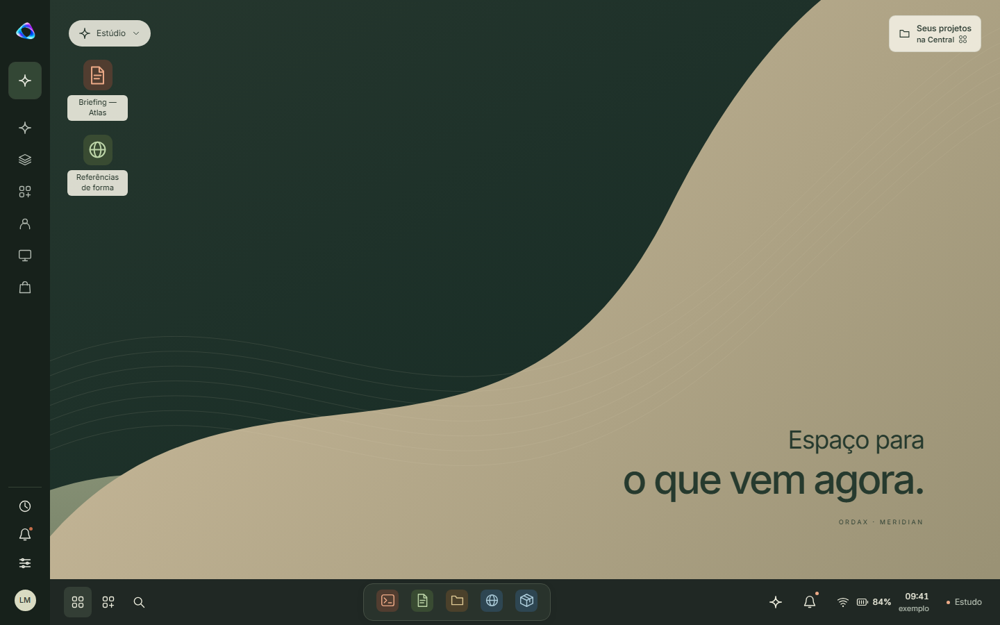

# Meridian Visual System — Visual Freeze

**Status: SSOT visual da proposta experimental Meridian. Direção visual congelada em 13/10/2026.** Mudanças futuras de shell exigem justificativa objetiva. **Visual Freeze não significa Integration Ready.**

Owner documental: Surface / direção visual Meridian. Este documento define aparência, orientação e comportamento percebido; não cria contratos de domínio, runtime, tema padrão ou autorização de release. Aplica-se à proposta em `codex/meridian-design-lab`. A identidade de produção e os temas Claro, Escuro e OrdaX USB continuam em [DESKTOP-IDENTITY](../DESKTOP-IDENTITY.md) e seus owners de tokens.

## 1. Autoridade, baseline e uso

| Referência | Identidade |
| --- | --- |
| Branch | `codex/meridian-design-lab` |
| HEAD inicial desta consolidação | `7782b76daa0fcf4eb4229dd124be61d7b0abaeb9` |
| Código auditado preservado | `44d2ef0cc6ae8d0c0573e754d300e316c46dff84` |
| Correção Round 3 preservada | `2b609edae1fca0db56b4de05f76d1bb822245ebe` |
| Parecer independente | **C — aprovada para congelamento/refinamento final** |
| Fonte do parecer | [Auditoria final Round 4](../evidence/meridian-round4-audit-2026-10-13/relatorio.md), [rail](../evidence/meridian-round4-audit-2026-10-13/sidebar.md) |
| Rastreabilidade visual | [Manifesto do Freeze](../evidence/meridian-visual-freeze/manifest.json): fontes, SHA-256, referências e procedência |
| Estado de main local | `fafed4a8916587ad35bc07c2f3baa1a60d561b1e`, preservado |

Ordem de leitura: este documento → referência visual do elemento → renderer/token correspondente → auditoria. As quatro rodadas são evidência histórica; não competem como especificações atuais. [Round 1](../evidence/meridian-audit-2026-10-13/relatorio.md), [Round 2](../evidence/meridian-round2-audit-2026-10-13/relatorio.md) e [Round 3](../evidence/meridian-round3-audit-2026-10-13/relatorio.md) preservam a evolução e as falhas.

Para implementação futura, prevalecem owners/contratos de produção e os gates próprios. Quando houver divergência visual, registre o defeito e seu impacto; não use o CSS experimental para contornar lifecycle, grants ou capacidades. O manifesto é um registro de evidência, não outro catálogo, design-token registry ou contrato de runtime.

Três níveis de precisão neste documento:

- **Regra congelada:** significado e relação visual/interativa que devem ser preservados.
- **Referência nominal:** medida/paleta observada neste baseline; permite comparação e ajuste justificado por legibilidade, contexto ou acessibilidade.
- **Detalhe incidental:** art, conteúdo editorial, coordenada ou mecanismo do protótipo; não é regra de produto.

## 2. Princípios congelados

| ID | Princípio | Critério de comparação |
| --- | --- | --- |
| MVS-01 | Mesmo sistema, duas apresentações | Central e Desktop conservam sessão/contexto; nenhum destino troca apresentação implicitamente. |
| MVS-02 | Orientação antes de decoração | Ícone, nome, estado e consequência concordam; hover/foco tornam destinos compreensíveis. |
| MVS-03 | O trabalho ocupa a região útil | Sidebar/taskbar/compacto reservam espaço; maximizada não deixa margens flutuantes. |
| MVS-04 | Contexto explícito, autoridade separada | Space/app/documento indicam alcance; seleção não concede leitura, execução ou permissão. |
| MVS-05 | Mesma experiência na coleção de materiais | Materiais alteram cor, arte e profundidade, não estrutura de navegação, hierarquia ou comportamento. |
| MVS-06 | Disclosure conserva acesso | Em tela estreita, menu/busca/painel guardam destinos retirados do rail; conteúdo rola em região definida. |
| MVS-07 | Estado é forma, texto e semântica | Dock, seleção, foco e avisos não dependem só de cor. |
| MVS-08 | Movimento comunica mudança | Curto, orientado a estado, dispensável; repaint comum não reanima a interface. |
| MVS-09 | Honesto sobre disponibilidade | Loading/error/offline/unavailable têm informação e próximo passo; fixtures não parecem telemetria verificada. |

## 3. Central e Desktop

### Central — superfície contextual e operacional

Tem header, navegação por páginas, Início, contexto de Space, continuidade, estado operacional e entrada integrada de Intelligence. A home organiza perspectivas **Visão do dia / Seu trabalho / Ecossistema**. Hierarquia editorial e continuidade de trabalho conduzem a composição; não é um painel genérico de KPIs.

Sidebar navega **páginas da Central**. `Início` retorna à home, mantendo apresentação e contexto. A marca acionável também pode retornar à home; ela não vira segundo alternador. Página selecionada anuncia `aria-current="page"`; localização no header identifica onde o usuário está.

A faixa operacional resume sessão, dados, rede e pendências, sem fabricar sucesso. Os cards de contexto são subordinados à intenção/trabalho, não pretexto para expandir áreas. Trocar uma perspectiva mantém a mesma Central. Abrir um app pelo dock é uma ação explícita de app e pode levar seu trabalho ao Desktop.

### Desktop — área de trabalho familiar do OrdaX

Tem rail OrdaX, wallpaper de fundo, conteúdo do contexto e janelas, taskbar/dock inferior. **Não tem topbar permanente nem faixa vazia reservada no topo.**

Destinos do rail abrem, restauram ou focam janelas/painéis do Desktop. Repetir um destino reutiliza sua janela existente. Eles não navegam silenciosamente para páginas da Central. O estado corrente é de janela (`aria-current="true"` no destino pertinente), não de página Central.

O wallpaper dá respiro e identidade; o conteúdo de app fica em superfície legível e independente da ilustração. Não deve ser exposto em volta de uma maximizada apenas para manter efeito de janela flutuante. Perfil profissional altera relevância/ferramentas do contexto, não cria outro Desktop.

### Alternância e destinos explícitos

O rodapé/menu oferece **Área de trabalho** quando está na Central e **Voltar à Central** quando está no Desktop. Ícone monitor indica o destino Desktop; glyph de quatro módulos indica o destino Central. Rótulos seguem a política existente [presentationDestination](../../system/surface/workspace/presentation.mjs), sem novo modo de produto.

Alternar preserva Space, sessão, janelas, rascunhos e contexto autorizado. Não é login, troca de Space ou novo runtime. O controlador de preview não é a implementação final dessa preservação.

**Seus projetos · na Central**, no wallpaper, explicita que abre a perspectiva **Seu trabalho** da Central. Não se interpreta o glyph folder como promessa de janela de arquivos nem se cria nova jornada de projetos.

## 4. Rail, orientação e identidade

Icon-first, persistente quando há espaço e ligado ao rodapé. Marca centralizada no rail compacto. Destinos principais, contexto e utilitários têm separação clara; o rail não vira lista de texto para compensar iconografia ambígua.

| Elemento | Central | Desktop | Indicação |
| --- | --- | --- | --- |
| Marca | Home da Central | Marca sem ação de apresentação | Asset OrdaX existente; não inventar outro símbolo |
| Início | Home / página atual | Ausente | Nome Início; glyph de módulos; marcador ativo |
| Intelligence / Spaces / Aplicativos / Perfis / Dispositivos / Descobrir | Páginas | Janelas existentes | Nome vem do catálogo; current corresponde à apresentação |
| Space atual | Seleção/revisão | Mesma seleção/revisão | Glyph do Space + nome acessível “Trocar Space, atual: …” |
| Conta | Jornada de identidade | Mesma jornada | Avatar, “Conta e identidade”, indicação de sessão |
| Continuidade / Notificações / Ajustes | Página ou painel existente | Janela ou painel existente | Utilitários; não duplicam alternância de apresentação |

Iconografia de referência: [icons.mjs](../../system/surface/experiments/meridian/icons.mjs), SVG 24×24, traço nominal 1,65, pontas/junções arredondadas; glyphs usuais 15–21 px no chrome/rail/dock e maiores no conteúdo. Ícones decorativos não repetem nome na árvore acessível; o botão tem nome. Esses glyphs são referência visual, não outro registry de apps/capabilities.

Estado corrente tem superfície selecionada e marcador de forma; hover é affordance, não ativação. Foco visível é independente de hover/current. Pressed é feedback transitório de contato, não prova de execução.

**Uma orientação por alvo gerenciado:** hint imediato em hover/foco, nome coerente, posicionado ao lado do rail ou acima do dock, limitado pela viewport. Não combinar esse hint com tooltip nativo concorrente. Escape dispensa sem deslocar foco; saída do alvo permite nova orientação. Hint não persiste sobre diálogo/repaint/lock. Essas correções da auditoria devem permanecer.

### Space, conta, perfil e apresentação

Space é contexto do sistema. Não é workspace visual, conta, perfil profissional ou permissão. A apresentação Central/Desktop também não é o modo de capacidade Web/Mobile/Desktop/USB/Nativo do produto; não pode alterar capacidades ou grants por trocar aparência.

| Conceito | O que indica | O que não concede |
| --- | --- | --- |
| Space | Contexto atual: trabalho, referências, pessoas e ferramentas pertinentes | Grant, identidade, leitura automática ou execução |
| Usuário/sessão local | Continuidade no dispositivo, inclusive sem cloud | Conta cloud autenticada ou sincronização |
| Conta OrdaX/cloud | Identidade/conexão explícita quando disponível | Disponibilidade de outro aparelho ou todos os dados |
| Perfil profissional | Relevância e conjunto de ferramentas do contexto | Novo shell, Space, conta ou permissão |
| Central/Desktop | Forma de apresentar/trabalhar na mesma sessão | Novo produto, runtime, Space ou identidade |

Troca de Space indica contexto atual e impacto quando aplicável. Trabalho não é apagado silenciosamente; indisponibilidade não escolhe fallback invisível. Reentrada/troca mantém revisão explícita. O protótipo usa namespaces de demonstração; isso não é proteção de arquivos reais. Exemplos de pessoa, avatar, plano e capacidade não integram a identidade visual congelada.

## 5. Taskbar, dock e tray

Taskbar reserva sua linha; apps não ficam sob seus controles. Alternador/menu/busca mantêm uma origem estável, dock agrupa apps, tray agrupa estado. A linguagem de dock é leve e contida; overflow aparece como rolagem interna intencional, não scroll horizontal acidental da página.

### Estados visuais do dock

| Estado | Forma de referência | Semântica/nome | Ação esperada |
| --- | --- | --- | --- |
| Fixado | Ícone sem marcador de execução | “Nome · Fixado” | Abrir o app disponível, conforme owner |
| Aberto | Ponto preenchido sob ícone | “Nome · Aberto” | Restaurar/focar janela existente |
| Ativo | Contorno + traço sob ícone | “Nome · Ativo”; current=true | Concordar com chrome e conteúdo foreground |
| Minimizado | Pequeno marcador vazado | “Nome · Minimizado” | Restaurar sem perder conteúdo/modo |

Estados não são quatro coleções independentes de apps. Um app fixado pode estar aberto; o marcador comunica sua condição corrente. Lista não duplica IDs. Foreground deriva do conteúdo realmente corrente; Central, janela minimizada e compacta recolhida não anunciam conteúdo guardado como ativo.

### Toque, teclado e overflow

Referência nominal: **44×44 px por dock item**, gap **6 px**, símbolo 32×32 com glyph 21 px. O alvo é o botão, não a área desenhada do ícone. Aceite físico de touchscreen ainda está pendente.

Uma região interna `overflow-x:auto`, gesto horizontal nativo, cues/fades/chevrons das extremidades indicam conteúdo anterior/próximo. Wrapper/taskbar/documento não passam a rolar com o gesto. Aumentar número de apps não comprime o alvo nem inventa outra barra de execução.

Setas esquerda/direita percorrem foco; Home/End vão ao primeiro/último controle. Focar não ativa app nem muda foreground. Ativar continua ação explícita do botão. Resize mantém app ativo ou alvo com foco visível; inércia de toque não pode sobrepor intenção posterior de teclado. Pointer/wheel/saída de foco devolvem rolagem nativa. Uma implementação futura deve reproduzir esse resultado com o lifecycle do owner, não copiar o helper como runtime.

### System tray

Estrutura congelada: **rede, bateria, horário, notificações, ajustes rápidos**. Detalhes migram para painel/menu onde não cabem. A entrada mantém nome/expansão coerentes; notificações usam o estado do seu owner e abrir painel não equivale a consumir eventos.

Horário, porcentagem, rede, dispositivos e número de eventos do estudo são fixtures. “Estudo” e “exemplo” sinalizam essa condição no preview. Em implementação futura, disponibilidade/telemetria devem vir do owner; ausência de medição não vira zero fictício. Valores como 09:41/84% e a frase “USB · sessão local” não são identidade universal da família de produto.

## 6. Janelas e foreground

| Modo | Linguagem congelada | Relação com região útil |
| --- | --- | --- |
| Floating | Contorno/cantos próprios, sombra e título delimitam janela | Pode expor wallpaper; posição/tamanho adaptam-se à viewport |
| Maximized | Superfície contínua, sem margem/cantos/sombra externos floating | Quatro bordas coincidem com região principal disponível |
| Minimized | Conteúdo sai da área visível; dock preserva identificação | Não reserva uma janela invisível sobre o conteúdo |
| Compact | Conteúdo em região explicitamente aberta, título/controles e seleção | Principal redimensiona; apps compactos continuam acessíveis |
| Foreground / inativo | Faixa do título, peso, glyph/borda/contorno e dock coerentes | Fundo não é apagado nem tornado ilegível para simular foco |

Chrome nomeia app/documento sem transformar título longo em largura mínima de desktop. Controles: **minimizar, compacto/restaurar, maximizar/restaurar, fechar**, com nomes e glyphs pertinentes ao estado. Fechar tem hover de atenção contextual; não domina a composição em repouso.

Foreground strip nominal: 3×16 px no título; texto ativo mais forte e glyph destacado. Borda/sombra derivam de tokens, não de copies por app. Conteúdo possui seu scroll; chrome/controles continuam alcançáveis. Foco de edição não reconstrói o subtree do app antes do input/click e não deve contradizer dock ou Intelligence.

**Maximizar não é fullscreen.** Região útil exclui sidebar, taskbar e compacto explicitamente aberto. Sem margem floating, cantos externos floating ou wallpaper exposto ao redor. Recolher compacto expande principal. Fullscreen é reservado como conceito distinto para futura mídia/imersão e não foi implementado/aprovado pelo Freeze.

Stage de primeiro uso/bloqueio/recovery é uma tela de jornada do ensaio, não fullscreen de mídia ou API fullscreen.

`foregroundWindow` no estudo é seletor de apresentação, consumido por dock, chrome e Intelligence. Ele não cria domínio/autorização de produção. Compacta selecionada, editada ou focada deve concordar com seu estado corrente; minimização/recolhimento/troca de Space invalidam a projeção visual correspondente sem conceder acesso a outro conteúdo.

## 7. Intelligence e contexto operacional

Capacidade nativa do OS: na Central, entrada integrada ao contexto operacional; no Desktop, **sob demanda**, próxima do trabalho. Não prender um chatbot permanentemente ao shell.

Entrada identifica Space, app foreground e documento válido do contexto quando houver. Falta de seleção é apresentada como tal, sem inferir um arquivo de outro Space ou conteúdo oculto. Fontes, proposta, alcance e revisão são distinguíveis. Selecionar contexto não concede leitura/egress/execução. O usuário revisa antes de prosseguir.

As telas/receipts/streaming de exemplo mostram linguagem de apresentação; não são Memory, model router ou Action Gateway. Contexto, disponibilidade e resultados de integração futura pertencem aos owners [Intelligence](../INTELLIGENCE.md), [contrato de Spaces/Profiles](../contracts/spaces-and-profile-packs.json) e contratos correspondentes. Se um link/owner mudar, o índice canônico vence; não criar substituto no design system.

## 8. Coleção Meridian — material, não comportamento

**Argila** usa canvas quente, superfícies claras, ink escuro e acento de argila; rail verde profundo. **Grafite** usa canvas/superfícies verdes escuros, ink claro e acento de argila luminoso. Calor e sobriedade, contraste funcional e profundidade contida definem a direção; não copiar a decoração de um painel SaaS genérico.

Mesmos componentes, DOM, hierarquia, comportamento, estados, navegação e responsividade. Superfícies/cor/borda/sombra/contraste mudam por tokens. A mesma ação não troca jornada, autorização ou layout por material. Fonte atual única: [meridian.tokens.css](../../system/surface/experiments/meridian/meridian.tokens.css).

### Extensão solicitada em 14/10/2026 — Pérola e Petróleo

O usuário autorizou explicitamente aplicar o concept mineral à coleção, mantendo Argila/Grafite. Esta é uma extensão de material do estudo, sobre `14b8984`, não outra rodada de shell ou integração canônica. **Pérola** combina canvas mineral claro, porcelana, rail petróleo e acento jade. **Petróleo** oferece as mesmas peças em azul profundo, texto perolado e jade luminoso. Geometria, navegação, compactos, contexto, marca canônica e contratos permanecem compartilhados.

Metadados e validação dos IDs pertencem a [catalog.mjs](../../system/surface/experiments/meridian/catalog.mjs). O [seletor compartilhado](../../system/surface/experiments/meridian/views/materials.mjs) é usado por Ajustes e pelo painel rápido; as miniaturas consomem os mesmos tokens das telas, sem paleta paralela. CSS de componentes não decide qual material está ativo. Arte vetorial mineral e wallpaper são recursos decorativos escolhidos por tokens no mesmo owner; não recebem autoridade de projeto ou marca.

IDs do preview: `paper` (Argila), `ink` (Grafite), `pearl` (Pérola), `petrol` (Petróleo). Argila continua o padrão. A escolha afeta esta sessão e ambas as apresentações; o link pode definir o material inicial. IDs desconhecidos não alteram a escolha corrente. Não há outro armazenamento de preferências nem mudança nos temas Claro/Escuro/USB de produção.

O contraste nominal de texto/acento sobre o fundo suave de Argila era 4,34:1. A extensão corrige esse caso mensurável de MVS-07, ajustando somente o acento para `#a44426`; o restante da paleta original é preservado. Pérola usa `#147369` para o mesmo papel. O snapshot e os hashes do Freeze abaixo continuam evidência histórica, não declaração de que a árvore atual tem os mesmos bytes. Verificação reproduzível da extensão: [materials-smoke.mjs](../../tools/meridian-preview/materials-smoke.mjs), contra o host local, com resultados separados em `out/meridian-materials` e [evidência selecionada](../evidence/meridian-materials-2026-10-14/README.md).

### Paleta de referência do baseline

Valores abaixo são snapshot documental, não segunda implementação de paleta. Consumo futuro deve apontar ao owner aprovado na tarefa de integração; nunca espalhar estes hexes em apps ou no site.

| Papel / token | Argila | Grafite |
| --- | --- | --- |
| Canvas / --md-canvas | #f4f2ed | #202824 |
| Superfície / --md-surface | #fffcf7 | #29332c |
| Camada discreta / --md-subtle | #eae7df | #333e35 |
| Texto / --md-ink | #282c29 | #eeeede |
| Secundário / --md-muted | #676b63 | #b2bcaf |
| Borda / --md-border | #dcded4 | #465045 |
| Acento / --md-accent | #ac4829 | #edaa87 |
| Hover de acento / --md-accent-hover | #87351f | #f7c2a1 |
| Fundo de acento / --md-accent-soft | #f1ded3 | #513d30 |
| Texto sobre acento / --md-accent-text | #fffaf5 | #28251e |
| Rail / --md-rail | #272e2b | #17211b |
| Texto do rail / --md-rail-text | #e8e9df | #e8e9df |
| Secundário do rail / --md-rail-muted | #b4bcb3 | #b4bcb3 |
| Rail selecionado / --md-rail-selected | #3e4840 | #334735 |
| Foco / --md-focus | #296680 | #b4dbe3 |

Cores semânticas sage/amber/danger preservam funções distintas de acento decorativo. Rótulo e glyph dão significado; “clay” não é sucesso e “green” não concede permissão. Os pares blue/rose/slate dão identidade contextual a glyphs/conteúdo, sem taxonomia de domínio inferida pela cor.

## 9. Tipografia

Inter variável local é a família de referência, herdada de `--ordax-font`; não requer fonte remota. [Owner da família](../../system/surface/ui/tokens.css) e [identidade/offline](../DESKTOP-IDENTITY.md#typography-and-offline-operation) permanecem canônicos. Hierarquia se faz por tamanho, peso, ritmo e posição; controles pequenos não podem ser a única forma de orientação.

| Papel | Referência atual | Regra congelada / limite |
| --- | --- | --- |
| Corpo base | 14 px / 1,5; Inter | Leitura de trabalho, sem compressão indiscriminada |
| Descrição/lead | 13 px / 1,7 | Separar descrição de heading, conservar medida de leitura |
| Heading de página | clamp(28 px, 2,75vw, 42 px), peso 520 | Hierarquia responsiva; overrides de recorte são nominais |
| Saudação Central | clamp(32 px, 3,05vw, 49 px) | Editorial, subordinada ao espaço útil; mobile adapta |
| Seção | 17 px, peso 580 | Distinguir agrupamento de página e metadata |
| Header de painel | 25 px, peso 500 | Identifica tarefa/contexto dentro do diálogo |
| Título de janela | 12 px; ativo peso 600 | Deve sobreviver a títulos longos e controles ao lado |
| Tooltips / Estudo / tray principal | 12 px | Labels orientáveis; não só glyph sem nome |
| Legenda “exemplo” do horário | 11 px | Disponibilidade/proveniência legível, não escondida |
| Labels/metadados gerais | Usualmente 10–12 px; alguns editoriais menores | Valor incidental; não congelar todas as exceções |

O cascade atual importa: `meridian.journeys.css` faz eyebrow/hint/caption em 12 px apesar do eyebrow base em 10 px. Botões/tag base ainda usam 11/10 px e há metadata/art editorial menor. Isso é **pendência de legibilidade/large text**, não licença para padronizar texto minúsculo em produção. Não converter a tabela em limites absolutos de fonte nem congelar pixels antes de zoom/leitor de tela/hardware.

A auditoria mediu 30 amostras visíveis (mínimo 4,86:1), tooltip 11,34:1 Argila / 13,51:1 Grafite. [Método e amostras](../evidence/meridian-round4-audit-2026-10-13/contrast.json). Esses recortes não certificam toda a interface, combinações, todos os tamanhos ou imagens.

## 10. Spacing, grid e geometria

Princípio: pistas de navegação e controles reservam tracks; conteúdo usa `minmax(0,1fr)`/mínimos adaptativos e seu scroll, sem empurrar o documento horizontalmente. Espaçamento separa contexto, ação e detalhes. Uma tarefa densa usa etapas/disclosure/scroll, não redução ilimitada de texto e alvo.

| Área | Medida nominal atual | O que fica congelado |
| --- | --- | --- |
| Escala --md-space-1…7 | 4 / 8 / 12 / 16 / 24 / 32 / 48 px | Ritmo compartilhado; não exigir múltiplos de 4 onde propósito pede 6 |
| Rail Central | 208 px; 178 em recorte médio; 72 no intermediário | Lateral persistente quando cabe; sem sufocar conteúdo |
| Rail Desktop | 72 px; ausente visualmente no mobile | Icon-first, marca centralizada, orientação e acesso completo pelo menu |
| Header Central | 66 px; 61 no mobile | Track próprio; nunca reservado no Desktop |
| Taskbar | 66 px; 72 no mobile, respeitando safe-area | Faixa reservada; conteúdo/app termina antes dela |
| Dock | Alvo 44×44; gap 6; padding 4×12; raio 14 px | Alvo nominal, região interna e cues coerentes |
| Página | Padding base 34×36×42; mobile 25×19×32, 15 px lateral em 320 | Gutters permitem respirar sem recortar conteúdo |
| Tokens de raio | Pequeno 9 / padrão 16 / grande 24 px | Família de cantos coerente; não todos os componentes com mesmo raio |
| Floating | Raio 12; exemplo até 710×550; x/y iniciais 24 | Delimitação/depth, adaptação e controles alcançáveis; coordenadas não são contrato |
| Maximized | Inset/borda/raio/sombra externos: zero | Coincidência exata com região útil, preservando tracks |
| Chrome | Row 44; 52 em toque/mobile; strip 3×16 | Distinção título/controles e estado sem ocupação excessiva |
| Compacto | clamp(220,38vh,360); landscape baixo ~156 px em 844×390 | Região explícita divide o espaço, seleção e acesso ao conteúdo |
| Cards | Tokens de raio, border 1, gap/gutter contextual | Agrupar conteúdo relacionado; não inventar domínio para preencher grid |
| Painel/diálogo | Lateral até 490 px com inset 12; corpo rola; sheet estreito | Título/fechar alcançáveis, conteúdo contido e retorno ao contexto |
| Busca | Diálogo até 640 px; no mobile ocupa região quase inteira | Input focado, teclado, Escape e retorno ao ponto de origem |

Os valores de z-index (rail/taskbar/frame), posição de janela, número de colunas do catálogo, altura exata de arte, texto de wallpaper e inset de floating do protótipo não são regra oficial. A relação de camadas é que importa: modal acima do trabalho e fundo inerte; hint orienta sem capturar ponteiro; janela corrente acima de outras janelas; rail/taskbar reservados.

## 11. Motion e microinterações

Referência nominal de duração: `--md-duration:180ms`, zerada em reduced motion. Princípio congelado: curto, funcional, orientado a estado e dispensável; nenhum atraso ornamental em tarefas críticas.

| Mudança | Referência atual | Evitar |
| --- | --- | --- |
| Central ↔ Desktop | Fade .85 → 1 | Simular outro app/conta ou recarregar sessão |
| Abrir/restaurar floating/compacta | Opacity .75 → 1 + deslocamento 4 px | Reanimar todas as janelas a cada repaint |
| Abrir maximizada / mudar modo | Fade .85 → 1 | Transição geométrica que sobrepõe tracks ou parece fullscreen |
| Tooltip | Entrada curta de opacity/deslocamento 2 px, sem espera longa | Duplicar title nativo, persistir depois de Escape/saída |
| Hover | Background/borda/cor/transform curtos | Equiparar hover a seleção ou ativação |
| Pressed | Leve escala .95–.98 no alvo pertinente | Decorar com bouncing/som ou atrasar comando |
| Minimizar/fechar | Imediato, feedback no dock/estado | Esperar animação para atualizar lifecycle |

`prefers-reduced-motion` e a opção existente da prévia removem animações/scroll animado; continuam mudanças de estado legíveis. Easing específico/keyframes são baseline, não API pública. Entrada/resize vêm de mudanças reais de aparência; observação de repaint não é relógio de tarefas. Animação de texto fixo nas jornadas não é streaming de modelo real.

## 12. Responsividade por intenção

| Ambiente de referência | Composição e acesso congelados | Baseline para comparar |
| --- | --- | --- |
| Desktop grande | Central com header/rail/contexto; Desktop sem topbar; dock/tray completos | 1440×900 |
| Desktop médio | Conteúdo reorganiza colunas; detalhes secundários podem mudar de posição; labels mantêm contexto | 1024×768 |
| Intermediário | Rail icon-first; conteúdo não herda largura mínima de desktop | 768×600 |
| Landscape baixo | Rail prioriza destinos, mantém Conta; Perfil/Descobrir/utilitários ficam em menu/busca/tray; compacto mostra um app por vez | 844×390 |
| Mobile vertical | Rail some visualmente, menu/busca/conta mantêm acesso; painéis viram sheets com scroll; dock rola | 390×844 |
| 320 px | Não achatar app/controle até ilegível; busca está no menu/atalho; um compacto por vez, disclosure dos detalhes | 320×568 |

Breakpoints atuais (1050/820/600 no rail; 1100/740/400 no tray/dock; 760 no compacto e landscape ≤500 px de altura) são mecanismos do protótipo. Não são definição de dispositivo nem promessa de homologação. Redimensionar uma janela pode exigir container queries mesmo num monitor grande; conteúdo deve adaptar ao espaço real.

Scroll é permitido e intencional no conteúdo/painel/dock correspondente. “Sem scroll horizontal da página” não significa cortar conteúdo ou proibir scroll de documentos longos. O header/chrome/fechar e o alvo escolhido por teclado permanecem alcançáveis. Nenhuma mudança responsiva altera identidade, Space ou permissão.

## 13. Acessibilidade — regra congelada e aceite pendente

| Princípio congelado | Verificação disponível | Homologação ainda necessária |
| --- | --- | --- |
| Nome acessível para todo controle | AX Chromium e nomes coerentes com catálogo/ação | Leitor de tela real e compreensão das jornadas |
| Foco visível distinto de ativo/hover | Outline de foco, retorno ao ponto de origem e edição preservada | Zoom/large text, ordem completa e seleção de texto |
| Estado por forma/texto/AX, não só cor | Current de página/janela e marcadores do dock | Forced colors e contraste de todas as combinações |
| Teclado e Escape | Launcher/busca/diálogos, setas/Home/End e dispensa de hint | Tecnologias assistivas/OS físicos |
| Reduced motion | Suprime animação e conserva estado | Aceite individual/configuração em hosts reais |
| Alvo nominal 44×44 do dock | Medição e gesto emulado nos recortes | Touchscreen físico, precisão/gestos e orientação |
| Layout legível e conteúdo alcançável | Recortes amplos/320/landscape e acesso por scroll | Zoom 200%/400%, large text e hardware |

O alvo nominal do dock **não homologa automaticamente todos os icon buttons**: chrome em paisagem ainda tem política ≥36×40 e base de icon button 34×34. Sua geometria/tamanho é pendência objetiva de acesso em hardware, não ampliação de scope nesta tarefa. Densidade de dois headers no compacto landscape e labels menores continuam limites registrados pela auditoria.

## 14. Catálogo visual de estados

A coluna “leitura visual” descreve o sinal que deve ser reconhecível, sem inferir execução. Os exemplos usam estados existentes. Estado transitório não é provado por imagem estática: para hover/focus/pressed e inércia, consultar CSS e a auditoria correspondente.

| Estado | Leitura visual / exemplo existente | Fonte/referência | Fronteira |
| --- | --- | --- | --- |
| Default | Superfície legível + glyph/nome, sem marcador de execução | Rail/dock/buttons; REF-D-ARG | Não chamar default de instalado/autorizado |
| Hover | Superfície responde + hint orienta destino | REF-HINT; interactions / :hover | Hover não ativa nem escolhe app |
| Focus | Contorno visível independente do active; hint/scroll acompanha | REF-C-MOBILE; :focus-visible | Foco no dock não muda foreground |
| Pressed | Alvo contrai levemente e retorna | :active em dock/taskbar/Space/Conta | Transitório; sem latch de permissão |
| Selected | Superfície + marcador/check + nome corrente | REF-C-ARG / painel Spaces | Seleção não concede acesso |
| Active | Faixa/peso de título + contorno/traço do dock | REF-W-MAX / REF-W-SPLIT | Só conteúdo realmente corrente |
| Open | Ponto preenchido no dock; janela visível ou guardada | REF-W-FLOAT / taskbar | Não equivale a foreground |
| Minimized | Marcador vazado, nome Minimizado; conteúdo fora da área visível | .is-minimized / taskbar | Restaurar preserva trabalho; não criar novo app |
| Disabled | Botão nativo desabilitado, contraste/opacity apropriados e condição explicada | journeyView: confirmação pendente, source revogada | Não congelar .55 como único tratamento nem usar botão clicável “cinza” |
| Unavailable | Texto de indisponibilidade, alcance e próximo passo, sem sucesso fabricado | [Space indisponível](../evidence/meridian-round3/space-indisponivel.png) | Sem fallback invisível/grant novo |
| Loading | Estrutura/skeleton + status de carregamento, conserva contexto | Central, scene loading / .md-skeleton-layout | Não mostrar dados inventados antes de chegarem |
| Error | Falha nomeada, consequência e recuperação visível | [Volume cheio](../evidence/meridian-round3/volume-cheio.png), [update inválido](../evidence/meridian-round2/captures/update-invalid-1440.png) | Não reportar operação real bem-sucedida |
| Offline | Símbolo/texto Offline + continuidade local explicada | [Offline + trabalho](../evidence/meridian-round3/offline-atualizacao-rascunho.png) | Dados/targets remotos continuam indisponíveis |
| Warning | Ênfase amber/contextual + ícone/texto e decisão | journey tone warning / notice | Aviso não deve depender só de fundo colorido |
| Pending | Pendência próxima da sessão/contexto com possibilidade de revisão | continuity / journey pending / trabalho não salvo | Não consumir/limpar trabalho implicitamente |
| Success | Check + resultado/recibo identificável e sua origem | .md-journey-receipt, tone success | No estudo, “Registro da demonstração”; na produção exige evidência do owner |

Imagens Round 2/3 nesta tabela ilustram estados/semântica e são históricas; **não são baseline de geometria do shell congelado**. O conjunto REF abaixo é a comparação de composição. Não extrair pessoas, medidas operacionais ou conteúdo de storyboards como requisitos reais.

## 15. Componentes de referência e maturidade

Classificação trata aparência/percepção, nunca prontidão de arquitetura. **Nenhum componente deste estudo está declarado pronto para integração.**

- **C — Visualmente congelado:** direção/estrutura/estados suficientemente estáveis para orientar comparação; homologação pendente continua aplicável.
- **R — Precisa refinamento objetivo:** direção mantida, mas deficiência/densidade/aceite conhecido deve ser resolvido com evidência.
- **P — Apenas protótipo:** mostra hipótese de apresentação/jornada; não copiar como implementação.
- **N — Não usar como referência:** conteúdo/mecanismo incidental ou alegação que não define Meridian.

| Elemento | Classe | O que pode orientar / limite |
| --- | --- | --- |
| Rail / sidebar | C | Orientação icon-first, destinos por apresentação, contexto/utilitários; não copiar registry de demo |
| Presentation switcher | C | Mesmo ponto de origem, nome/glyph do destino, preservação de sessão/contexto |
| Taskbar / dock item | C | Tracks, estados por forma/AX, 44×44 nominal, scroll/cues/teclado; toque físico pendente |
| System tray | C | Agrupamento rede/bateria/horário/avisos/quick settings e disclosure; valores não congelados |
| Tooltip/hint | C | Um mecanismo gerenciado, clamp, hover/foco/Escape; sem title concorrente |
| Window / chrome | C | Relação floating/max/compact, foreground, título/controles e dock coerentes; não é window manager |
| Space selector / Conta | C | Contexto/identidade distinguíveis, escolha/revisão explícita e orientação |
| Search / panel / dialog | C | Input/fechar/foco, fundo inerte, conteúdo rolável, sheet em tela estreita |
| Operational strip | C | Sessão/contexto/pendência próximos do trabalho, sem telemetria fabricada |
| Cards / agrupamentos | C | Superfícies, ritmo/hierarquia, próximo passo; não todos os tipos/colunas/conteúdos |
| Intelligence contextual | C | Sob demanda, Space/app/documento válido, fontes/proposta/revisão distinguíveis |
| Button / icon button | R | Solid/quiet/light, nomes/estados/foco como linguagem; alvos gerais, zoom e fonte pequena precisam aceite |
| Compacto landscape | R | Divisão/seleção/scroll congelados; dois headers e pequena região útil ainda exigem aceite |
| Labels editoriais / large text | R | Hierarquia mantida; tamanhos mínimos/cascade e zoom 200/400 precisam avaliação objetiva |
| Store, pairing, update, recovery, autenticação e receipts do ensaio | P | Padrões de alcance/decisão/erro; journeys e resultados não são contratos ou serviços |
| Apps simulados / criação de projeto / coleção de referências | P | Relação com trabalho e região útil; não packages, Files real ou disponibilidade |
| Controller / interactions / source / view models | N como arquitetura final | Podem explicar baseline; não adotar como runtime, store, domínio ou autoridade |
| Telemetria fixa, persona, plano, preços, número de dispositivos, porcentagens | N | Não caracterizam produto nem capacidades comprovadas |
| Art/textos/posições arbitrários de demo | N como contrato | Estética ajuda comparar; artwork/source legítimo pode ser referência visual, não valor operacional |

### Matriz visual para impedir divergência

ARG = Argila; GRA = Grafite. Material conserva a mesma estrutura/ação em todas as linhas. C/R/P têm o significado da classificação acima.

| Elemento | Central | Desktop | Mobile/landscape | ARG | GRA | Estado / classe |
| --- | --- | --- | --- | --- | --- | --- |
| Header | Localização/busca/contexto | Ausente, sem track | Central conserva menu/conta | Mesmo papel | Mesmo papel | C |
| Início | Home / página | Ausente no rail/menu de páginas | Menu/busca Central conservam home | Current de página | Current de página | C |
| Rail | Destinos de página | Destinos em janela/painel | Some/encurta, conserva acesso em menu | Rail profundo | Rail profundo | Hover/foco/current / C |
| Space | Seletor/revisão | Mesmo seletor/revisão | Painel/busca/menu, sem fallback | Mesmo contexto | Mesmo contexto | Seleção/indisponível / C |
| Conta | Jornada de identidade | Mesma jornada | Menu/header conforme apresentação | Mesmo nome | Mesmo nome | Hover/foco/sessão / C |
| Alternador | Área de trabalho | Voltar à Central | Rodapé/menu no mesmo sistema | Mesmo destino | Mesmo destino | Pressed/transition / C |
| Dock | Apps abertos/fixados, sem foreground oculto | Apps + foreground visível | Interno rolável, 44×44 nominal | Ponto/traço/contorno | Ponto/traço/contorno | Quatro estados / C |
| Tray | Resumo/entrada Sistema | Grupo do sistema | Detalhes no painel/menu | Mesmo disclosure | Mesmo disclosure | Disponibilidade/avisos / C |
| Janela maximizada | Ação de app leva ao Desktop | Toda região útil | Tracks/compacto reservados | Sem margens | Sem margens | Maximized / C |
| Compacto | Estado de trabalho conservado ao alternar | Região explícita | Um escolhido por vez; scroll | Mesmo layout | Mesmo layout | Selected/collapsed / C, densidade R |
| Intelligence | Intenção no contexto operacional | Ajuda sob demanda | Conteúdo de painel responsivo | Mesma revisão | Mesma revisão | Fonte/proposta/review / C |
| Diálogo | Contextual/modal | Mesmo padrão | Sheet/scroll, close alcançável | Mesmo foco | Mesmo foco | Open/disabled/error / C |
| Journeys operacionais | Demonstrações | Demonstrações | Etapas/disclosure ilustrativos | Mesma hipótese | Mesma hipótese | P, nunca capability real |

## 16. Auditoria dos design tokens

[meridian.tokens.css](../../system/surface/experiments/meridian/meridian.tokens.css) continua source dos valores experimentais, sob `[data-meridian]`; os materiais sobrescrevem valores no mesmo owner. Component CSS compõe esse source; não há paleta paralela por app. Esta documentação classifica papéis e snapshots, não implementa um novo arquivo de tokens para consumo.

| Categoria | Tokens atuais | Leitura / destino |
| --- | --- | --- |
| Estruturais | --md-space-1…7, --md-radius/-small/-large, --md-rail-width/-compact, --md-bar, --md-dock | Escala/track/raio nominal; breakpoints não viram identificação de dispositivo |
| Material — superfícies/texto | --md-canvas, --md-surface, --md-subtle, --md-surface-alt, --md-ink, --md-muted, --md-border/-strong | Separação figura/fundo e leitura; derivados/aliases continuam no owner |
| Material — acento/rail | --md-accent/-hover/-soft/-text, --md-rail/-text/-muted/-border/-selected | Ênfase e orientação, sem inferir autoridade |
| Material/contexto | --md-sage/-soft, --md-blue/-soft, --md-amber/-soft, --md-rose/-soft, --md-slate/-soft | Família para estados/glyphs; função depende também de nome/forma |
| Estado | --md-focus, --md-danger/-soft, --md-window-edge, --md-chrome-active; acento/selected compartilhados | Foco/atenção/foreground distintos; não criar estado só pela cor |
| Profundidade/material | --md-shadow/-small, --md-window-shadow | Hierarquia contida; max externa continua sem sombra |
| Motion | --md-duration, redução pelo host/preferência | Duração nominal; zero em redução; easing no componente é detalhe |
| Tipografia | --md-font | Família canônica; tamanhos/pesos ainda estão no CSS dos componentes, sem escala completa de tokens |
| Artwork | --md-on-art, --md-art-dark/-light/-clay, --md-clay-soft | Art/glyph/aliases do estudo; não exportar artwork como estado de domínio |

### Duplicações, aliases e valores experimentais

- `--md-surface-alt = var(--md-subtle)` e `--md-clay-soft = var(--md-accent-soft)` são aliases explícitos, não duas paletas. `--md-border-strong`, `--md-window-edge`, `--md-window-shadow` e `--md-chrome-active` derivam de outros tokens; não congelar o RGB computado como novo literal independente.
- `--md-bar` e `--md-dock` têm o mesmo valor nominal 66 px, mas responsabilidades distintas. Igualdade numérica não justifica fundir os dois nem reintroduzir header no Desktop.
- A regra `prefers-contrast:more` que mapeia muted/border a ink aparece em **tokens.css e meridian.views.css**. É redundância objetiva de CSS. Foi registrada; **não foi removida nesta consolidação**, para conservar a cascata do baseline auditado até revisão específica de high contrast/forced colors. Não constitui segundo serviço/tema.
- `.md-dock-app {flex:none}` reaparece no CSS de composição embora a regra base já o declare. É redundância de declaração, sem novo comportamento. Nenhuma limpeza de source foi realizada nesta tarefa documental.
- Eyebrow base 10 px / override de journeys 12 px é cascata intencional do preview, não token tipográfico canônico completo. A hierarquia foi documentada e a legibilidade ficou em R; não transformar todos os overrides em regra oficial.
- SVG/art e vistas de app usam cores/medidas locais para ilustração, x/y de janela e demos. Tais valores não devem virar contrato. UI dinâmica como brightness/volume/window position não é design token persistente nem preferência real.

Não se criou token registry, schema/lock, API de tema ou export para apps. **Duplicações corrigidas nesta tarefa: nenhuma.** A decisão evita reabrir o shell/validação da auditoria; os dois casos objetivos acima podem ser tratados depois com causa e aceite delimitados, sem Round 5.

## 17. Referências visuais congeladas

A palavra “canônica” nesta seção significa **referência de comparação da proposta Meridian**, não tema/capability de produção. Imagens não são prova de runtime/serviço. Não duplicamos PNGs existentes: a auditoria é origem dos recortes já adequados; seis capturas específicas completam os enquadramentos ausentes no conjunto final, com source preservado.

REF IDs são somente identificadores documentais. SHA/procedência/viewports estão no [manifesto](../evidence/meridian-visual-freeze/manifest.json). Para decidir se a interface mudou, compare apresentação/material/viewport/estado equivalentes; não compare uma captura de loading a um app ativo nem use conteúdo fixture como contrato.

| ID | Papel / viewport | Referência | Procedência |
| --- | --- | --- | --- |
| REF-C-ARG | Central Argila / 1440×900 | [Central](../evidence/meridian-round4-audit-2026-10-13/verified-independent4/central-paper-1440.png) | Auditoria, código 44d2ef0 |
| REF-C-GRA | Central Grafite / 1440×900 | [Central](../evidence/meridian-round4-audit-2026-10-13/verified-independent4/central-ink-1440.png) | Auditoria, código 44d2ef0 |
| REF-D-ARG | Desktop Argila, sem janelas / 1440×900 | [Desktop](../evidence/meridian-visual-freeze/desktop-argila-1440.png) | Captura específica sobre 7782b76 |
| REF-D-GRA | Desktop Grafite, sem janelas / 1440×900 | [Desktop](../evidence/meridian-visual-freeze/desktop-grafite-1440.png) | Captura específica sobre 7782b76 |
| REF-W-FLOAT | Várias floating / Grafite 1440×900 | [Janelas](../evidence/meridian-visual-freeze/desktop-janelas-grafite-1440.png) | Captura específica sobre 7782b76 |
| REF-W-MAX | Maximizada / Argila 1440×900 | [Maximizada](../evidence/meridian-visual-freeze/maximizada-argila-1440.png) | Captura específica sobre 7782b76 |
| REF-W-SPLIT | Compacta + maximizada / Grafite 844×390 | [Paisagem](../evidence/meridian-round4-audit-2026-10-13/verified-independent4/chrome-ink-844.png) | Auditoria, código 44d2ef0 |
| REF-DOCK | Dock cheio, alvo ativo / Argila 320×568 | [Dock](../evidence/meridian-round4-audit-2026-10-13/verified-independent4/chrome-paper-320.png) | Auditoria, código 44d2ef0 |
| REF-TRAY | Tray aberto / Grafite 1440×900 | [Tray](../evidence/meridian-visual-freeze/tray-grafite-1440.png) | Captura específica sobre 7782b76 |
| REF-I | Intelligence contextual / Argila 1440×900 | [Contexto](../evidence/meridian-visual-freeze/intelligence-contextual-argila-1440.png) | Captura específica sobre 7782b76 |
| REF-C-MOBILE | Central mobile / Argila 390×844 | [Mobile](../evidence/meridian-round4-audit-2026-10-13/verified-independent4/central-paper-390.png) | Auditoria, código 44d2ef0 |
| REF-D-MOBILE | Desktop mobile / Grafite 320×568 | [Mobile](../evidence/meridian-round4-audit-2026-10-13/verified-independent4/chrome-ink-320.png) | Auditoria, código 44d2ef0 |
| REF-HINT | Orientação rail Desktop / Argila 1440×900 | [Hint](../evidence/meridian-round4-audit-2026-10-13/verified-independent4/guidance-desktop-paper.png) | Auditoria, código 44d2ef0 |
| REF-C-HINT | Orientação rail Central / Grafite 1440×900 | [Hint](../evidence/meridian-round4-audit-2026-10-13/verified-independent4/guidance-central-ink.png) | Auditoria, código 44d2ef0 |

### Leituras de composição

Central Argila (mesma estrutura em Grafite):

Desktop Grafite (sem header permanente; mesma estrutura em Argila):

Paisagem baixa, compacta + maximizada:

Essas imagens mantêm informações do estudo, inclusive personas/USB/telemetria fixa. Congelar a composição não congela essas informações como verdade do produto. O manifesto seleciona os arquivos; as evidências originais permanecem intactas.

## 18. Não fazer

- Reintroduzir topbar permanente ou faixa reservada de header no Desktop.
- Fazer destino da sidebar Desktop navegar silenciosamente para página da Central.
- Duplicar alternador no rail ou chamar Início de mudança de apresentação.
- Confundir maximizar com fullscreen, cobrir taskbar/rail/compacto explicitamente aberto ou deixar margens floating em maximizada.
- Transformar Central em dashboard SaaS com KPIs/cards inventados para preencher lacunas.
- Prender um chatbot permanente ao shell ou inferir contexto de janela minimizada/compacta recolhida/outro Space.
- Criar Desktop, navegação ou permissões diferentes por perfil/material.
- Fazer materiais usarem componentes, lógica ou estrutura de navegação divergentes.
- Comunicar estado somente pela cor ou remover o foco para deixar uma captura “limpa”.
- Cortar conteúdo/controle para satisfazer “sem scroll”; comprimir alvo/fonte para encaixar todos os apps.
- Duplicar tooltip nativo/hint; contrariar Home/End com snap; deixar observers/hints de shell removido no lifecycle futuro.
- Transformar fixture, fonte demonstrativa, persona, preço, plano, recibo ou progresso roteirizado em contrato/telemetria.
- Adotar controller/interactions/journeys/view models como runtime final ou montar demo source numa composição de produção.
- Trocar Claro/Escuro/USB, adicionar site/login/cadastro ou iniciar adapter/backend nesta consolidação.

## 19. Governança do Freeze e pendências objetivas

**“A direção visual Meridian está congelada. A partir daqui, mudanças de shell exigem justificativa objetiva.”**

Uma alteração futura deve registrar: regra MVS afetada, defeito/necessidade observável, reprodução/evidência, owner, menor correção, materiais/recortes impactados e aceite. Exemplos válidos: controle inalcançável por zoom, alvo insuficiente em touchscreen, contraste, foco/semântica incorretos, inconsistência com estado real de owner. Preferência estética genérica ou “dar outra cara” não é justificativa para nova rodada de shell.

Se uma decisão congelada precisar mudar, a revisão explícita deve atualizar **este mesmo documento** e o registro de evidência; não criar Meridian-v2/novo-final como segunda autoridade. Ideias novas aguardam tarefa separada e não foram implementadas aqui.

| Pendência | Próximo aceite / limite |
| --- | --- |
| Zoom 200/400%, large text, labels pequenos | Testar conteúdo, foco, overflow, hierarquia e tamanho legível sem regressão entre materiais |
| Leitor de tela real | Compreensão de nomes/current, contexto, sequência e retorno de foco |
| Forced colors/alto contraste completo | Rever cascade redundante, todas as superfícies/ícones/camadas e foco |
| Touchscreen/hardware | Precisão de alvos/gestos, inércia→teclado, orientação e controles fora do dock |
| Compacto landscape denso | Guardar/editar/selecionar alcançáveis; manter reserva explícita da região e maximização |
| Runtime/lifecycle/projeções | Planejar separadamente com owners; não promover repaint/fixtures ou criar novo window manager |
| Gates canônicos pendentes | Foundation/Web/platform/hardware/assinatura/release têm seus próprios gates; Freeze não os fecha |

O último parecer separa **maturidade visual suficiente**, **arquitetura ainda protótipo** e **integração insuficiente**. As medidas e checks históricos da auditoria são prova daquela árvore; esta tarefa documental não repete essas matrizes nem anuncia um novo PASS de Foundation, CI, kernel, USB ou build.

## 20. Resultado e rastreabilidade desta consolidação

Criado um owner documental visual, matriz Central/Desktop/mobile/materiais, catálogo de estados, classificação de componentes, auditoria de tokens e seleção de referências. Sem alteração de source/CSS/fixtures/runtime; sem limpeza visual arbitrária. Houve inspeção dos arquivos, auditoria completa e capturas existentes, seis enquadramentos específicos, verificação local de links e `git diff --check`.

A tentativa inicial de capturar no host existente 4203 não ficou pronta dentro do prazo; não foi atribuída causa nem tratado como PASS. As seis referências foram obtidas depois num host loopback descartável desta mesma árvore, encerrado junto com o browser do roteiro. Nenhum host/aba pessoal foi substituído. Isso é captura de referência, não homologação nem diagnóstico de integração. O [registro das capturas](../evidence/meridian-visual-freeze/new-captures.json) identifica esse scope.

**Não houve Round 5, integração, merge, push, deploy, promoção de tema ou alteração de main.** Este Freeze orienta outro desenvolvedor/chat e futura Surface/apps/site pelo mesmo vocabulário visual; não concede acesso, implementação pronta ou permissão para começar essas frentes.
