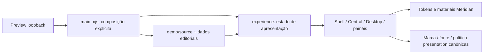
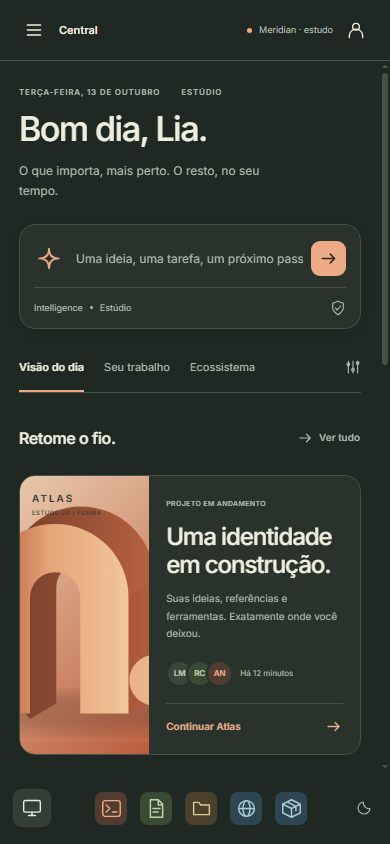
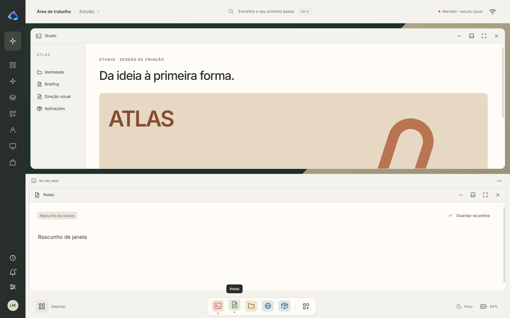

# Auditoria técnica Meridian — 13/10/2026

**Resultado:** proposta isolada e navegável, com quatro correções objetivas; pronta para uma próxima revisão visual informada pelo inventário. **Não é aprovação para integração ao produto, release ou CI integralmente verde.** O smoke Web canônico continua reprovado por timeout e Foundation não passa neste ambiente Windows.

## Escopo, snapshot e rastreabilidade

- Repositório: ordaxsystems/ordax-os, checkout local em C:/Users/TONECOS/Documents/github/ordax-apps/tools/assistant-host/.data/os-meridian-lab.
- Branch: `codex/meridian-design-lab`.
- HEAD inicial e baseline: `69a893701f2f43dee5046f7649ec675facd02e5d`; parent `9fec127`.
- Working tree inicial limpo; nenhuma mudança posterior legítima precisou ser descartada.
- Referência local `main` inicial: `fafed4a8916587ad35bc07c2f3baa1a60d561b1e`. Ela está atrás do baseline: 413 commits exclusivos do lado Meridian e zero do lado main. Não houve checkout, reset, merge, push ou escrita em main.
- O repositório externo ordax-apps não recebeu alterações desta auditoria. Suas mudanças já existentes no assistant-host foram preservadas.
- O computador reiniciou durante o trabalho. A retomada confirmou HEAD, árvore limpa anterior às correções e logs persistidos; processos antigos não foram tratados como ainda válidos.
- Correções e evidências pertencem ao commit local que contém este relatório; o hash final é informado na entrega e pode ser obtido com `git log -1 --format=%H`. O baseline permanece no histórico.

Owner: Surface/presentation para o experimento. Apps, Runtime, Platform, Identity, Memory, Intelligence, grants, pairing, trust e release conservam suas autoridades. Vinculação de planejamento: seção Meridian de [DESKTOP-IDENTITY](../../DESKTOP-IDENTITY.md), [plano funcional](../../../PLANO-FUNCIONAL-SURFACE-E-APPS.md) e [MVP canônico](../../../MVP.md).

## Correções realizadas

| Achado confirmado no baseline | Causa | Correção e prova |
|---|---|---|
| P1: rascunho da Central desaparecia ao abrir/fechar painel | render substituía todo o DOM e só restaurava valor do elemento ainda focado | Conservação transitória por Space, formulário, campo e conversa; fechamento/repaint preservam texto, envio limpa o campo, destroy limpa a memória. Prova cobre isolamento entre Spaces/conversas e texto escapado. |
| P1: Ctrl/Meta+K → Escape devolvia foco ao main, não ao campo de origem | retorno dependia do último data-action clicado | Registrar origem por ID/action antes de abrir o primeiro painel, conservar origem em painéis encadeados e retornar ao controle visível ou ao main quando ele não existe mais. Prova real de teclado. |
| P1: botões sem nome acessível em breakpoints | rótulo visual era ocultado por CSS, sem nome independente | Nomes para helper button, busca, personalização, foco e conta. AX do Chromium sem controles vazios nos recortes testados. |
| P1: identificação/acesso aos cenários desaparecia a 320 px | media query escondia o botão Meridian | Identificação compacta de estudo em telas menores e botão preservado. Cores, composição e direção visual mantidas. |

Não houve nova funcionalidade de domínio, backend, persistência, tema de produção ou redesign. Datas, nomes, porcentagens e conteúdos editoriais continuam fictícios. A suspeita de escapes de linha no briefing não se confirmou: o arquivo já continha escapes JavaScript válidos e não foi alterado.

A prova nova reutiliza `tools/browser-proof/chromium.mjs`, o host real do preview e o workflow Surface existente. Não cria outro framework de validação nem depende de pacote novo.

## Gates e comandos

Os logs completos ficam no diretório local `C:/Users/TONECOS/Documents/github/ordax-apps/tools/assistant-host/.data/meridian-audit-20261013`. [validacoes.json](validacoes.json) registra comandos, resultados, sessões e hashes dos logs. [meridian-proof.json](meridian-proof.json) contém as verificações e geometrias da prova focada.

| Gate | Comando canônico / recorte | Resultado |
|---|---|---|
| Dependências | npm ci --ignore-scripts --no-audit --no-fund | Exit 0, 187 pacotes; aviso ENOSPC preservado. Não alterou lock. |
| Sintaxe Meridian | node --check nos 13 módulos originais e main do preview | PASS baseline; repetida após correções, incluindo o novo smoke. |
| Typecheck | Executado pelo build canônico: tsc --noEmit | PASS; não executado duplicadamente. |
| Lint | Nenhum script canônico dedicado descoberto no manifest | N/A; não foi inventado um lint nem declarado PASS. |
| JSON contracts | python tools/verify/json_contracts.py | PASS; 138 contratos, 9 manifests de source. |
| Boundaries | python tools/verify/module_boundaries.py | PASS baseline; repetido após correções. |
| Source graph | python tools/surface-web/build.py check | PASS baseline; repetido para confirmar isolamento final. |
| Node/Surface | node --test --test-concurrency=2 com arquivos de baseline-node-files.txt, incluindo família de produto | 650 testes: 649 passaram e 1 falhou por dependência ainda ausente. |
| Diagnóstico Store | node --test tests/test_web_store_catalog.mjs após npm ci | PASS, 6/6. A primeira execução iniciou antes do término da instalação; falha de prontidão do ambiente, preservada. |
| Foundation Python | python -m unittest discover -s tests -p 'test_*.py' -v | FAIL: 2.845 testes, 13 falhas, 275 erros, 39 skips do runner; 556,923 s. Não rerodada com a causa conhecida. |
| Build Web | python tools/surface-web/build.py build --source-commit 69a893701f2f43dee5046f7649ec675facd02e5d --out-dir out/meridian-audit-web-baseline | PASS, 12 arquivos. |
| Verificação do bundle | python tools/surface-web/build.py verify --out-dir out/meridian-audit-web-baseline | PASS. |
| Repetibilidade | Segundo build/verify em out/meridian-audit-web-repeat e comparação SHA-256 arquivo a arquivo | PASS: 12 arquivos, zero diferenças. |
| Referências Web | npm run verify --workspace tools/surface-web | PASS, 34 referências/assets e checks de ciclo de vida/geometria. |
| Chromium Native | node tools/surface-native/browser-smoke.mjs | PASS fora do sandbox de processo: 1280×800, 390×844, 320×568, 844×390. |
| Chromium first-run | node tools/surface-native/first-run-browser-smoke.mjs | PASS fora do sandbox: 16 assertivas. |
| Chromium Web canônico | node tools/surface-web/browser-smoke.mjs --bundle-dir out/meridian-audit-web-baseline --evidence-dir out/meridian-audit-web-browser-retry | FAIL: ready de .os-shell/.classic-desktop + boot hidden expirou. Repetição focada também falhou. |
| Chromium Meridian | node tools/meridian-preview/browser-smoke.mjs | PASS: 155 verificações, 3 superfícies, 6 tamanhos, 12 rotas, 6 cenários, teclado/rascunhos/janelas. |
| Contraste de tokens | Cálculo dos pares semânticos do stylesheet, preservado em contrast-tokens.json | 32 pares medidos; detalhes abaixo. Não equivale a certificação de toda a UI. |
| Gates finais leves | Sintaxe, boundaries, source graph, supply chain do workflow e recorte Node de tema/localização/workspace | PASS: sintaxe em 15 módulos/entrypoints, boundaries, source graph, supply chain e 63/63 testes Node. |

Não foram executados build de kernel/imagem USB, escrita física, promoção de release, homologação de hardware ou CI remoto. O experimento não entra nesses artefatos; esta auditoria não autoriza tais ações.

### Falhas, ambiente e limites da classificação

**Foundation:** os primeiros erros causais e grupos recorrentes incluem fcntl ausente, sh/jq indisponíveis, criação de links negada pelo Windows, bits de permissão POSIX diferentes, política PowerShell bloqueando um script e LF/CRLF divergindo de hashes de bytes. Também há verificação de caminho de kernel com separadores Windows. São incompatibilidades/falhas já presentes fora dos arquivos Meridian; não se alteraram expectativas, políticas ou contratos para torná-las verdes. As 13 falhas/275 erros permanecem registrados. Um gate Foundation equivalente ao CI Linux ainda precisa ser obtido; esta auditoria não atesta que todos esses casos passariam lá.

**Web Chromium:** as tentativas iniciais dos três smokes falharam na conexão DevTools sob sandbox. Native e first-run passaram ao executar a mesma receita com acesso de processo/loopback. O Web então falhou na condição ready, inclusive na repetição isolada. A inspeção manual do mesmo bundle em outro servidor local mostrou a UI, boot oculto e nenhum erro de console; isso não substitui o smoke reprovado. A causa do timeout permanece **indeterminada** neste host. O código/bundle canônico é preexistente à mudança Meridian: o diff do baseline contra seu parent não altera workspace, UI canônica, contratos, build Web ou locks.

**Ensaios da nova prova:** a primeira execução falhou após 46 verificações. Houve erro temporário de ordem de import CSS na identificação compacta e problemas de sincronização/navegação/tecla do harness. A segunda chegou a 87 verificações e parou porque Conversas não possui botão direto na sidebar. Corrigiram-se a ordem do CSS, a espera pelo documento, a emissão de teclas nativas e o acesso real por busca. A terceira passou 155 verificações. Os logs das falhas foram mantidos; nenhum gate foi desativado ou expectativa relaxada.

**Ambiente:** Windows, Node 26.7.0, npm 12.0.2; Python usado pelo caminho explícito do runtime local, pois python/python3 do PATH apontavam a aliases WindowsApps. npm ci emitiu ENOSPC apesar do exit 0; builds e provas posteriores funcionaram, mas esse aviso não é ignorado. O runner CI canônico é Ubuntu/Python 3.12: não se alega paridade completa de ambiente.

### Paralelismo, snapshots e repetições

No baseline, a suíte Python e o conjunto Node foram iniciados em sessões separadas com saída integral em arquivos, enquanto ocorria leitura de código/contratos e inventário. A instalação de dependências ainda não terminara ao iniciar Node; isso causou o único erro de dependência, depois diagnosticado por teste focado. Builds e repetibilidade foram sequenciais entre si, com diretórios de saída distintos. Smokes de navegador foram executados sequencialmente para não disputar os mesmos recursos.

Não foram editados arquivos do baseline durante seus testes/builds. Resultados foram capturados antes das correções. Na retomada após reboot, os .exit e logs foram relidos em vez de reexecutar as suítes grandes.

Após correções repetiram-se sintaxe e boundaries, source graph e tema/localização/workspace, pois houve alteração de markup/estado/CSS e inclusão da prova no workflow. Supply chain valida a alteração de CI. O browser Meridian é a validação diretamente afetada. Não se repetiu o build/typecheck canônico completo: seus inputs/import graph/locks não mudaram e os dois bundles anteriores são idênticos. Foundation não foi repetida porque os impedimentos conhecidos permanecem fora do escopo. O smoke Web recebeu uma repetição focada para diagnóstico, não uma sequência de retries até verde.

## Arquitetura, composição e design system

- 13 módulos do experimento; grafo estático local sem ciclos encontrados. Único import de módulo compartilhado fora do experimento: workspace/presentation.mjs. Marca e Inter são assets dos owners atuais.
- O entry point do preview é separado de Web/Native. Nenhuma composição de produção importa fixtures ou monta Meridian; build canônico não contém o experimento. Não há nova dependência, lock, migration ou contrato público.
- Argila e Grafite usam os mesmos renderers, hierarquia, classes e handlers; data-material altera tokens. Não há uma segunda árvore de componentes para o material escuro.
- Tokens visuais próprios são aceitáveis para um estudo opt-in, mas ainda não são um design system de produção. Não devem substituir diretamente os perfis de cor do produto.
- CSS: meridian.css tem 1.881 linhas, views 2.742 e tokens 105. Há 549/858/23 ocorrências de medidas px e 0/50/64 cores hex, respectivamente. São contagens estáticas, não uma medida automática de defeitos. As cores em views concentram tratamento editorial/artístico; devem ser revisadas antes da promoção, sem retokenização arbitrária nesta auditoria.
- Há repetição de resolução do Space e padrões de listas/detalhes entre views. experience centraliza navegação, painéis, forms, janelas, pointer drag e dispatch em funções densas. Isso aumenta o risco de perda de estado durante repaint; a perda de rascunho corrigida foi uma manifestação concreta.
- O controller ainda reconstrói a árvore inteira em cada render. O conserto é adequado ao preview; a integração deve reaproveitar o lifecycle/reconciliação canônico, não manter esse shell como um segundo runtime.
- O código Meridian é JavaScript ESM, não TSX/TypeScript. O typecheck do build não prova seus objetos editoriais. Sintaxe, boundary, inspeção e prova de navegador são as evidências aplicáveis.

## SSOT, duplicações e mocks

**Nenhuma nova autoridade de produção foi criada ou conectada. Isso não torna os fixtures substitutos válidos dos contratos reais.** Há duplicação de representações simplificadas de domínio e comportamento de janelas na prévia. Elas são view models editoriais, isolados e explicitamente fictícios; sua promoção direta é um bloqueio de integração. Não se criou um novo schema Space/Profile/Account para legitimar essa duplicação.

| Domínio | Situação Meridian | Fonte/owner a reutilizar na integração |
|---|---|---|
| Space/contexto | id/nome/perfil/módulos e seleção em memória; fallback para primeiro Space | spaces/1, space-selection, authorized-view; membership/roles e ausência explícita. Create do demo não pode virar método do port read-only. |
| Profile | Cards e alteração de rótulo no Space | profile-pack, provisioning, activation-state, content trust e component inventory. |
| Identity/Account/Session | Lia@example.test; guest/connected são cenários, não sessões | identity-session/1, identity-actions/credentials, account-lifecycle; local-session separado. |
| Intelligence | Resposta fixa, fontes e proposta roteirizadas | intelligence/model-router/Memory/Action Gateway; grants existentes. |
| Device | Lista e estado online/capabilities fictícios | device-agent/capabilities/action envelopes, pairing e Device Host. |
| Store item | Oito tipos editoriais e lista installed por Space | app-store catalog/2 e gerenciador; estados installing/staged/blocked/failed-retained não cabem no booleano do demo. |
| App | Oito exemplos, nomes/cores e conteúdo de janela demonstrativo | Catálogo/manifest/SDK do owner Apps e app-activation. |
| Window | expanded/floating/compact, posição e minimização locais | Workspace canônico; não integrar o array windows como outro lifecycle. |
| Notification | Projeção da lista de atividade e IDs lidos | notifications/notification-store e centro compartilhado atual. |
| Activity | Timeline global editorial | Atividade/continuidade do owner e contexto autorizado. |
| Message | Respostas mantidas na sessão, sem envio | Network/transport-v2, membership, trust & safety; sem ingestão automática em Memory. |
| Action/automation | Dispatch altera somente a fixture ou abre views | Personal OrdaX, Action Gateway, policy/approval/executor. |
| Memory/privacy/sync | Textos e booleans de apresentação | Memory, grants e Sync atuais; toggle não autoriza nem sincroniza nada. |

A substituição futura exige uma projeção de apresentação dos snapshots canônicos e fixtures validadas contra esses contratos. Não é seguro trocar createMeridianDemoSource por um cliente de API mantendo o dispatch atual. Nenhum backend foi conectado para antecipar isso.

Isolamento observado: fonte explicitamente injetada, dados em demo/, sem persistência ou fetch nos handlers, CSP com connect-src e form-action none, permissões de câmera/microfone/geolocalização/USB negadas pelo host, sem endpoint de escrita. A prova registrou somente requisições ao próprio loopback e negativas para arquivos privados, diretórios e caminhos fora da allowlist. Isso cobre o preview servido, não uma homologação de host exposto à rede. Não houve exploração de links simbólicos ou auditoria de serviço de produção.

Guest/offline/error não constituem testes de autorização: alguns painéis, mensagens e atividades continuam mostrando o conjunto editorial global. "Outros Spaces fora do contexto" é uma intenção de UX, não prova de enforcement no mock. Fonte vazia/Space revogado também não está modelado adequadamente. Essas lacunas estão no inventário; criar serviços ou contratos alternativos para preenchê-las violaria o escopo.

## Validação visual e experiência de sistema

### Argila e Grafite

Inspecionadas a 1440×900, 1024×768, 768×600, 390×844, 320×568 e 844×390. A prova final não encontrou overflow horizontal da página/main nessas combinações. As capturas confirmam a mesma organização e dimensão dos componentes nos dois materiais; a diferença vem de superfície, cor e contraste. A identificação de estudo permanece visível em largura mínima.

### Desktop e relação com Central

Dock, Space, busca, marca, glyphs, materiais, foco e painéis são compartilhados. A prova percorreu Notes compacto + Studio expandido, minimização/restauração e retenção do rascunho; 390 px não apresentou overflow horizontal. A leitura em região compacta funciona sem exigir arrastar janela flutuante.

A relação ainda exige decisão de produto: Central oferece uma narrativa de projeto; Desktop apresenta simulações de apps, não a sessão real. A troca de Space esvazia as janelas do estudo. "Desktop", "Área de trabalho", "Seu trabalho" e "Space" precisam de distinção consistente, especialmente entre área visual e limite de autorização. Não há overview/snap completo ou prova de múltiplos monitores. A nova rodada deve mapear esses estados ao workspace existente.

### Central: sistema operacional versus dashboard

Pontos que sustentam uma identidade de sistema: contexto ativo, intenção diretamente no ambiente, retomada de documentos/ferramentas, dispositivo como capacidade e continuidade com janelas. A hierarquia editorial é clara e a marca não depende de um painel de métricas.

Pontos que ainda lembram um dashboard: sidebar de destinos, coleção de cards com agenda/projetos, percentuais/data fixos, catálogos sem lifecycle e textos promocionais sobre dispositivos. Não se vê suficientemente o estado operacional da sessão USB, volumes, bloqueio, atualização, recovery, indisponibilidade e resultados reais. O caminho prioritário é completar essas jornadas e transições; trocar o estilo dos cards agora não resolveria a lacuna.

## Acessibilidade, responsividade e estados

- Names/roles: controles testados têm nome na árvore AX; labels de inputs, landmarks, skip link, headings, dialog nativo rotulado, switches/checkboxes e pressed state existem. Os nomes perdidos por breakpoint foram corrigidos.
- Teclado: busca por Ctrl+K, Escape, retorno ao campo e navegação de 32 passos de Tab sem foco em controles de fundo foram exercitados. Drag de janela é por ponteiro; ações de compactar/maximizar/restaurar têm botões. Não se alega equivalência completa de arraste/redimensionamento por teclado.
- Focus-visible: outline de 2 px e offset 4 px via token; pares focus/canvas e focus/surface medidos entre 5,68 e 10,20. Estados hover/active/pressed têm estilos. Disabled tem estilo base, mas estados realmente negados/indisponíveis quase não são representados.
- Contraste semântico: 32 pares em [contrast-tokens.json](contrast-tokens.json). Texto principal/canvas: 12,66 Argila e 12,89 Grafite; muted/canvas: 4,86 e 7,70. Todos os pares de texto selecionados superaram 4,5; foco superou 3. Medição não cobre texto sobre arte, transparência/filtros, todos os estados hover ou preferências do sistema.
- Tipografia: hierarquia legível nas capturas, mas labels editoriais de 8–11 px e densidade dos metadados merecem P1. Texto ampliado não escala uniformemente todos os valores fixos em px. A prova valida 320 px nesse modo, não certifica zoom de 200%/400%.
- Reduced motion: token respeita prefers-reduced-motion; a preferência da prévia é aplicada e animationDuration da página chega a zero na prova. Leitor de tela real, high-contrast/forced-colors e zoom completo não foram homologados.
- Responsividade: 18 combinações superfície/viewport, mais 12 rotas a 390 px, seis cenários e composição compacta. O teste mede overflow da página/main; não substitui inspeção de cada popover, hover, documento arbitrariamente longo ou todo par de janelas.
- Estados: connected/guest/offline/empty/loading/error são demonstráveis. Skeleton e vazio concentram-se na Central. Falta a matriz por operação de denied, unavailable, revogação, storage cheio, update pendente, bateria baixa e Space ausente. Eles foram inventariados, não inventados como backend nesta tarefa.
- Localização: a cópia pt-BR é editorial do estudo. O produto mantém o owner i18n e seus testes; Meridian ainda precisa de projeção/localização completa antes de integração.

Os temas **Claro, Escuro e OrdaX USB** permaneceram intactos. O nome "OrdaX US" da solicitação corresponde aqui ao perfil existente OrdaX USB; nenhum perfil foi renomeado. Não há alteração nos tokens, preferências ou paletas canônicas.

## Build, riscos e próxima rodada

Build canônico sem erro, 12 arquivos com hashes idênticos entre execuções. O chunk principal tem 742,04 kB (209,76 kB gzip); CSS principal 107,30 kB. Permanecem aviso de chunk acima de 500 kB e diagnóstico de tempo de plugins. São do bundle canônico inalterado; não se ajustou limite para silenciar warning. Importações/assets/referências passaram nos checks. O produto é montado no cliente; não há gate de hydration SSR aplicável ao preview. O smoke Web reprovado limita a afirmação sobre runtime canônico.

Riscos materiais: integração direta dos fixtures; controller que recria o DOM; falsa sensação de enforcement nos estados guest/Space/privacy; lacunas de lifecycle e recovery; baixa cobertura de estados assíncronos; legibilidade de metadados e escalabilidade de texto; gates canônicos pendentes neste ambiente. Nenhum desses riscos autoriza duplicar serviços.

O [inventário](inventario.md) contém **196 itens em 17 categorias: P0=118, P1=66, P2=9, P3=3; MVP=184, pós-MVP=9, futuro/experimental=3**. Inclui todos os tópicos solicitados, Native no ciclo MVP e Pizzaria/Empresas/Advocacia/Impressão 3D sem limitar a arquitetura a eles. O estado é do source consultado, não disponibilidade de release.

Os [14 fluxos completos](fluxos.md) explicitam os passos cobertos e ausentes. As três ideias P3 tratam antecipação de perda de rede, comparação de impacto ao trocar contexto e ensaio explicativo de recovery. Nenhuma foi implementada. Recomendações para o site público ficam somente nesse documento; landing, conta web, login e documentação pública não foram alterados.

## Conferência da entrega

Este relatório cobre: branch/HEAD/baseline/árvore inicial; comandos, paralelismo, sessões e logs; status e classificação das falhas; correções/commit; SSOT/duplicações/mocks; preservação dos temas; Argila/Grafite/Desktop e sua coerência; acessibilidade/responsividade; build/riscos; inventário/fluxos/prioridades/ideias futuras; validações repetidas e motivo. A comparação final de `main` deve manter o SHA inicial acima, registrada junto à entrega. Nenhum merge ou push integra esta auditoria.
