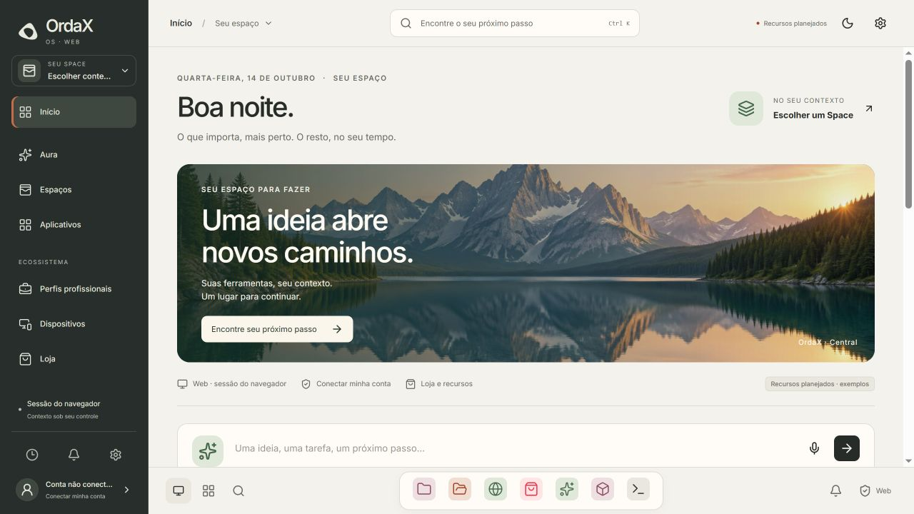
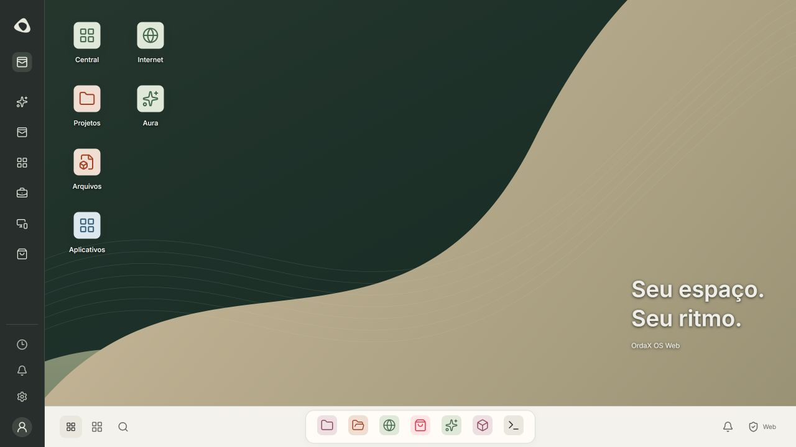
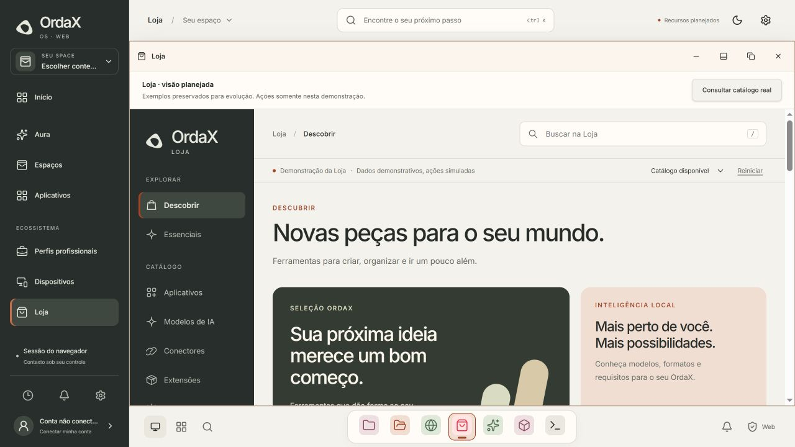

# Meridian integration validation — 2026-10-14

Explicit user authorization: use the Meridian/USB visual direction in the actual
Web, integrate the Store appearance, retain unimplemented resources as labelled
mocks, and reuse the existing Web hero imagery. This is a presentation adoption,
not a new backend, official catalog, provider or Native lifecycle implementation.

## Changes and ownership

- Web keeps Central, its account key, existing preferences, desktopReducer and
  WindowLayer. MeridianHome supplies editorial Day/Work/Ecosystem perspectives,
  existing alpine day/night image hero and explicitly identified planned cards.
- Shared `ui/meridian.tokens.css` and `ui/meridian.css` load in Web and Native/USB.
  Native Store cards/hero/navigation consume the same visual language while their
  existing catalog/request/activation owners remain unchanged.
- Store presentation source moved from the standalone composition into
  `workspace/components/store/presentation/`; compatibility entries keep the old
  standalone URL. Both presentations use one renderer, fixtures and demo reducer.
- The Web Store mounts in its existing managed window using a ShadowRoot for
  styling, element IDs and listener scope. No iframe or global URL/title mutation.
  Local navigation, scroll and mock state survive minimize/restore/compact/view
  changes. AbortController/timer cleanup runs when the window is closed.
- A ready verified catalog still opens the real, fail-closed Store by default.
  With unavailable Web transport the planned view stays visible and labelled.
  Switching catalog modes hides/preserves the demo session; fixtures are never
  inserted into an official snapshot or converted to execution authority.
- Dock pins reuse existing shortcut metadata; opening focuses/reuses the existing
  window. Pins have no running marker until a real managed window exists.
- Original reference digests remain intact in their ledgers; adoption history
  records explicitly authorized presentation changes. No dependencies installed,
  new credentials, account changes, host installs or physical operations.

## Automated checks

| Check | Result |
| --- | --- |
| `node --experimental-strip-types --test tests/test_web_store_catalog.mjs tests/test_store_preview.mjs tests/test_verified_store_projection.mjs tests/test_store_update_request_batch.mjs` | 44 passed |
| `python -m unittest discover -s tests -p test_surface_ui_contract.py` | 27 passed |
| `python -m unittest discover -s tests -p test_surface_web_builder.py` | 8 passed |
| `npm.cmd run typecheck --workspace tools/surface-web` | Passed |
| `npm.cmd run build --workspace tools/surface-web` | Passed; includes typecheck |
| `npm.cmd run build:store-preview --workspace tools/surface-web` | Passed; original standalone entry still builds |
| `npm.cmd run verify --workspace tools/surface-web` | Passed; 34 reference files, lifecycle/geometry and fail-closed AI |

Total: 79 automated tests passed. No contract test was relaxed. The Web builder
check caught ownership moving out of Central; Central now retains the canonical
preference subscription and passes presentation values to MeridianHome. The
reference verifier required explicit adaptation records for moved/renamed views;
upstream digests were preserved. The offline source check caught a documentation
localhost URL inside the composition tree; the README now uses a host/port label,
without changing the offline guard.

The canonical main JS remains above the existing 500 kB warning threshold
(approximately 727 kB, 207 kB gzip). Store remains a lazy resource, approximately
139 kB (40 kB gzip). Its encapsulated presentation CSS is included in that module.
No unrelated shell/service refactoring was introduced to suppress the warning.

## Browser checks

[Recorded passing observations](browser-results.json) cover the live Web at port
4201, actual compiled Web at port 4205, and compiled standalone Store at port 4204.
The production checks include lazy Store and compact-action chunks, mobile menu,
real/demo separation, URL isolation, dialogs, material propagation and closing.

A development/HMR run encountered a failed fetch of the existing compact-actions
module; its canonical error boundary kept an expand fallback. The final compiled
bundle loaded the compact actions, opened its mobile menu and expanded the window
without console errors or warnings. This is distinguished from a production defect.
Temporary viewport overrides were reset. Local preview servers are development
infrastructure, not a hosted deployment or Native hardware proof.

## Remaining boundaries

Native/USB shared visual wiring was inspected and covered by source contracts;
no physical boot, touch, hardware or Native lifecycle proof was performed. The
Meridian experiment on port 4203 is a reference checkout, not the active Web owner.
Mocks preserve intended resources for incremental implementation; project files,
agenda, routines and device integration do not claim a live backend. Account,
Spaces, Intelligence and official Store availability keep their canonical ports.

## Chrome completion

The user identified the rail/nav as only partially adapted. The completed chrome
uses grouped/context rail, real Space/account controls, utility footer, persistent
Central header search, centered colored icon dock, start-side view/launcher and
end-side system availability. Desktop retains the compact rail with Space access;
mobile has a full-width work area and destination menu. Pending professional
profiles remain a labelled mock. No new service or experimental controller.

Targeted verification after this correction:

- `node --experimental-strip-types --test tests/test_meridian_navigation.mjs`: 2
  regressions passed; alias labels reuse/restore one Aura window and retain its
  draft/geometry and other managed apps.
- `node --experimental-strip-types --test tests/test_web_store_catalog.mjs`: 6
  passed, including official catalog isolation and active Desktop Store mounting.
- `python -m unittest discover -s tests -p test_surface_web_builder.py`: 8 passed.
- `python -m unittest discover -s tests -p test_surface_ui_contract.py`: 27 passed.
- Web typecheck/build and the 34-file reference/lifecycle verification passed.

Total: 43 targeted tests passed in this follow-up. Earlier 79-test evidence above
belongs to the preceding integration. The existing main bundle warning remains
approximately 728 kB JS / 207 kB gzip. No unrelated dependency was installed.

The dev host was restarted after its resolver cached an import while the new
module was being created. Final browser checks use the completed module graph and
compiled bundle. [Chrome browser checks](chrome-browser-results.json) record menu
search, reusing/restoring windows, Space availability, dock keyboard focus,
Ctrl K/Escape, responsive menu and planned-resource access.

## Preferences consistency follow-up

The canonical appearance miniatures and PT/EN descriptions now describe Meridian
Argila/Grafite. The dock reads the existing persisted favorites preference;
unpinning an open app keeps its running window visible until it is closed.
Favorite launch and rail/dock launch resolve Intelligence/Aura to one window.

The Store shadow host receives canonical contrast and motion preferences, and
Meridian typography uses rem so document text scale reaches the embedded view.
No preference IDs, storage owner, mock inventory or backend authority were added.

Validation: 24 Node tests (preferences, navigation and Store simulation), 27 UI
contract tests, Web typecheck/build, separate Store build, and 34-reference
verification passed. Browser checks confirmed paper/ink preview values, root
text scaling 16 to 20 px, high contrast in Store, reduced-motion host attributes,
unpin/open/close/re-pin behavior, one Aura window across launch paths, compiled
Store rendering, no production console errors and no document overflow at 390 px.
Baseline preferences and favorites were restored after QA. Existing main bundle
size warning remains (~728 kB / 207 kB gzip). Physical USB behavior and real Store
operations are not asserted by this presentation validation.

