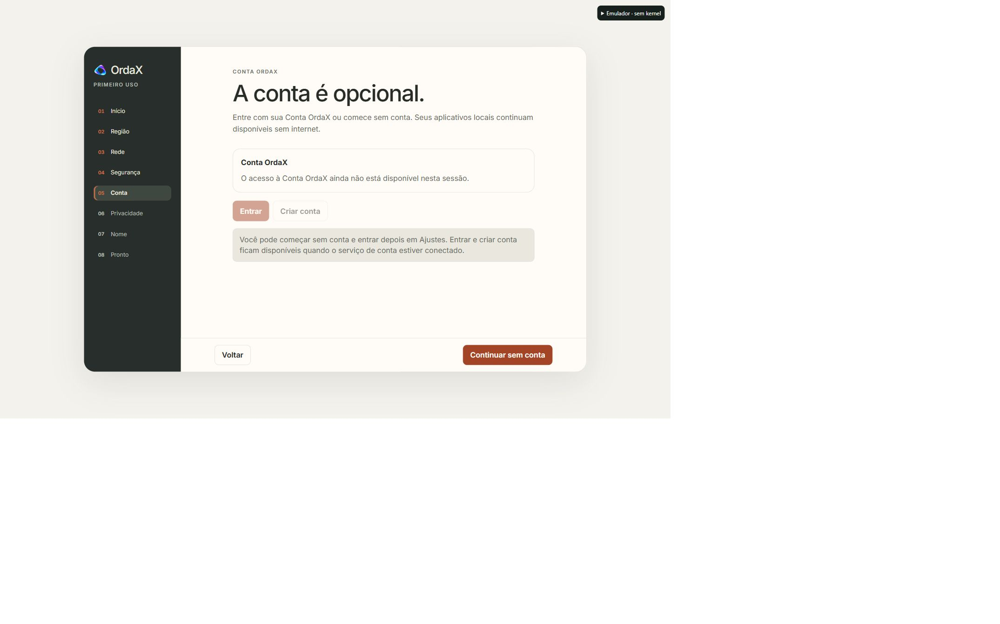
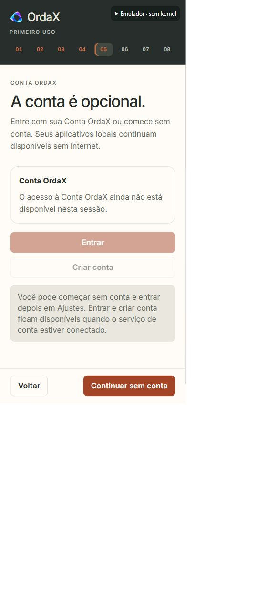
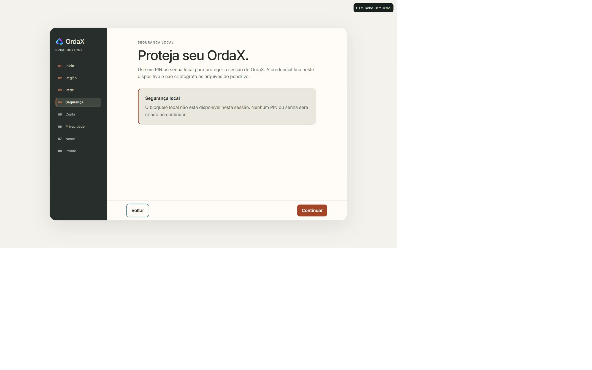

# Meridian First Run and real Native emulator

Source candidate; no physical-media or Stable/MVP promotion claim.

## Verified in the real browser

The Windows emulator serves the actual Native entry:
`/system/composition/native/index.html`. The former independently mounted
emulator onboarding and subsequent Web preview handoff were removed.

The canonical Native renderer and stylesheet now use Meridian directly:
warm canvas, dark contextual rail, editorial hierarchy, canonical brand symbol,
shared type, surfaces, borders and clay actions. Legacy First Run gradient/glass
styling was replaced in its owner rather than covered by another stylesheet.

A real browser session completed welcome, region, network, local security,
local-only account, privacy, device-name fallback and completion. English and
America/Manaus were selected through UI controls; the Native desktop and clock
used them. A full page reload retained completion, locale and time zone, with
no onboarding dialog. The explicit development reset was then used to leave
welcome available for review, preserving preferences.

Native hardware APIs and privileged WebKit bridges were unavailable in Windows,
not represented by fake grants. Native controls retain their capability states.

## Responsive observations

- Notebook: measured CSS viewport 1440 × 900; shared two-column shell.
- Narrow: measured CSS viewport approximately 390 × 843; all eight step markers
  remained on one row at the same vertical position. Progress height ~137px;
  Continue remained visible with its lower edge ~829px inside the viewport.
- Screenshots are unmodified browser captures. The in-app browser zoom/capture
  scale can include surrounding canvas; CSS sizes above were measured from DOM.

## Automated verification

30 Node tests passed across First Run semantics, localization, capability refusal,
Native bridge/App Data boundaries, SSOT ownership and emulator persistence through
the real Native adapters. Invalid/cross-origin writes, conflicting completion and
unreadable saved state were rejected. Hardware endpoints remain unavailable.

The Python Native-host suite was attempted on Windows: five cases require Linux
`fcntl` and were not counted as passes. The physical USB runtime was not changed.

The emulator browser smoke source was updated to follow the Native frame and
reload persistence; the observed end-to-end proof above used the real browser UI.

## Follow-up: network, security and account UX

The same Native renderer now presents unavailable capabilities as consistent
Meridian status panels with product-facing copy. Security still explicitly states
that the session lock does not encrypt USB files. Credential policy, legal consent,
authentication and hardware capability gates remain unchanged.

Account continuation is in the persistent footer alongside Back. Sign-in and
registration controls remain present and disabled when unsupported. The local
path was clicked in the actual emulator iframe and reached Privacy; Back returned
to Account. No credential was entered or created. Wi-Fi choices now expose their
selected state to assistive technology and use full-width rows; connection controls
stack on narrow viewports. The hardware-enabled Wi-Fi/credential paths were not
visually exercised because the emulator does not provide those capabilities.

Observed the actual emulator iframe at CSS 389 × 843: no horizontal overflow;
footer actions had bottom 829.29px, and the rightmost edge was 367.56px.
Updated Portuguese copy has corresponding English, Spanish, German and French
translations in the existing catalog. Verification: 25 Node tests passed (journey,
state, i18n, capabilities, Native emulator host); 3 Python credential-policy tests
passed. Syntax and whitespace checks passed. This does not replace the outstanding
Linux-only and physical-media validation described above.

