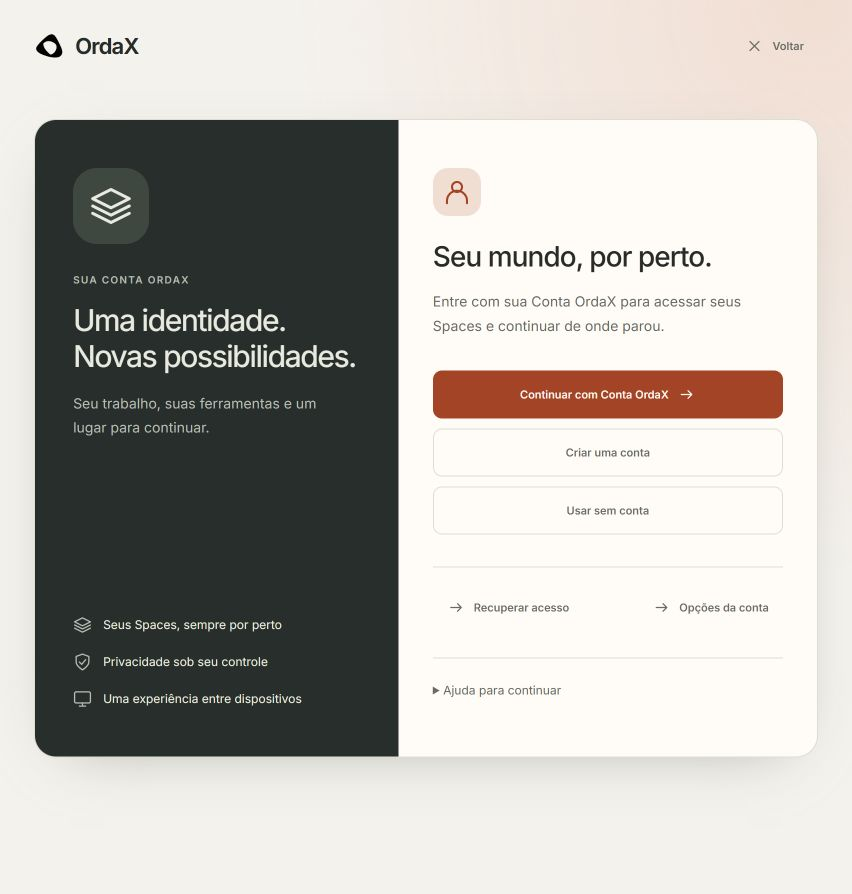
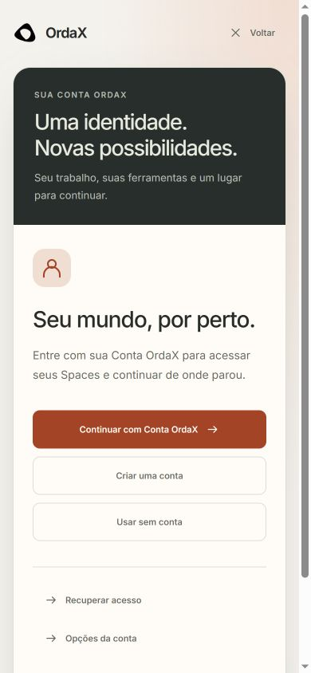
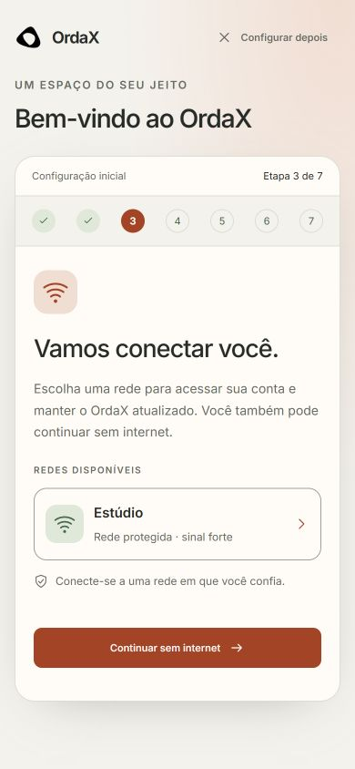
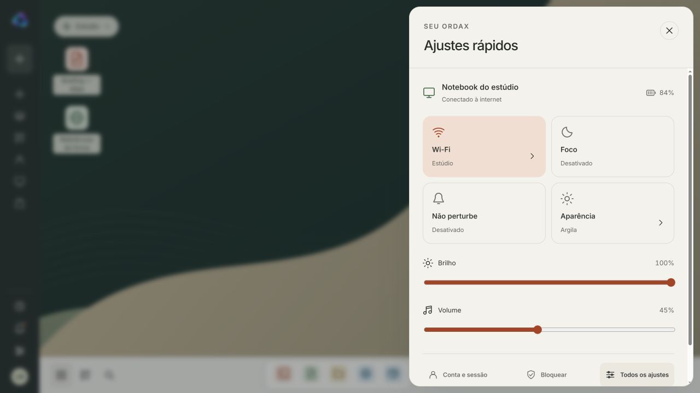
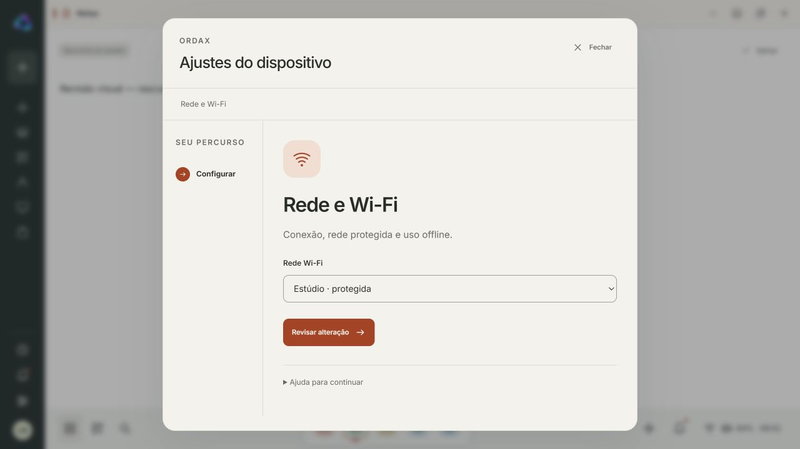
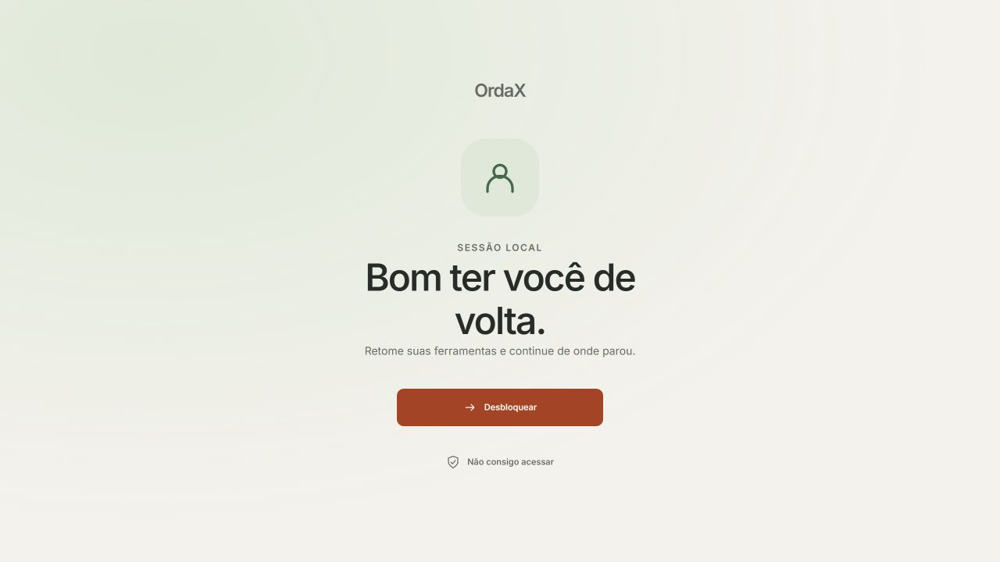
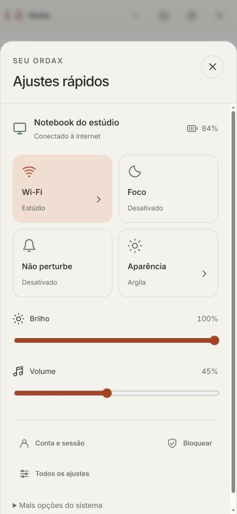

# Meridian system pages — product presentation review

Work began 2026-10-14; final browser validation 2026-10-15. Explicit user request:
remove study/presentation/portable-system metadata from the pages so they can
review the real product appearance, preserving visual interactions and mocks.
The separate Web integration is unchanged; this branch continues the frozen
Meridian source in its own checkout. Earlier freeze evidence remains untouched.

Implemented: welcome-first setup, seven named stages, network card, optional
account/offline routes, concise copy, privacy/device-name/review/completion;
full-page account entry, account creation/recovery/session alternatives; responsive
Meridian cards and semantic stage progress. Header/tray lab markers are hidden by
default and retained through `review=1`. `step=network` opens the existing setup
screen directly, without creating a new route/runtime or device service.

The host still has connect-src none, form-action none and device permissions
disabled. No credential fields, real authentication, registration, security or
network command was added. All transitions use injected fictional fixtures and
existing in-memory state. On-screen copy intentionally presents the product view
requested by the user; this evidence documents its actual execution limits.

Validation:

- Six pure navigation regressions passed, including explicit account recovery
  links, rejection of unrelated state jumps, fresh confirmation, removal receipts,
  blocked activation, retry bounds and offline/network-error continuation.
- Syntax checks passed for changed entry/controller/renderers/definitions.
- Browser reviewed setup language/keyboard/time-zone, Wi-Fi card/connecting/error,
  offline continuation, optional account, privacy, device name, retained choices
  in review and completion; account recovery/return and sign-up/return remained
  reachable. No external account or device action was performed.
- Mobile 390x844 had document width 390, no horizontal overflow and no study/demo/
  owner/portable-system wording in account/setup screens. Account actions and
  network choices remain accessible. The normal medium viewport was also reviewed.
- Normal/review chrome and clean browser console were checked. Screens are served
  directly by the existing static host; no npm install or build is needed.

Open account: `/?journey=identity`. Open Wi-Fi: `/?journey=setup&step=network`.
Open first use: `/?journey=setup`. Review controls: `/?review=1`.

## Quick settings and lock follow-up — 2026-10-15

Added product-facing quick controls, compact network/settings review and a new
lock composition. Existing mocked destinations remain in the footer/more-options
section; review scenario controls remain opt-in. Brightness/volume use the existing
presentation state, with live native-range outputs. Network apply/undo updates
only the same injected demo source after guarded visual transitions.

Seven navigation regressions and syntax checks passed. Browser checks verified:
keyboard range endpoints and live values, DND toggle, current network selection,
confirmation required before apply, visible offline state after apply, undo back
to connected, and clean topic copy. Lock/error/unlock retained an open Notes
window and the exact test draft. At 390x844, both settings and quick dialog measured
390 px wide with no internal/document horizontal overflow. Quick dialog text had
no study/demo/owner/example labels. No device, network or authentication operation
was performed. Temporary test text/preferences were cleared by reloading the
agent's presentation tab after QA; external/user data was untouched.

